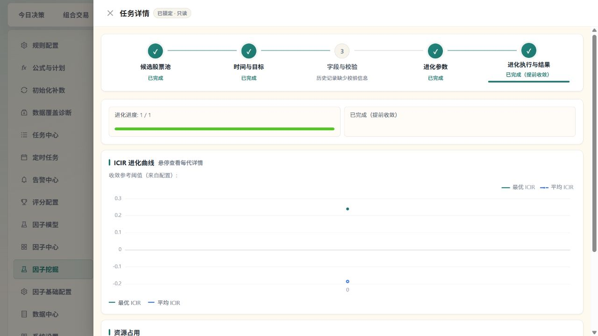
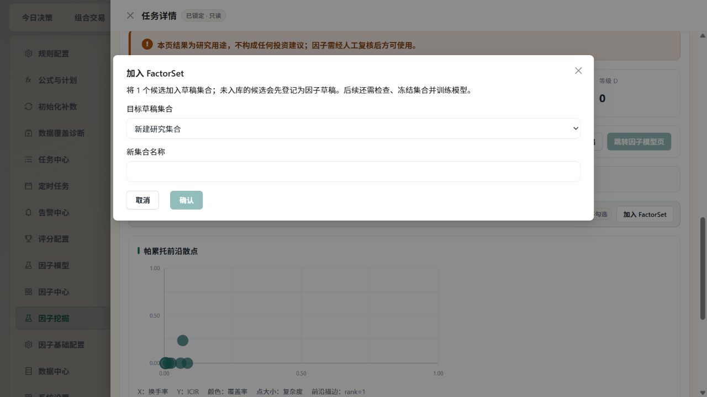

# 因子挖掘全链路验收

验收日期：2026 年 10 月 14 日。范围为设置中的因子挖掘：候选池冻结、时间与目标、字段校验、进化、暂停恢复、最终验证、结果登记、加入集合、模板和经验库。

核心计算与结果留存链路已用隔离 SQLite 和 DuckDB 的真实数据验证，并修复多处会让“已完成”失真的执行断点。前端修复已由 Vite 加载；实际业务后端尚待重启。用户要求保留正在运行的全市场估值同步，因此先等待同步结束，再加载后端修复。历史批次没有重新计算，历史成功状态不能证明其符合本次修正后的规则。

## 修复后的执行关系

锁定股票池快照 → 保存本次日期、持有期、切分比例和进化配置 → 按冻结范围计算公式 → 使用真实持有期收益标签 → 按调仓日采样 → 验证集指导进化 → 固定测试集最终评估 → 登记因子版本 → 加入草稿集合 → 冻结集合并交给模型训练。

最终测试、模型训练、生产模型启用是不同操作。挖掘完成不会自动激活模型或触发交易。模板保存与经验记录进入各自的实际存储；经验库尚未成为自动进化的学习反馈源。

## 已修复问题

| 问题 | 修复结果 |
| --- | --- |
| 冻结股票池没有限制实际计算，横截面排名混入全市场 | 在公式执行前过滤快照标的，目标和最终评估使用相同范围；损坏或空快照明确阻断 |
| 可选持有期实际沿用 5 日标签 | 挖掘可使用 1 至 20 个交易日的真实 T+1 开盘买入、T+N 收盘退出收益，按冻结截止日限制成熟标签 |
| 周频和月频执行混入日频、重复日期放大样本 | 使用完整日历生成周末/月末调仓点，再与范围和成熟标签相交；滚动因子仍保留日频历史输入 |
| 未成熟尾部重复扣除，预算与执行不一致 | 已成熟的信号不再次扣持有期；预算同时核对验证集和测试集的最小样本要求 |
| 切分比例、随机种子及字段和进化参数在执行或恢复时丢失 | 保存并恢复原始配置，显式种子 0 保留 |
| 暂停恢复从第 0 代重跑 | 按已完成代恢复种群、随机状态、试验次数和收敛状态；旧任务没有有效断点时明确引导复制草稿 |
| 取消排队任务、异常退出留下任务状态或锁 | 释放本任务持有的锁与等待项，失败同步到批次列表，避免释放其他任务的写锁 |
| GA 变异子代保留父代公式身份，实际计算仍是父代 | 同步子代公式、规范化公式和去重哈希，变异真正进入计算 |
| 最终验证使用验证集；评估全部失败仍成功 | 最终验证固定使用独立测试集，全部失败如实返回失败 |
| 最终 IC 嵌套结构读取错误，结果为空 | 正确提取指标，返回可追溯的评估 ID 和因子版本 ID |
| 拒绝或加入集合只 flush，响应成功但未持久化 | 请求提交事务；独立请求会话验证登记、加入集合、冻结和经验记录仍可查询 |
| 保存模板与模板配置读取不同表；开关没有进入初始种群 | 使用同一模板存储与真实开关，缺少必需参数返回明确错误 |
| 经验后续转差但仍作为正面样本 | 更新治理结果和排除状态，不继续提供错误正面样本 |
| 镜像状态通过不兼容 DuckDB 连接方式读取 | 改为共用仓库连接；修复仓库路径工厂的可重入锁死锁 |
| 完成进度灰条、终态还可中断/停止、详情写“进行中” | 进度与真实代数一致，终态标签和可用操作与后端状态一致 |
| 结果操作只有外观，未知指标冒充校正 ICIR | 接通登记、逐项加入集合、跳转和 JSON 导出；缺失指标和等级如实显示 |
| 历史列表只显示 20 条、复制草稿丢配置和原池 | 补历史分页、原锁定快照回显及重新选择；隔离迟到请求，保留源任务溯源 |
| 候选加载失败被显示为空、评级操作后列表陈旧 | 失败显示原因和重试；评级成功后更新结果行与计数 |
| 关闭后重开同一成功批次，候选结果区域消失 | 随抽屉打开重新加载；响应同时核对请求序号、会话和批次，旧响应不能覆盖新任务 |

## 验证证据

- 挖掘后端完整目录：1321 项通过、1 项跳过、0 失败，197.78 秒。跳过项是全 NaN 面板已被缓存质量门禁拒绝后的不可达比较分支。
- 共享公式执行、默认 5 日目标、共享标签与镜像契约：115 项全部通过，16.05 秒。默认标签用实际入场和出场记录核对，未继续依赖源码中固定字符串。
- 前端完整挖掘目录：19 个文件、200 项全部通过，41.08 秒。随后浏览器发现同批次重开问题；补充用例先复现失败，修复后壳、向导与草稿相关 38 项全部通过。两次验证不累计成新的整包总数。
- TypeScript 类型检查、改动 diff 检查通过。
- 真实 worker 回归通过 HTTP 创建任务，实际计算公式和标签、写入最终测试证据；同时验证异常可见、暂停后恢复 12 代共 72 次试验、提前停止释放锁且不执行最终评估。
- 冻结范围的横截面排名以第三只池外股票作对照；1 日和 20 日收益按真实退出日期及非恒定价格验证。
- 公共留存 API 在每次请求后关闭数据库会话，确认因子登记 → 加入集合 → 冻结 → readiness → 经验库可跨请求读取。
- 本地浏览器验证历史列表、成功详情、进度、缺失历史校验说明、关闭后重开仍显示 6 条真实候选，以及选中候选后打开入组表单。25 条实际模板、23 条启用状态可以读取。入组表单明确登记 → 集合冻结 → 模型训练的后续关系，名称为空时禁止确认。现场取消表单，没有创建新集合或改写历史候选。
- 现场没有新建挖掘、调用真实 LLM、同步新数据、激活模型或交易。

主要回归文件：

- [真实任务执行与恢复](../tests/services/factors/mining/test_mining_runtime_integrity.py)
- [冻结范围及持有期标签](../tests/services/factors/mining/test_mining_scope_labels_contract.py)
- [调仓日期与切分预算](../tests/services/factors/mining/test_mining_signal_schedule_contract.py)
- [结果跨请求留存](../tests/services/factors/mining/test_mining_retention_api.py)
- [镜像状态连接兼容性](../tests/services/factors/test_mirror_status_runtime.py)

## 当前环境

前端在 127.0.0.1:5173，后端在 127.0.0.1:8000，健康接口和所检查的挖掘接口可连接。实际业务数据库版本为 MySQL 5.7.26。当前有 69 个历史挖掘批次，其中成功 20、取消 30、失败 19；本次没有增删这些批次。现场经验库有 7 条记录，均显示负样本、使用次数 0、成功率缺失，符合尚无自动学习反馈的限制。

运行中的后端使用全局 Python 3.12.2，未启用自动代码重载。它使用 DuckDB 1.5.4、Plotly 6.5.0，而 requirements 要求 Plotly 小于 6。项目 .venv 使用 DuckDB 1.5.5、Plotly 5.24.1，却缺少 vectorbt。两个环境并不等价；本次没有切换解释器或修改全局依赖。

当前镜像状态旧进程仍报 DuckDB configuration conflict。修复在隔离公共 API 回归中已通过，现场新进程的复验须等估值同步结束。全市场估值同步任务为 c1f7a531e57f41ba86c58427a50481bb；本线程后续检查每 5 分钟确认任务状态，全部相关任务空闲后仅重启本项目托管后端并复验健康、镜像和历史详情。

现场最近因子流水线记录显示 10 月 13、14 日行情横截面仅约 18.8%，没有达到 90% 的完整行情门槛，因此选用 10 月 12 日。当前没有活动生产模型，评分发布等待本人验证和启用。清理旧评分批次还曾因 MySQL 5.7 不支持 ROW_NUMBER 窗口语法而跳过。以上属于当前环境与数据的真实限制，不能靠界面“已完成”替代。

## 下一批优化

| 优先级 | 事项 | 作用 |
| --- | --- | --- |
| P1 | 字段预检按冻结股票池、历史日期和字段统计真实覆盖 | 当前预检只证明整张表存在数据；让提交前说明与执行样本一致 |
| P1 | 为 MySQL 5.7 的评分批次清理提供兼容查询 | 消除现场流水线的清理跳过，控制历史数据增长 |
| P1 | 统一项目运行环境与依赖锁定 | 避免全局 Python 与 .venv 分歧，以及 Plotly 与 vectorbt 组合风险 |
| P2 | 保存真实 parent_ids_json 和完整父代链 | 血缘入口现在有接口，但实际候选缺少父代关系 |
| P2 | 经验样本进入进化候选生成并回填成功率 | 让经验库形成可核验反馈；目前仅留存和治理，不应称自动学习闭环 |
| P2 | 候选结果分页与完整导出 | 当前一次加载前 50 项，导出对应已加载项 |
| P2 | 将冻结范围进一步下推到输入 SQL | 当前计算前已正确过滤，但仍先读取较大源面板，可减少内存和耗时 |
| P2 | 单独规划历史模板迁移与历史结果重算 | 避免旧错误存储及旧计算规则产生的记录被继续误用；本次没有自动改写 |

## 页面验收截图

## 后端加载状态

待估值同步终止且相关任务空闲后重启。用户已明确选择保留同步；不得提前结束任务。后续检查成功后补记新进程 PID、健康接口、镜像真实范围和批次详情结果。
