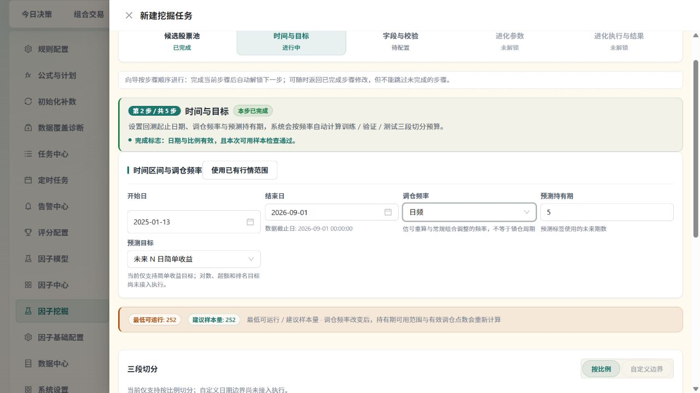
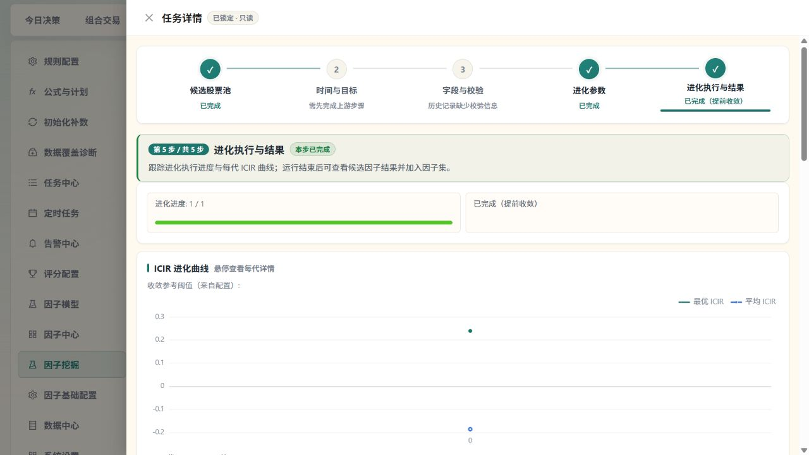
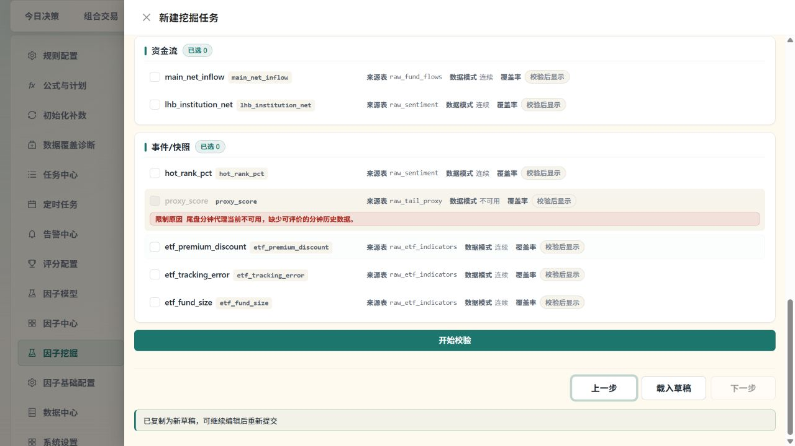
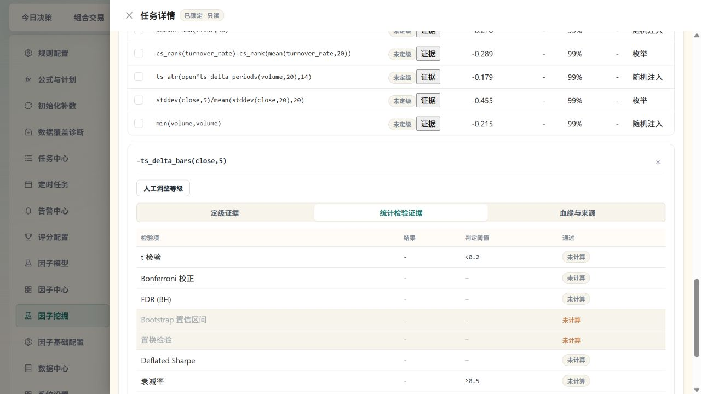
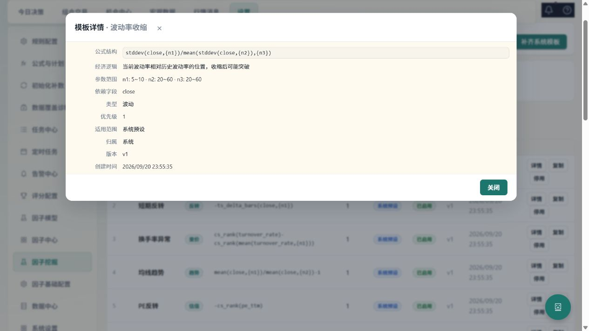
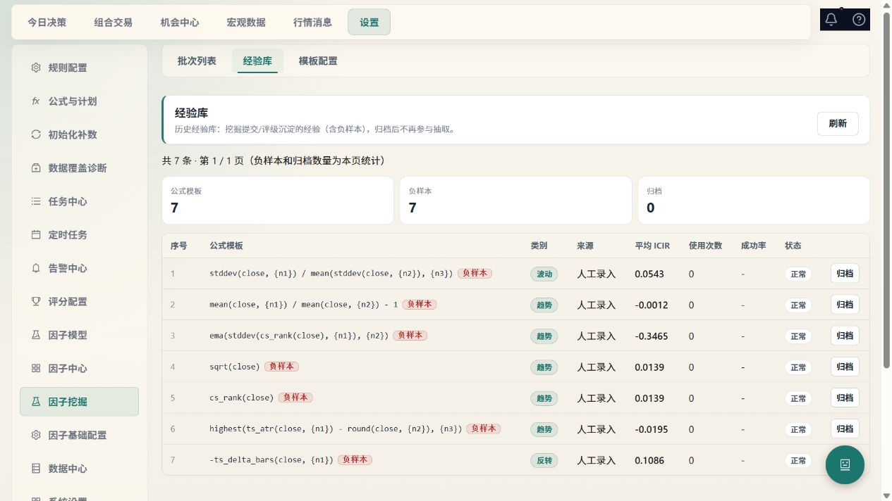
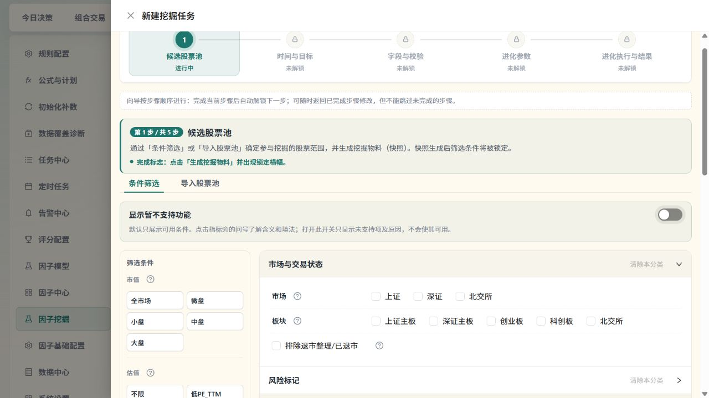
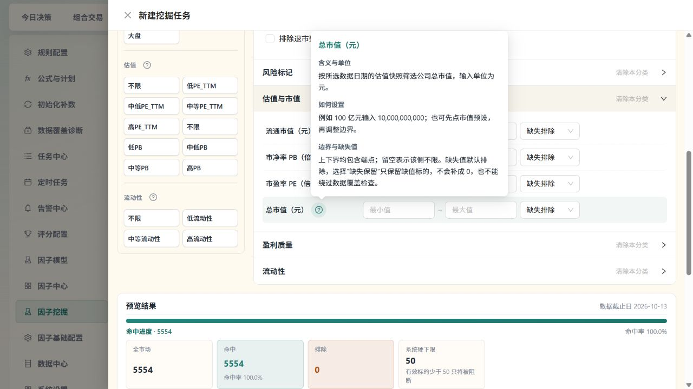

# 因子挖掘全链路验收

验收日期：2026 年 10 月 14 日。范围为设置中的因子挖掘：候选池冻结、时间与目标、字段校验、进化、暂停恢复、最终验证、结果登记、加入集合、模板和经验库。

核心计算与结果留存链路已用隔离 SQLite 和 DuckDB 的真实数据验证，并修复多处会让“已完成”失真的执行断点。前端修复已由 Vite 加载；后端修复已在新进程完成现场 API 复验。此前按用户要求保留估值同步；该同步后来被系统标记为重启中断失败，未完成全部标的。后续检查观察到服务已出现新进程，验证修复已加载后结束检查。历史批次没有重新计算，历史成功状态不能证明其符合本次修正后的规则。

## 修复后的执行关系

锁定股票池快照 → 保存本次日期、持有期、切分比例和进化配置 → 按冻结范围计算公式 → 使用真实持有期收益标签 → 按调仓日采样 → 验证集指导进化 → 固定测试集最终评估 → 登记因子版本 → 加入草稿集合 → 冻结集合并交给模型训练。

最终测试、模型训练、生产模型启用是不同操作。挖掘完成不会自动激活模型或触发交易。模板保存与经验记录进入各自的实际存储；经验库尚未成为自动进化的学习反馈源。

## 已修复问题

| 问题 | 修复结果 |
| --- | --- |
| 冻结股票池没有限制实际计算，横截面排名混入全市场 | 在公式执行前过滤快照标的，目标和最终评估使用相同范围；损坏或空快照明确阻断 |
| 可选持有期实际沿用 5 日标签 | 挖掘可使用 1 至 20 个交易日的真实 T+1 开盘买入、T+N 收盘退出收益，按冻结截止日限制成熟标签 |
| 周频和月频执行混入日频、重复日期放大样本 | 使用完整日历生成周末/月末调仓点，再与范围和成熟标签相交；滚动因子仍保留日频历史输入 |
| 未成熟尾部重复扣除，预算与执行不一致 | 已成熟的信号不再次扣持有期；预算同时核对验证集和测试集的最小样本要求 |
| 切分比例、随机种子及字段和进化参数在执行或恢复时丢失 | 保存并恢复原始配置，显式种子 0 保留 |
| 暂停恢复从第 0 代重跑 | 按已完成代恢复种群、随机状态、试验次数和收敛状态；旧任务没有有效断点时明确引导复制草稿 |
| 取消排队任务、异常退出留下任务状态或锁 | 释放本任务持有的锁与等待项，失败同步到批次列表，避免释放其他任务的写锁 |
| GA 变异子代保留父代公式身份，实际计算仍是父代 | 同步子代公式、规范化公式和去重哈希，变异真正进入计算 |
| 最终验证使用验证集；评估全部失败仍成功 | 最终验证固定使用独立测试集，全部失败如实返回失败 |
| 最终 IC 嵌套结构读取错误，结果为空 | 正确提取指标，返回可追溯的评估 ID 和因子版本 ID |
| 拒绝或加入集合只 flush，响应成功但未持久化 | 请求提交事务；独立请求会话验证登记、加入集合、冻结和经验记录仍可查询 |
| 保存模板与模板配置读取不同表；开关没有进入初始种群 | 使用同一模板存储与真实开关，缺少必需参数返回明确错误 |
| 经验后续转差但仍作为正面样本 | 更新治理结果和排除状态，不继续提供错误正面样本 |
| 镜像状态通过不兼容 DuckDB 连接方式读取 | 改为共用仓库连接；修复仓库路径工厂的可重入锁死锁 |
| 完成进度灰条、终态还可中断/停止、详情写“进行中” | 进度与真实代数一致，终态标签和可用操作与后端状态一致 |
| 结果操作只有外观，未知指标冒充校正 ICIR | 接通登记、逐项加入集合、跳转和 JSON 导出；缺失指标和等级如实显示 |
| 历史列表只显示 20 条、复制草稿丢配置和原池 | 补历史分页、原锁定快照回显及重新选择；隔离迟到请求，保留源任务溯源 |
| 候选加载失败被显示为空、评级操作后列表陈旧 | 失败显示原因和重试；评级成功后更新结果行与计数 |
| 关闭后重开同一成功批次，候选结果区域消失 | 随抽屉打开重新加载；响应同时核对请求序号、会话和批次，旧响应不能覆盖新任务 |

## 验证证据

- 挖掘后端完整目录：1321 项通过、1 项跳过、0 失败，197.78 秒。跳过项是全 NaN 面板已被缓存质量门禁拒绝后的不可达比较分支。
- 共享公式执行、默认 5 日目标、共享标签与镜像契约：115 项全部通过，16.05 秒。默认标签用实际入场和出场记录核对，未继续依赖源码中固定字符串。
- 前端完整挖掘目录：19 个文件、200 项全部通过，41.08 秒。随后浏览器发现同批次重开问题；补充用例先复现失败，修复后壳、向导与草稿相关 38 项全部通过。两次验证不累计成新的整包总数。
- TypeScript 类型检查、改动 diff 检查通过。
- 真实 worker 回归通过 HTTP 创建任务，实际计算公式和标签、写入最终测试证据；同时验证异常可见、暂停后恢复 12 代共 72 次试验、提前停止释放锁且不执行最终评估。
- 冻结范围的横截面排名以第三只池外股票作对照；1 日和 20 日收益按真实退出日期及非恒定价格验证。
- 公共留存 API 在每次请求后关闭数据库会话，确认因子登记 → 加入集合 → 冻结 → readiness → 经验库可跨请求读取。
- 本地浏览器验证历史列表、成功详情、进度、缺失历史校验说明、关闭后重开仍显示 6 条真实候选，以及选中候选后打开入组表单。25 条实际模板、23 条启用状态可以读取。入组表单明确登记 → 集合冻结 → 模型训练的后续关系，名称为空时禁止确认。现场取消表单，没有创建新集合或改写历史候选。
- 现场没有新建挖掘、调用真实 LLM、同步新数据、激活模型或交易。

主要回归文件：

- [真实任务执行与恢复](../tests/services/factors/mining/test_mining_runtime_integrity.py)
- [冻结范围及持有期标签](../tests/services/factors/mining/test_mining_scope_labels_contract.py)
- [调仓日期与切分预算](../tests/services/factors/mining/test_mining_signal_schedule_contract.py)
- [结果跨请求留存](../tests/services/factors/mining/test_mining_retention_api.py)
- [镜像状态连接兼容性](../tests/services/factors/test_mirror_status_runtime.py)

## 当前环境

前端在 127.0.0.1:5173，后端在 127.0.0.1:8000，健康接口和所检查的挖掘接口可连接。实际业务数据库版本为 MySQL 5.7.26。当前有 69 个历史挖掘批次，其中成功 20、取消 30、失败 19；本次没有增删这些批次。现场经验库有 7 条记录，均显示负样本、使用次数 0、成功率缺失，符合尚无自动学习反馈的限制。

运行中的后端使用全局 Python 3.12.2，未启用自动代码重载。它使用 DuckDB 1.5.4、Plotly 6.5.0，而 requirements 要求 Plotly 小于 6。项目 .venv 使用 DuckDB 1.5.5、Plotly 5.24.1，却缺少 vectorbt。两个环境并不等价；本次没有切换解释器或修改全局依赖。

原进程曾报 DuckDB configuration conflict。后续现场复验确认新后端的镜像状态 available=true，返回真实范围与数量，不再出现该连接冲突。全市场估值同步任务 c1f7a531e57f41ba86c58427a50481bb 后来返回 failed/interrupted，processed=876、total=5555；系统错误为 BACKEND_RESTART_INTERRUPTED，不能称为同步完成。本线程的等待检查没有取消该任务，也未执行重载脚本的进程停止动作。

现场最近因子流水线记录显示 10 月 13、14 日行情横截面仅约 18.8%，没有达到 90% 的完整行情门槛，因此选用 10 月 12 日。当前没有活动生产模型，评分发布等待本人验证和启用。清理旧评分批次还曾因 MySQL 5.7 不支持 ROW_NUMBER 窗口语法而跳过。以上属于当前环境与数据的真实限制，不能靠界面“已完成”替代。

## 下一批优化

| 优先级 | 事项 | 作用 |
| --- | --- | --- |
| 已修复 | 字段预检按冻结股票池、历史日期和字段统计真实覆盖 | 见 2026-10-15 追加修复：同源只读预检、真实执行面板与正式提交再检 |
| P1 | 为 MySQL 5.7 的评分批次清理提供兼容查询 | 消除现场流水线的清理跳过，控制历史数据增长 |
| P1 | 统一项目运行环境与依赖锁定 | 避免全局 Python 与 .venv 分歧，以及 Plotly 与 vectorbt 组合风险 |
| P2 | 保存真实 parent_ids_json 和完整父代链 | 血缘入口现在有接口，但实际候选缺少父代关系 |
| P2 | 经验样本进入进化候选生成并回填成功率 | 让经验库形成可核验反馈；目前仅留存和治理，不应称自动学习闭环 |
| P2 | 候选结果分页与完整导出 | 当前一次加载前 50 项，导出对应已加载项 |
| P2 | 将冻结范围进一步下推到输入 SQL | 当前计算前已正确过滤，但仍先读取较大源面板，可减少内存和耗时 |
| P2 | 单独规划历史模板迁移与历史结果重算 | 避免旧错误存储及旧计算规则产生的记录被继续误用；本次没有自动改写 |

## 页面验收截图

## 后端加载状态

已完成现场复验。2026 年 10 月 14 日 23:48:05 出现新后端进程 PID 47848，使用 C:/Python312/python.exe 运行 uvicorn app.main:app，监听 127.0.0.1:8000。前端监听 PID 43692。检查时两项服务先后短暂不可连接，随后新进程恢复；本次检查没有停止或重新启动这些进程。

- /health：HTTP 200，status=ok。
- /api/v1/factor-mining/locks/status：HTTP 200，挖掘域空闲、DuckDB 写锁空闲、等待队列为空。
- /api/v1/data-mirror/status：HTTP 200，available=true；2285588 条行情、5561 个标的，范围 2025-01-13 至 2026-10-14；不再返回 DuckDB configuration conflict。这个状态证明镜像可读取，不等同于本批次字段覆盖合格。
- /api/v1/factor-mining/runs 及最新历史批次详情：HTTP 200，历史批次数仍为 69，原批次保持 succeeded，候选池 ID 可返回。
- 估值同步：HTTP 200，failed/interrupted，876/5555；系统记录 Backend restarted before task completed，finished_at=2026-10-14T15:43:18Z。需要另行处理剩余标的，没有自动重新同步。

现场证据保存在 .analysis/mining-backend-live-verification-2026-10-14.json。此前托管 state.json 仍记录旧 PID 20332/17624，与现场新监听进程不一致；本次没有据此终止新进程或强行改写其管理记录。一次加载和验证的目标已达到，后续自动检查关闭，避免重复重启。

## 2026-10-15：新版分步交互复验与修复

本轮针对用户修改后的五步挖掘向导继续测试，保留原有页面调整。每次只显示当前步骤，提供本步目的、完成条件和明确的下一步；第五步只有实际提交成功或查看已有任务时才可进入。配置进化参数本身不会打开空白运行页。

### 本轮修复

| 发现的问题 | 修复及验收结果 |
| --- | --- |
| 第二步可用无效日期、旧预算继续下一步 | 校验起止日期、冻结截止日与切分比例；预算绑定本次会话和全部时间参数。日期、持有期、频率或比例变化会立即使旧预算失效，检查中、失败、不可用或样本不足都禁止继续，失败可重试 |
| 复制完整草稿直接跳过新预算检查 | 从时间步骤重新核验，后续已保存字段和进化配置保留，不重新创建原池快照 |
| 不知道如何选择本地已有日期 | 增加“使用已有行情范围”：仅在本人点击时填入，结束日取镜像末日与冻结截止日较早者，不覆盖其它配置 |
| 测试集比例可编辑但执行按余量计算 | 测试比例只读并自动取余量；三段均须大于零，服务端最小测试预算仍继续校验 |
| 自定义切分、部分预测目标和进化配置可选但没有执行实现 | 自定义切分、对数/超额/排名目标、选优偏好、类别配额、覆盖策略、AI/随机占比与赛道保底配置置灰，说明尚未接入；旧配置仍保留。可执行的强度、种群/代数、AI 开关、锦标赛和繁殖参数继续可操作 |
| 高级参数回显与已保存、已提交值不一致 | 子表单受控，草稿完整恢复并合并嵌套类别配置；强度同步最大代数。快速试验改成明确的应用预设按钮；自适应开启时跨类别比例由调度决定，关闭后允许手动输入 |
| 显式跨类别比例 0 被当作缺省 0.2 | 后端保留零值，并作为有效高级配置进入真实 worker；缺失值和 None 才采用默认值 |
| 只读任务仍可通过键盘操作部分输入 | 原生禁用 fieldset 配合组件级禁用，日期、比例、Select、Slider、Switch 等均真正禁用；文本仍可读取。修改须复制为新草稿 |
| 新任务被迟到的历史恢复、保存、提交或候选池预览覆盖 | 按向导会话与请求序号隔离；保存/提交同步防重复；旧操作完成不改变当前任务、草稿 ID、提示或最近任务指针 |
| 预算没有考虑快照截止日后的收益不可知 | split-budget 新增 data_cutoff_at；保持完整交易日历定义周/月末，再按截止日限制成熟标签，与执行口径一致 |
| 周频不足样本却提示“月频”，并建议降低频率 | 提示改为测试段样本不足，不冒称月频；建议扩大区间或选择日频等调仓点更多的频率 |
| Windows 本地服务状态检查可误终止进程 | 原 os.kill(pid, 0) 在 Windows 上可能发送 CTRL_C_EVENT。改为只读 OpenProcess/WaitForSingleObject 并关闭句柄；拒绝访问保守认为仍存在。独立 Detached 子进程和真实 CLI status 回归先复现误退出，修复后持续存活 |

### 验证与当前环境

后端完整挖掘目录最终 **1328 项通过、1 项跳过、0 失败**，245.04 秒。新增零值和截止日用例走公开 API 与隔离库真实计算；没有用业务库启动挖掘。服务管理脚本另有 **18 项全部通过**，最终复跑 4.45 秒，临时状态文件、随机端口和子进程均为测试自有资源。

前端最终完整挖掘目录 **20 个文件、235 项全部通过、0 失败**，53.38 秒，记录见 `.analysis/mining-frontend-final-2026-10-15.json`；覆盖跳步拦截、预算失效/失败/重试、快照范围联动、异步会话隔离、草稿恢复、参数真实性和只读键盘操作。TypeScript 类型检查与最终 diff 检查通过。针对关键缺陷的新增用例先复现失败，再验证修复。

真实页面验证了：复制历史快照进入单步配置；周频不足时阻断；填入已有行情范围并按冻结日截断；日频预算合格后进入字段页；空字段阻断、选择后解锁第四步；未提交时第五步保持禁用；锦标赛值 7 与手动跨类别比例 0 正确回显；历史日期及比例输入均为原生 disabled；正常关闭后重开同一成功批次仍显示 6 个真实候选。1280 像素视口未出现整页横向溢出。开发热更新期间页面会重新加载，现场表单未保存到业务库。

修复后的管理脚本已启动本项目后端 PID 1840、Vite 前端 PID 46312。再次运行 status 后两进程仍存活，随后健康、锁、镜像、历史列表和历史详情接口均返回 HTTP 200，前端 5173 返回 HTTP 200。镜像 available=true，2285588 行、5561 个标的，范围 2025-01-13 至 2026-10-14；没有 DuckDB configuration conflict。历史批次仍为 69，锁空闲、等待队列为空。现场证据：`.analysis/mining-final-live-2026-10-15.json`。

当前完整行情范围、持有期 5 日、60/20/20 比例的只读预算如下。通过预算只代表日期点数够用，不代表冻结池字段覆盖、验证成绩或生产使用资格通过。

| 频率 | 有效点数 | 训练 / 验证 / 测试 | 最低门槛 | 当前能否继续 |
| --- | ---: | --- | ---: | --- |
| 日频 | 417 | 250 / 78 / 79 | 252 | 是 |
| 周频 | 89 | 53 / 17 / 17 | 104 | 否，需更长历史或改频率 |
| 月频 | 21 | 12 / 3 / 4 | 41 | 否，需更长历史或改频率 |

没有现场调用真实 LLM、同步新数据、提交真实挖掘、启用模型或交易。已有历史结果不自动重算。字段校验尚需补充按冻结池/日期的真实覆盖统计、候选结果仍只加载前 50 项、经验库尚未进入自动学习反馈；这些后续优化及运行环境依赖差异仍适用上一节清单。

## 2026-10-15：追加审查的问题记录（修复前）

本节保留后续只读审查与隔离复现时的结论，**R1—R10 已在下一节修复**。之前的 235 项前端、1328 项后端通过不能覆盖这些遗漏的跨任务、异步返回及指标缺失场景。审查当时没有重新启动服务、改业务源码、创建现场任务、调用真实供应商或 LLM。

| 编号 | 优先级 | 问题与实际影响 | 关键位置 |
| --- | --- | --- | --- |
| R1 | P1 | 活跃镜像会被挖掘巡检当成孤儿释放写锁。镜像的 owner_run_id 存任务 ID，巡检却只查挖掘批次。镜像仍在运行时，其他写任务可被错误放行 | `stall_watchdog.py:172-178`、`mirror_task.py:235` |
| R2 | P1 | 镜像结束后，写锁虽交给排队挖掘，却没有启动其 worker。任务可能一直 queued 并持锁；释放函数返回的晋升任务 ID 被丢弃 | `mirror_task.py:394`、`:407-414` |
| R3 | P1 | 本次数据预检不代表本次任务：预算按全仓交易日，worker 按冻结池内标签日；字段校验按整表有值率；主向导还没有接入校验 blocked/failed 结果，修复/重选按钮回调为空。用户可以走完向导后才失败 | `service.py:364/415`、`task_runner.py:666-670`、`validation_service.py:243-250/390`、`MiningShell.tsx:813/1552` |
| R4 | P1 | 自动评级组装指标没有 correlation，但所有 S/A/B/C 等级都要求该指标。默认定级路径因此落到 D，随后还会触发 D 级治理；不是因子的真实质量结论 | `service.py:1080-1104`、`factor_grading.py:130/150` |
| R5 | P1 | 真正生成候选池/导入的迟到响应未隔离向导会话。A 点击生成后关闭，新建 B，A 返回仍可把旧池 ID、快照和截止日写入 B。此前已修的是预览请求，没有覆盖物化操作 | `MiningPoolStep.tsx:231/236/343`、`MiningShell.tsx:1481` |
| R6 | P1 | 证据请求可能串候选：A 证据迟到后覆盖 B 抽屉，而人工改级仍发给 B，存在依据 A 证据修改 B 的风险 | `result/FactorMiningResult.tsx:117-155` |
| R7 | P1 | 统计检验表对非降级行无条件显示“通过”，没有比较阈值或识别 null。页面能把超阈值、缺失结果显示为通过 | `result/GradeEvidenceDrawer.tsx:321-342` |
| R8 | P1 | 手动繁殖三率缺少前置校验。只把 mutation 从 .55 改 .60，另两项 .25/.20 保留，总和 1.05，前端仍允许提交，worker 启动才抛错；默认组合只把 random 设 0，又被 or .20 静默恢复，执行值与输入不同 | `step4/ReproductionConfig.tsx:62-67`、`task_runner.py:790-792`、`genetic_algorithm.py:100-112` |
| R9 | P2 | 周频测试段不足 24 点时，预算提示统计降级、最高 B；统计计算却缺省只按 monthly 降级，未传递预算结论。修复评级输入后，此处还会留下等级上限不一致 | `evaluation_adapter.py:231/774`、`statistical_tests.py:363`、`factor_grading.py:219` |
| R10 | P2 | 管理员清理脚本按通用命令/端口匹配，没有验证本项目绝对路径，可能命中另一个项目的同名服务；本轮只做合成匹配，没有执行清理 | `scripts/dev_services_admin.ps1:115` |

复现证据：

- R1/R2 使用全新临时 SQLite，调用真实镜像任务与挖掘提交、锁和巡检入口，仅注入等待事件的假镜像与骨架阶段，不写仓库、不运行 GA。R1 中镜像仍 running 且未放行，写锁从 busy=true 变 false；R2 中镜像 done、排队任务持有写锁，但状态仍 queued，阶段入口没有执行。结果见 `.analysis/mining_env_runtime_review_2026_10_15.json`，脚本同名 `.py`。临时 worker 和库均清理。
- R3 使用临时 DuckDB：全仓 400 个行情日，冻结池 50 只股票仅有最后 50 日。真实目标标签计算后，全仓预算为 395 点，验证/测试各 74，门禁通过；按 worker 过滤池内标签后只有 45 点，验证/测试各 4，真实 build_split 抛 MiningSplitError。池外股票有 400 条 pe_ttm 时，字段预检还报 100% 通过，真实池内 50×50 因子面板有效值为 0。临时仓库已清理。
- R4/R9 使用公开纯计算入口离线核验：其它达标指标相同，缺 correlation 时 grade=D，提供 correlation=.2 时 grade=S；104 个周频点的预算通过，测试点 20、预算 degraded=true，compute_stats 同一 20 点却 degraded=false 并生成 Bootstrap 区间。脚本与结果见 `.analysis/mining-review-metrics-2026-10-15.py/.json`。
- R5/R6 是异步闭包与缺少请求身份核对的代码审查结论，没有通过现场生成快照或人工改级复现，避免改写业务数据。
- R7 现有测试 fixture 含 Bonferroni p=.021、置换 p=.002，而页面阈值显示 p<.001，渲染分支仍无条件“通过”；null 分支同样没有判断。
- R8 直接调用真实 GAConfig(.60/.25/.20, adaptive=false) 已复现总和 1.05 的 ValueError，未启动任务。零值回退来自实际 worker 参数转换路径。

建议先修 R1/R2 的锁与唤醒，再修 R4 的真实自动评级、R6/R7 的证据可信度，随后贯通 R3 的同源预检和 R5/R8 的交互配置边界。各项需补对应公共入口回归；不要仅修改提示或把缺失指标填成 0。

## 2026-10-15：追加修复与完整回归

收到用户“好的”后按上述顺序修复，保留用户原有五步独立页面及暂存改动。验证使用临时 SQLite/DuckDB、真实公开 API、真实 GA 和实际统计计算，AI 关闭；镜像并发用可控的测试 worker。没有通过业务库提交挖掘、请求真实 LLM、采集新数据、启用模型或交易。

| 编号 | 最终处理 |
| --- | --- |
| R1/R2 | 镜像按真实异步任务与线程存活判断保锁，增加任务/写锁双心跳；所有释放统一唤醒下一位 worker。STALLED 先协作取消，线程退出前不放锁；排队晋升与重复恢复只能派发一个 worker。镜像 create/resume 原子占槽，忙时拒绝，不产生无人消费的镜像队列 |
| R3 | 预算按冻结池、持有期、调仓频率、实际可交易标签及截止日计算；字段用真实编译与 FactorExecutor 面板对齐同一目标样本计算覆盖。预检只读、不要求先存在标签，worker 复用同一标签构造，只向共享批次写冻结池。字段校验未完成、失败、阻断、过期或配置变化均不能继续；正式创建再检，在建批次/任务/占锁前返回 422。重选与数据修复按钮已接线 |
| R4 | 最终评估在相同冻结池和测试区间计算与实际活动因子版本的相关性，并保存比较版本、样本及异常。排除候选自身所属因子，保留其它因子的真实比较；空参考库明确记录 empty_library。参考数据不足或版本归属不符保留未知，暂未定级，不误触发 D 治理。已人工调整的同一版本不会被后续自动评估覆盖；显式恢复自动才按最新完整证据重算 |
| R5/R6 | 候选池物化、快照、导入、成员列表和评级证据请求核对会话/目标/请求序号；迟到返回不能覆盖另一草稿或候选，也不把另一对象的操作回写到当前抽屉 |
| R7 | 证据读取实际 EvaluationRun 和版本已保存的等级/人工标记；统计行比较真实自动评级阈值，缺失显示“未计算”，非评级硬门槛显示“仅参考”。历史非有限数值清洗为 null，避免 JSON 500。恢复自动评级会真正重算，并保留人工历史 |
| R8 | 前后端统一校验手动三率边界及总和 1；非法输入不能提交，仍可保存草稿。worker 使用验证后的实际值，不再用 or 默认值掩盖 0 |
| R9 | 统一小于 24 个测试点的统计降级口径，周频也跳过重采样检验，不能用显式 false 绕过不足样本 |
| R10 | 管理员清理先核对本项目绝对脚本路径或托管记录、命令、cwd、日志与创建时间；空命令、PID 复用、无可靠归属明确拒绝。每次终止前复核，不按端口猜归属，也不终止未知进程子树。仅使用合成 CIM 测试，没有运行管理员清理 |

新增回归覆盖了审查遗漏的真实公共路径，包括镜像活跃巡检、镜像结束唤醒、卡死线程退出前保锁、派发提交延迟竞态、镜像原子竞争、池外行情误导预检、首次非 5 日持有期、字段阻断后的正式提交、同公式新评估保留人工等级以及迟到返回隔离。旧历史批次和结果没有自动重算，旧任务不能据新规则宣称重新通过。

管理员脚本在缺失/损坏托管记录、空 CommandLine、缺少创建时间或相对命令启动时间无法核实时会保留进程并明确拒绝；这是已知的旧记录兼容边界。依赖锁定、MySQL 5.7 清理兼容、父代血缘、经验反馈、候选分页/完整导出及输入 SQL 范围下推仍属于后续优化，不能称已完成。

### 最终验证与现场加载

| 验证范围 | 最终结果 | 记录 |
| --- | --- | --- |
| 后端完整挖掘目录 | **1371 通过、1 跳过、0 失败**，338.87 秒 | `.analysis/mining-followup-backend-final-2026-10-15.xml` |
| 前端完整挖掘目录 | **20 文件、255 项全部通过**，58.88 秒 | `.analysis/mining-followup-frontend-final-2026-10-15.json` |
| 共享异步任务、状态机、镜像和输入修正 | **107 项全部通过** | `.analysis/mining-followup-shared-final-2026-10-15.xml` |
| 共享目标、标签批次、尾部、覆盖和真实目标评估 | **50 项全部通过** | `.analysis/mining-followup-targets-final-2026-10-15.xml` |
| 服务管理 | **20 项全部通过**；进程策略包含 21 个合成 CIM 场景 | `tests/test_dev_services.py`、`tests/test_dev_services_process_policy.py` |

最后仅修改统计页“DSR 已按此校正”的无条件文案，避免缺失时仍声称已完成；相关证据页回归复跑通过，记录 `.analysis/mining-evidence-copy-final-2026-10-15.json`。TypeScript 与 diff 检查通过。唯一跳过项是缓存拒绝全 NaN 面板后不可达的比较分支；有数据差异时拒绝缓存的安全用例仍执行并通过。完整回归首轮发现的两处旧断言已修正：缺少真实证据不再虚构 D，真实完整劣质指标仍能触发 D 治理；最终完整回归没有失败。

再次确认挖掘域、写锁及等待队列空闲，外部同步、镜像和因子流水线没有活动任务后，使用托管记录及 CIM 命令/创建时间双重核验，只停止原后端 PID 1840。新后端 **PID 75468** 已加载本轮修复；前端 **PID 46312** 保持不变。执行服务 status 后两进程仍存活。健康、锁、镜像、历史列表、历史详情、候选列表与评级证据均 HTTP 200，历史批次仍为 69，镜像 available=true，无 DuckDB configuration conflict。现场记录：`.analysis/mining-followup-live-final-2026-10-15.json`。

真实页面使用已有快照 1ba5d5c1（252 个标的），区间 2025-01-13 至 2026-09-01、截止 2026-09-01、持有期 5 日、日频、60/20/20 时，新同源预算为 **392 个调仓点，训练 235、验证 73、测试 74**。这替代该配置原先按全仓日历推算的预算，不能与其它截止日或全库预算混用。字段页选中 close 后，“下一步”仍禁用并提示先校验当前池、时间和字段；没有在现场创建字段校验或挖掘任务。历史结果 6 个候选可重开，评级与统计缺失显示“未定级 / 未计算”，没有伪造通过。

文案开发热更新期间观察到一次 `useApp must be used within AppProvider` 的 Context 实例不一致日志，随后全页重载恢复；重新进入历史详情和证据页正常。开发环境热更新稳定性仍需单独优化，不能据此声称控制台完全无警告。正式业务功能验证使用恢复后的页面。现场旧估值同步仍为此前的 failed/interrupted（876/5555），没有将其记作成功，也没有自动续跑。

## 2026-10-15：因子挖掘展示国际化补齐

针对用户截图的三处枚举和时间展示，补齐既有中英文词典与公共展示函数，不改业务枚举值或执行规则。

- 模板列表/详情：system、personal 译为“系统预设 / 个人模板”；系统归属 system 显示“系统”。25 个明确系统预设支持中英文名称与原版经济逻辑，当前语言的显示名可搜索、排序。个人名称、用户标识和自定义说明保留，未知系统模板及未知范围不冒充已有类型。
- 经验库：类别、ai_generated/enumerated/random/manual 来源、normal/premium/archived/need_field/unavailable 状态使用译名。中文页面现场确认显示“波动 / 趋势 / 反转”“人工录入”“正常”。
- 批次与运行页：daily/weekly/monthly 显示日频/周频/月频；来源、操作、已确认阶段及取消中/已失效等状态走翻译。结果和评级页补齐操作来源、统计维度、评级历史时间；图表与探针中的固定中英文混排也已补齐。
- 候选池/字段：看板固定指标和已确认市场环境枚举、固定字段分组/校验结论、六类导入结果、已确认市场/板块/来源与全选无障碍标签使用词典。未知码、股票名、公式、字段代码和后端自由解释保留原文，不按猜测改写诊断。
- 时间：批次、草稿、模板、分析与评级历史统一格式化；后端事件时间含无偏移的旧 UTC 时间按 UTC 解析，再按当前语言和本地时区显示。日期型回测边界仍保留原日历日期，避免时区移日。空值/无效时间显示“-”。

最终完整因子挖掘前端和翻译键一致性检查 **23 个文件、271 项全部通过，58.71 秒**，记录 `.analysis/mining-i18n-final-2026-10-15.json`；最后系统归属文案另复跑模板及词典检查通过，记录 `.analysis/mining-i18n-template-final-2026-10-15.json`。TypeScript 和 diff 检查通过。新增中英文渲染回归覆盖语言切换、未知枚举原文、个人内容保护、按英文名称搜索、公式不变及日期 UTC 口径。浏览器实测中文版批次、模板详情与经验库；英语展示由渲染测试验证。

前端已热更新，无需重启后端；没有调用现场模板补齐、复制、启停、归档、导入、校验或挖掘写接口。

## 2026-10-15：候选池筛选默认简化与指标帮助

根据用户要求，候选池筛选区顶部新增“显示暂不支持功能”，首次默认关闭，偏好仅保存在本地浏览器。它只改变展示：不写入 filter_config，不触发筛选预览，也不会开启未实现能力。关闭时隐藏不可用字段、不可应用预设及因此为空的分类/分组；打开后仍保持禁用并说明原因。锁定配置时仍可切换视图和阅读帮助，业务输入保持只读。

旧草稿中已经保存的不可用或未知条件不会被隐藏动作删除，保留可见并提示查看处理；支持的 liquidity.window_days 不会被误报为未知条件。同步修复“清除本分类”删除后又合回旧配置的问题，市场、板块、ST、数值槽位及旧顶层不可用条件均可明确清除，不影响其它分类。

每个筛选指标、市场/板块及常用预设分组旁增加问号说明，覆盖“含义与单位、如何设置、边界与缺失值”。内容按实际执行核对：市值/成交额为元，输入值没有亿元换算；换手率/ROE 使用百分点数值；PE/PB 非正值不自动排除；ROE 是最新已公告报告值；流动性按最近 N 个市场交易日的已有记录平均；ST/退市仅按当前名称识别。说明没有冒称历史状态回放或自动重算 TTM。未知指标使用通用提示，后台诊断原文保留。

帮助支持悬浮、键盘聚焦和点击，具名按钮关联说明，Esc 仅关闭当前帮助且不关闭向导。浏览器发现“先聚焦再点击导致浮层反而关闭”，用同序列公共渲染回归先复现后修复，现场复验点击可稳定打开。数值边界和缺失策略补齐含指标名的无障碍标签；浮层限制宽度并允许换行，小屏输入布局可分层。打开未支持项时使用中性说明，避免把尚未开放能力当成用户操作错误。

最终完整挖掘前端及中英文词典检查 **25 文件、281 项全部通过，61.67 秒**，记录 `.analysis/mining-filter-guidance-final-2026-10-15.json`；TypeScript 与 diff 检查通过。新增回归覆盖默认隐藏、偏好记忆、开关不改业务配置、已选不可用保留、未知能力禁用、分类真实清除、窗口参数白名单和帮助点击/关闭。真实页面验证开关、禁用状态、默认隐藏恢复和指标说明；仅运行只读筛选预览，没有创建候选池、快照、校验、采集或挖掘任务，无需重启后端。

