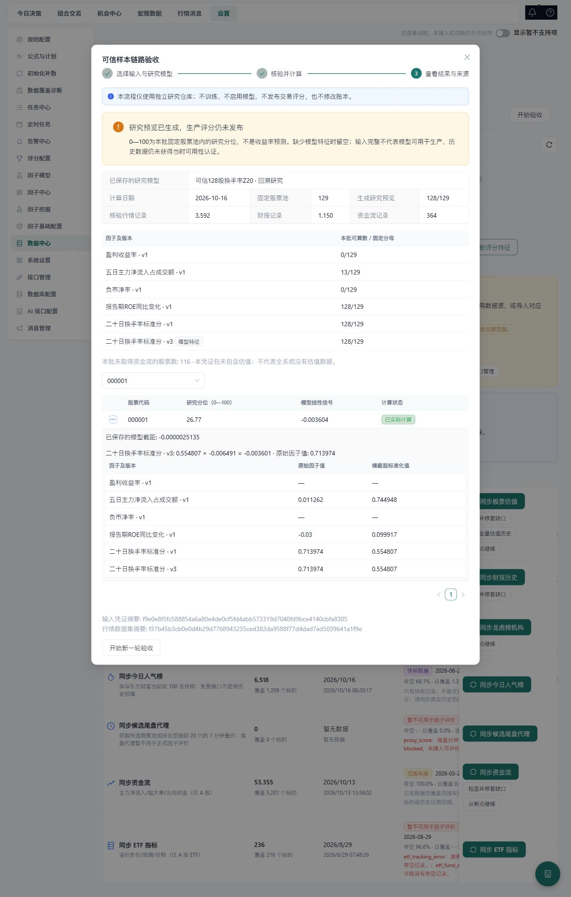
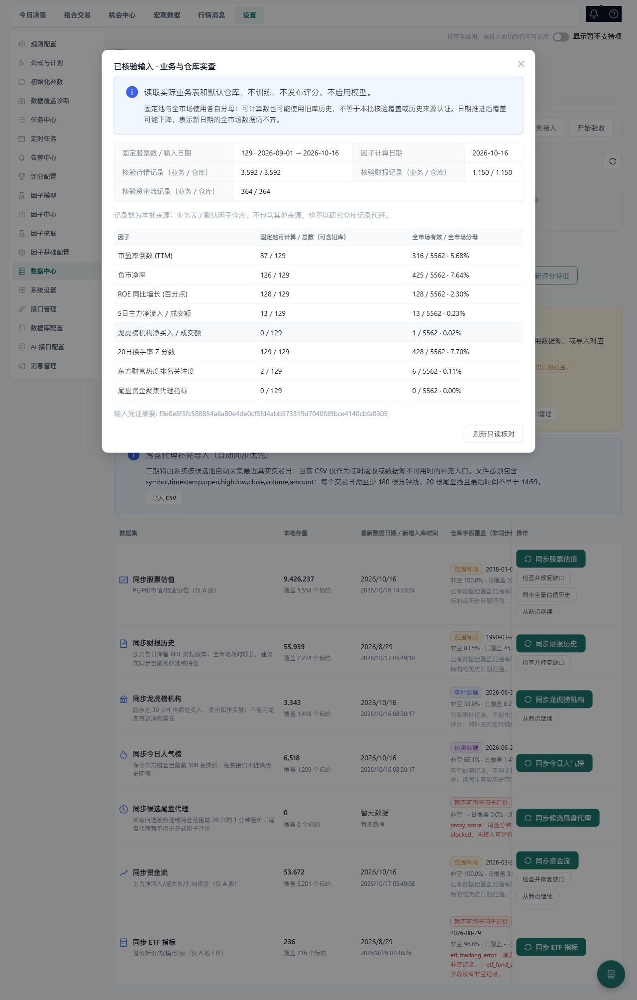
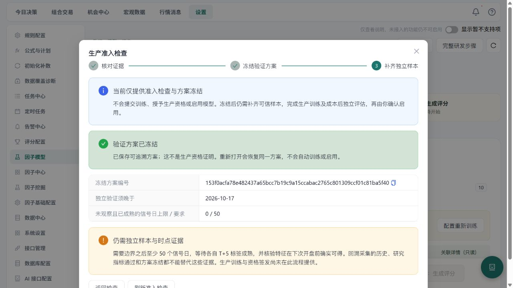
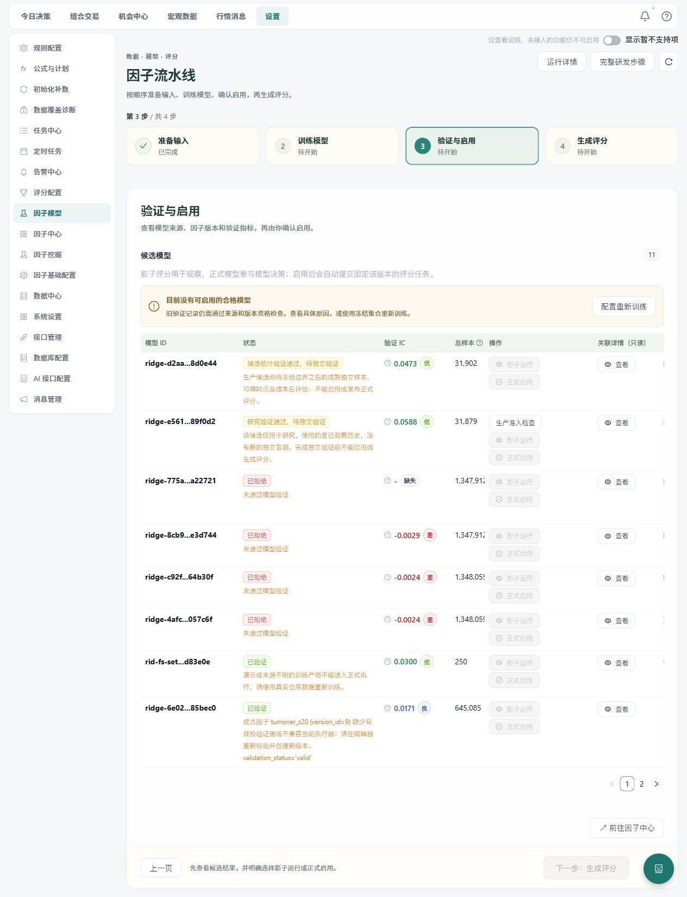
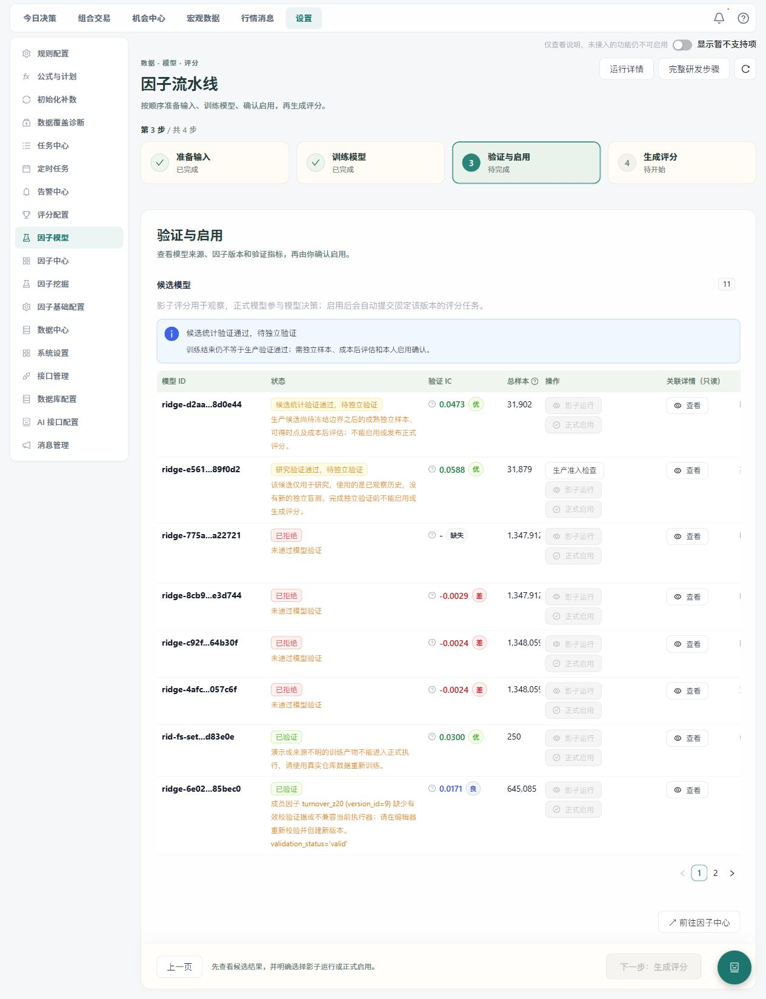

# 换手率因子与模型链路修复验收

本轮从2026年10月15日晚延续至16日，文件名保留启动日期。用户授权修复旧换手率因子、重新真实训练验证并复测。**启用模型须另经本人确认**；没有授权修改活动模型、发布本次模型的现场评分或交易。前次《因子中心全功能验收》中的“不创建现场训练”属于前一阶段，本轮按新的授权创建真实资产和任务。

## 版本与数据来源

保留 `turnover_z20` v1/#4、v2/#9、原冻结集合 `fs-set-3126b70f` 和5个历史模型。旧v2表达式引用未定义的 `mean_20d/stddev_pop_20d`，不能用历史valid标签冒充当前可执行。

新建 `turnover_z20` **v3/#100073**，来源为本地行情镜像 `raw_daily_bars.turnover_rate`。表达式严格要求最近20条观察均为有限值，使用总体标准差，完整零波动窗口返回0；不满20条、含缺失/非有限值均不参与训练。方向保留nonlinear；新版本明确采用MAD(3)和截面zscore(ddof=0)，不是对历史归一化结果的逐位复刻。

```text
iif(count(turnover_rate - turnover_rate, 20) == 20, iif(stddev(turnover_rate, 20) > 1e-8, (turnover_rate - mean(turnover_rate, 20)) / stddev(turnover_rate, 20), 0), None)
```

225行、9标的与独立Python总体标准差及DuckDB有限窗口参考计算一致，最大误差0，包含预热、常量、极小波动、NaN、正负Inf和稀疏历史。严格编译深度6，无放宽限制。证据：`.analysis/turnover-formula-finite-guard-readonly-2026-10-15.json`。

复制旧集合后仅修改新草稿成员，再冻结为 **`turnover-z20-v3-20261015`**，仅含v3/#100073。冻结内容哈希 `fs_e9a07f4e63fe2e875afb3d3690812b0c77727c69`，冻结时间2026-10-15T15:08:29Z。真实readiness=READY；原集合未改写，因子原活动版本指针也未改。

## 真实运行发现并处理的断点

1. **预览的自然日窗口不足。** 编译通过但10月14日预览0/20有效；旧代码仅回溯30自然日，跨国庆不足20个交易日。修复为按仓库真实交易日预热，仍禁止使用请求日之后的数据。现场重载后同一请求为20/20有效、缺失0，evaluation_supported=true。4条公开HTTP回归先2红2绿；修后连同执行器、公共契约及依赖预检共79项通过，20.92秒。
2. **本次候选可能被旧模型替代。** 前端原通用入口选择首个合格模型；现按最近真实训练任务结果中的确切model_run_id打开验证。运行中、缺少结果时禁用；新模型被拒仍能查看其真实原因，不能借用旧合格模型放行。
3. **启用缺实质确认。** Settings列表/详情原点击即启用并自动评分。现先展示模型ID、集合、当前指针/模式、资格和自动评分副作用；取消无写入。修正集合成员名称N/A，沿用现有国际化。相关7文件91个不同前端用例通过，TypeScript和生产构建通过；构建保留既有大包提示。
4. **真实训练暴露SQL连接失效。** 首次任务 `8a5a45a5b20e47748891ca623287a4c4` 于2026-10-15T15:20:43Z启动，15:38:56Z在factors阶段失败，错误MySQL2006/ConnectionAborted10053，查询冻结集合时旧连接失效。镜像已完成，但未生成模型；不能将该任务算作训练成功。原错误和完整结果保留于修复日志。

首轮耗时还证实指定单因子训练会镜像所有7类输入、全范围反复扫描历史估值，并先计算全部8个原生因子。显式窗口会重读旧ID以接收历史更正；不能简单只读大于watermark的ID，否则会丢更正。估值镜像现仅投影实际使用的列，避免搬运无关provider JSON/行业历史，保留内容哈希、日期过滤与skip_unchanged语义；两份镜像/更正回归30项通过，14.56秒。

## 训练和验收边界

真实训练请求固定2025-01-13至2026-10-14，data_cutoff_date=2026-10-14，window_days=250、validation_days=50、warehouse模式，三处factor_set_id一致。10月15日行情不完整，未纳入训练；五交易日收益标签在此截止下成熟至9月30日。标签从已有本地行情生成，不联网同步或调用LLM。

请求明确 `train_model=true/materialize_scores=false`。运行态基线为manual、active_model_run_id=null、version11。每次只重载已核实身份且相关任务空闲的本项目托管后端，保留前端PID41300；运行中任务不因加载补丁中断。

新增公共HTTP隔离全链路覆盖：旧v2保留→创建guarded v3→冻结→真实临时SQL镜像/DSL计算/标签/Ridge→停在待本人启用→仅临时库显式启用并发布评分。与原公共生命周期合跑10/10通过，21.23秒。此结果不能冒充现场启用或现场新模型评分发布。

真实因子评价已完成：任务 `f18a7ed1c69c44bdb5fa240dc83b56e1`，报告 `eval-100073-303aba28-20261014`，请求信号窗口2025-01-13至2026-09-30；实际评价验证段2026-01-30至2026-06-02（78交易日，425434有效样本，覆盖率98.08096%），保留原评估器60/20/20及5日purge/embargo。**gate=rejected**：Rank IC均值-0.0154567、ICIR -0.173307、正IC比例50%，分别未达到大于0、0.15和55%门槛。方向nonlinear另有解释降级警告。没有改变方向或门槛、改区间重刷出通过结果。

压力输出总体stable，但参数扰动结果为空、时间段稳定性为insufficient；不能把缺失敏感度一项robust当成全面稳定性证明。评价data_cutoff_at为2026-10-14，目标来自常驻真实标签批次，无fallback。已生成的研究评价不代表模型验证通过；Ridge可学习带符号系数，其真实结果须另读本次模型产物。

## 最终真实训练与验证结果

连接/依赖修复加载后，使用完全相同的预定请求重跑：任务 **`4bb5217a5bb249cd9bc02c15a3ee119d`**，2026-10-16 **00:22:50—00:26:53** 上海时间，耗时**4分03秒**，任务正常done，结果为 **TRAINING_REJECTED**。这次正常完成了本地镜像、DSL计算、真实标签和Ridge训练；统计拒绝不能当作程序执行失败，也不能当作验证通过。

| 项目 | 真实结果 |
| --- | --- |
| 模型 | `ridge-4afc1347543b6ccdff057c6f` |
| 模式/绑定 | warehouse；新冻结集合；turnover_z20 v3/#100073 |
| 因子批次 | `factors-bdf825694c6247b8b02a59fd73dfa09a` |
| 实际因子计算 | 422交易日，2294578行，仅turnover_z20；2173052行有效，全计算面板覆盖94.7038%（含预热等缺失） |
| 无关外部输入镜像 | 全部0行；依赖仅raw_daily_bars，未读估值等7类无关输入 |
| 建模窗口 | 250交易日，1348059个样本（包含验证窗口），5560个标的 |
| 训练区间 | 2025-09-18至2026-07-14 |
| 验证区间 | 2026-07-22至2026-09-30，50交易日、260245个样本 |
| 隔离窗口剔除样本 | 27430 |
| 模型训练IC | 0.0122608576 |
| **模型验证IC** | **-0.0024479116，低于当前门槛0** |
| 验证ICIR / R² | 0.0986581509 / -0.0199231254 |
| alpha | 100（原候选集0.1/1/10/100，未换门槛或日期刷通过） |
| 已保存拟合系数/归一权重 | 0.000017822 / 1.0；拟合结果可查看，不代表有发布资格 |
| 同批、同版本训练准入覆盖证据 | 98.909636%（2139968行因子证据），不同于全计算面板/验证段覆盖口径 |
| 启用资格 | production_eligible=false，MODEL_NOT_VALIDATED，activated_at=null |

目标批次为真实常驻 `targets-labels`。请求明确 `materialize_scores=false`；结果 `trained_model_auto_activated=false`，没有发布本模型现场评分，没有交易。**本模型不合格，不能请求用户绕过门槛启用**。后续若形成合格候选，仍须先提供摘要、由本人确认，再启用与生成评分。

模型 `data_cutoff_at=2026-10-15T16:26:21` 表示本次冻结输入的真实可用时间，上海时间为16日00:26:21；市场样本/标签截止日独立存于 `hyperparameters.data_cutoff_date=2026-10-14`。界面现分别展示“输入可用时间”和“样本截止日”，未伪造14日午夜可用或纳入15日残缺行情。

## 已加载的收尾修复与回归

冻结集合及版本在任何长仓库操作前解析为纯值快照；流水线释放自己阶段刷新后新开的读事务，Ridge只释放自己开启的只读事务。已有调用者事务（含已flush未提交和外部Connection事务）完整保留，不通过捕获重试任意数据库错误掩盖问题。指定集合的训练按真实依赖镜像和计算；纯DSL换手率跳过默认8因子重活，无集合通用刷新仍保留原8因子。

现场验收还发现被拒模型已保存真实FactorModelMember，两个scoring读取接口却只读验证通过快照，导致权重/因子IC全空；现读取顺序为快照优先、对应模型真实成员其次、旧富JSON最后，按因子代码及版本匹配。覆盖率原借全局health的87.4503%，现仅采用本模型同计算批次、同因子版本的有限0..1准入证据；错批/错版/缺失/NaN/越界/bool均为空，拒绝资格保持。两个接口现场已读回真实系数、单因子IC和98.909636%覆盖。

模型关联表补齐双语字段和小提示；明确单因子IC与模型预测IC口径不同。评价报告未提供过滤审计字段时，仅显示“未提供证据”，不再默认四项绿色通过和六项零排除；显式false/0仍保留原意。

真实页面复验还发现精简scoring列表的前端适配器不含hyperparameters，单纯给列表假数据的组件测试会漏掉样本截止日。现详情抽屉按确切模型ID读取已有完整记录，与关联详情共用请求代次/目标ID守卫；读取失败或返回错模型时日期保持未记录，不改变scoring启用资格。真实fetch边界覆盖精简列表→完整详情、失败和错ID，另验证A迟到响应不能污染B。现场已确认样本截止日为2026-10-14，输入可用时间仍为16日00:26:21。

指定单因子训练还触发旧健康读取缺陷：最新研究批次被当作默认8因子的完整批次，其余7项误计缺失。默认健康现选择包含全部默认代码及对应版本的最近批次，并按原生版本计算覆盖；不按健康程度挑选较好的历史结果。新完整批的真实缺值仍计低覆盖，只有研究批时明确缺默认批。现场默认批回到`factors-08a78ca0315d4cceb48ca66a3abe4300`，首页平均32.4%，status仍degraded；财报/资金流/尾盘代理等真实缺数与过期警告没有隐藏。

| 检查 | 结果与证据 |
| --- | --- |
| 流水线/依赖/兼容 | 140个不同用例最新全绿；首轮131绿9旧夹具红，补合法集合/公式后对应整文件绿；保留原失败及逐条来源。`.analysis/factor-pipeline-scope-lifecycle-aggregate-2026-10-16.json` |
| Ridge/事务/门禁/溯源 | 关联64/64通过，781.09秒；现场相同C:/Python312新增事务与故障4/4通过，7.14秒。`.analysis/ridge-session-related-green-2026-10-16.xml`、`ridge-session-system-green-2026-10-16.xml` |
| 只读模型溯源 | 82个不同用例最新全绿；新增12覆盖权重来源、版本/批次匹配、GET无SQL写入、拒绝模型不能启用。首轮1条旧demo契约改为明确拒绝演示训练，旧新名称映射及原红保留。`.analysis/factor-model-read-lineage-aggregate-2026-10-16.json` |
| 默认健康批次/版本 | 新5项先4红1绿；修复后连同原health、readiness及公共契约46/46通过，15.17秒。`.analysis/factor-health-scope-related-final-2026-10-16.xml` |
| 最终前端 | 补真实客户端边界后13文件147/147通过，85.38秒，0失败/跳过。`.analysis/turnover-ui-client-final-2026-10-16.xml`；早前144项不另累计 |
| 最终构建 | TypeScript、生产构建通过；Vite阶段48.15秒，保留既有大包提示。`.analysis/turnover-build-client-final-2026-10-16.log` |

以上后端分组有交集，不相加为一个虚高总数，也不与前次577/371重复累计。

三次增量加载均在相关任务空闲、托管身份核实后进行：预览补丁15756→55436，训练补丁55436→55412，只读详情补丁55412→64204；这三次前端41300保留。每次有独立一次性verified标记，重载前后版本、集合、模型与真实运行态逐字段一致。

16日上午恢复工作时，健康补丁加载前的只读检查发现64204与41300均已退出、8000/5173均关闭；原重载脚本在首次GET失败，尚未执行停止/启动。核实托管路径及命令后，使用现有管理器恢复服务并加载健康补丁，未终止任何进程。**该次验收时后端35584、前端16608（vite）**；恢复证据`.analysis/turnover-services-recovered-2026-10-16.json`为verified，旧进程退出原因未取证，不作推断。

最终/health正常、镜像available无configuration conflict、锁与挖掘/外部同步/镜像/流水线/评价均空闲，历史挖掘完整ID读取正常；默认因子健康仍如实为degraded。原有5模型、旧版本内容、原冻结集合及因子活动版本指针不变，runtime仍manual/null/version11；候选仍rejected，模型输入证据及权重逐项相符。密钥文件哈希与本轮基线一致。最终现场核验保存在修复日志 `final_read_verification` 与 `preservation_audit`。

## 原始证据

- 操作、请求、版本和任务完整日志：`.analysis/turnover-chain-repair-2026-10-15.json`。
- 预览先红后绿：`.analysis/factor-preview-trading-warmup-{red,green}-2026-10-15.xml`。
- 隔离全链路：`.analysis/turnover-v3-public-lifecycle-combined-2026-10-15.xml`。
- 镜像更正：`.analysis/turnover-input-mirror-2026-10-15.xml`。
- 预览补丁一次性重载：`.analysis/turnover-preview-reload-done-2026-10-15.json`，后端15756→55436，前端保留，业务与运行态逐字段一致。

已知非阻断兼容提示：DSL包含None时当前pandas对float64序列赋object数组发FutureWarning；当前验收没有因此失败，后续升级需显式数值化。真实统计效果以本次最终训练/验证输出为准，不以合成测试的高IC作市场结论。

原生因子的全历史JOIN和通用评分输入范围尚未优化，本轮只优化有明确冻结集合的训练。研究报告没有过滤/生产保真审计证据时不能推断ST/停牌等过滤已执行；未提供的证据已在页面明确。极度稀疏标的的短窗口预热仍受可用历史限制，本轮从本地行情最早日期开始计算，没有用填零伪造20条观察。

页面证据：[模型真实拒绝与版本/权重](assets/turnover-v3-model-rejected-2026-10-16.jpg)。

## 10月16日：继续排查验证拒绝原因

用户明确选择“继续排查未通过原因”。本阶段仅做既有候选诊断和隔离边界复现，**没有修改产品代码、模型资产、门槛、窗口或方向，没有新建训练/评价/评分任务，没有启用模型**。此前“技术链路正常完成”不代表训练协议不存在进一步改进项。

### 真实数据重放

Windows进程锁阻止另一个进程读取或复制现场DuckDB。确认所有相关任务/锁空闲并核实托管进程后，仅暂停后端35584，复制数据库及WAL后立即恢复为**63932**，前端**16608**保留。复制前后文件状态与WAL哈希一致，重启前后模型/版本/集合/运行态一致。计算仅在隔离副本上进行；副本约2.2GB，诊断结束已删除。现场health/镜像正常、任务空闲，runtime仍manual/null/version11，原候选仍rejected。

以同一因子批次、v3、常驻目标批次和原250/50日窗口，通过单特征Ridge闭式正规方程复算原四个alpha，没有提交训练任务或试探新参数。**原验证MSE、验证IC、每日ICIR及最终系数均复现**，诊断计算耗时12.42秒。

| 复核项目 | 结果 |
| --- | --- |
| 总样本 | 1348059；这是250日全部样本，不能称作纯训练样本 |
| 实际训练拟合样本 | 1060384 |
| 验证样本 / 边界清除 | 260245 / 27430 |
| 原始因子训练段池化Rank IC | -0.0122608576 |
| 原始因子验证段池化Rank IC | +0.0024479116 |
| 验证所用训练段系数 | **-0.0001281047**（alpha=100） |
| 预测的池化验证IC | **-0.0024479116**，与落库指标一致，低于原门槛0 |
| 每日预测IC均值 / ICIR / 正IC日比例 | +0.0057639338 / +0.0986581509 / 48% |
| 完整窗口重拟合系数 | **+0.0000178220**，与当前落库权重一致 |

直接拒绝原因是固定训练段与验证段的因子关系发生反号：训练段学到负系数，验证段原始因子IC却转为微弱正值，预测IC因此为负。这是当前数据下可复现的结果。原四个正alpha的系数均为负，改变alpha只改变系数大小，不能改变单特征预测排名。按固定自然月分组的IC亦有正负变化，不能据某一正月份换窗口重刷通过。

### 确定的训练协议与证据缺口（本阶段尚未修复）

1. **调参集与验收集复用。** `ridge_model.py:847–901` 先用最后50日的MSE选alpha，又用同一50日算发布门禁。这不属于独立留出验收。单特征本轮四alpha排名方向相同，不能将此问题当作本次拒绝的解释；多特征的验收可靠性会受影响。
2. **保存的系数与指标属于两个拟合阶段。** 训练段负系数产生被拒指标，随后包含验证样本的全窗口重拟合变成正系数并落库。成员IC是原始因子相关，模型IC是预测相关；二者反号有明确数学原因。仅凭当前保存权重不能复现其验证指标，不能将重拟合后在已见验证样本上的正IC称作独立验证通过。
3. **IC聚合方式未充分说明。** `validation_ic` 是池化Spearman；ICIR是每日横截面IC的均值/样本标准差。负池化IC、正每日ICIR可以同时成立，不能改门禁口径替旧候选翻案。
4. **样本标签及门禁使用总数。** 当前sample_count含验证和清除样本，界面“训练样本”及最低训练样本门禁应区分总量与实际拟合量；本轮106万实际训练行足够，这不是本次拒绝原因。
5. **目标输入不是逐值冻结快照。** `targets-labels`是共享可变标签库，audit_batch_id不保存历史标签值。模型/集合记录不可变并不等于未来可按批次逐值重放所有输入；本阶段用当前稳定副本成功复现，不能倒推出标签将永远不变。

建议最小训练协议修复：外层保留最后50日只作验收；仅在此前训练段做带T+5清除的内层时间调参；选择alpha后以外层训练段拟合并保存**同一个被验收模型**，先取消全窗口重拟合。保存训练/调参/验证/清除计数、系数阶段和IC口径，模型identity加入protocol_version，避免同输入直接复用旧记录。保留旧拒绝候选及现有门槛。未来新协议重训与启用仍是独立动作，启用前必须本人确认。

### 上游边界复现及本批次归因边界

纯内存真实执行器/标签器fixture（2.3秒）另证实三项缺口，尚未修复：

- 新浪比例换手`.02`与东财百分数`2.0`被原样归入同一turnover_rate列，缺少统一单位。20条常量2%窗口在单点切源后可伪造Z=4.3589；整段一致倍数缩放不会改变Z-score。本次范围内1397686条行情均只记source=akshare，source_origin区分的是业务表（1396576条universe_daily_bars、1110条daily_bars），不能据此区分新浪/东财。**尚无本次混源污染的实证，不批量乘100改历史数据。**
- 稀疏股票已有25条观察但跨120个市场日时，执行器50市场日预热仍可能漏掉所需历史，输出null；这是保守漏算。本次因子从仓库最早行情起算，该窗口边界例不足以解释本次负IC。
- `entry_open=inf`可被现标签器标作可交易并生成有限-100%标签，应补价格有限性约束。本次所查1397686条行情的open/close/turnover均无非有限值，负换手0；1357208条可交易目标中非有限值0、收益≤-100%为0，**未发现此边界污染本次模型的证据**。

已确认正常：标签使用市场日历T+1开盘→T+5收盘，缺T+1行情会剔除；训练样本要求exit_date<首验证信号日，跨边界标签已清除；截面归一化按信号日执行。

本阶段证据：`.analysis/turnover-rejection-forensics-2026-10-16.{py,json}`（真实固定窗口重放）、`.analysis/turnover-readonly-target-audit-2026-10-16.{py,json}`（隔离边界复现）、`.analysis/turnover-rejection-snapshot-2026-10-16.json`（空闲副本与恢复/清理）、`.analysis/turnover-rejection-final-state-2026-10-16.json`（候选及运行态保全）。

## 10月16日：独立验收协议修复与真实重训（v2）

用户继续授权落实上述修复及真实重训，启用仍需本人另行确认。本节覆盖前一节“尚未修复”的状态；旧模型和旧验收记录保留。

### 本轮实现

- 新协议`ridge-temporal-holdout-v2`保留末50日只作最终验收；先对外层训练段清除exit_date≥验收开始的标签，再取其末20%日期为内层调参段，内层训练同样清除跨调参边界标签。原四个alpha仅按内层MSE选取，外层验收标签不参与选择或准入IC计算。
- 选定alpha后，仅在已清除的外层训练段拟合并保存；取消包含验收样本的全窗口重拟合。实际训练样本用于样本门禁，总样本保留为兼容字段；分开记录训练、内层拟合、调参、验收、两次清除的计数/日期，明确池化Spearman与未年化每日ICIR(ddof=1)。
- 现场MySQL表实际为FLOAT，直接文本读取仅6有效位。系数按float32→6有效位文本→float收口，再算验收与保存，与现有ORM/评分读取一致；不改表、旧模型或全局读取契约。已知值1.782201968596827e-5的公读结果1.7822e-5由独立回归确认。精度政策进入模型身份和HP。
- 模型身份包含协议、真实窗口样本指纹、成员版本、集合哈希和实际验收/治理门槛。同批共享标签改写会产生新身份；显式旧ID拒绝冒用。复用前只读核验快照路径、SHA256、内容指纹、行数、版本、协议和分段指标；缺失/损坏会拒绝复用，旧资产不回写。
- 模型实际建模输入独立保存为不可变Parquet及manifest（使用已有DuckDB序列化，不增加pyarrow依赖），含特征/目标/信号日期/退出日期。原子暂存后落盘，并记录校验和；共享标签随后更新不改变已保存输入。旧记录没有快照则如实保持未知，不伪造历史输入。
- 新采集的新浪换手比例乘100，统一为百分数，与东财一致；没有依据按数值大小猜供应商或改存量。稀疏个股按真实观察数有界补预热，不跨请求未来；不足20条或窗口缺失仍为空。标签价格/量额和训练输入均显式拒绝NaN/±Inf。
- 两个模型详情入口显示总样本、实际拟合、内层拟合、调参、验收样本和验收日，并补双语说明。缺失旧字段显示未记录；移除以总样本推断“可放心启用”的文案，生产资格与本人确认流程保留。

### 验证与环境

按XML用例身份去重，后端及启动器共**245个不同用例最新结果通过**（271条执行记录、26条重复，不与前轮累计）。覆盖上游相关132、旧Ridge/FactorSet/事务/完整公共链路、流水线与评分门禁47、输入快照、协议隔离/复用/精度以及启动器。启动器组有2条会启动真实临时进程的旧用例被排除，不冒充已运行；完整真实公共训练→临时人工启用→评分链路仍已在隔离库通过。原始红证据及新增测试夹具遗漏created_at的失败记录都保留，夹具补齐后快照3项通过。

前端13文件**153/153通过**，86.12秒；TypeScript/生产构建通过，Vite阶段48.02秒，保留既有大包提示。证据：`.analysis/turnover-protocol-acceptance-aggregate-2026-10-16.json`、`turnover-protocol-ui-final-2026-10-16.xml`、`turnover-protocol-build-final-2026-10-16.log`。

本轮开始发现原63932/16608均已退出。读取真实业务表基线后恢复服务，原有因子/版本/集合/6模型及运行态逐字段一致。Windows只读探针证实执行器Job含KILL_ON_JOB_CLOSE并允许显式breakaway；启动器现在仅在其明示允许时加后台分离标志，没有修改任何Job限制或权限。恢复进程仍被IsProcessInJob标记在某个上层Job，故不能宣称已脱离全部宿主清理或已实测跨轮存活。旧进程具体退出原因缺直接退出码，机制风险与个案归因分开记录。

加载最终复用/回读修复时，仅在任务空闲并核验托管身份后重载后端66156→**62112**，前端**44156**保留；health/镜像正常无configuration conflict，所有基线模型与manual/null/version11保持。证据：`.analysis/turnover-protocol-v2-reload-done-2026-10-16.json`、`turnover-protocol-v2-reuse-loaded-2026-10-16.json`、`turnover-protocol-service-job-2026-10-16.json`。

### 真实任务

已提交一次固定窗口任务`7dc095741a1a4f028abfbeb28da7d2e4`，2026-10-16 13:07:32上海时间开始。继续使用v3/#100073和新冻结集合，2025-01-13至2026-10-14输入范围、250/50日、原门槛、train_model=true/materialize_scores=false；不联网补新数据，不调用LLM。任务详情与请求保存在`.analysis/turnover-protocol-v2-live-2026-10-16.json`。

任务于13:11:02结束，耗时**3分30秒**；程序完成，业务结论为`TRAINING_REJECTED`，错误列表为空。新模型为**`ridge-c92f6b0c5cc2dfc52564b30f`**，不是旧候选的状态改写。

| 真实结果 | 值 |
| --- | --- |
| 总样本 / 实际外层拟合 | 1,348,059 / 1,060,384 |
| 内层拟合 / 调参 | 819,097 / 213,935 |
| 最终验收 | 260,245行、50交易日，2026-07-22至2026-09-30 |
| 外层 / 内层跨边界清除 | 27,430 / 27,352 |
| 实际外层拟合日期 | 2025-09-18至2026-07-14；最后标签退出日2026-07-21，早于验收首日 |
| 内层拟合 / 调参日期 | 2025-09-18至2026-05-12 / 2026-05-20至2026-07-14；内层最后退出日05-19 |
| 原四alpha的内层选择 | alpha=100；四者调参MSE差异极小，不表示统计效果改善 |
| 保存系数 / 截距 | -0.000128105 / -0.0005312660064846694 |
| 池化验收IC / MSE | **-0.002447911569340292** / 0.005251655323339073 |
| 每日IC均值 / 未年化ICIR | +0.005763933779135446 / +0.09865815092777837 |
| 验收结论 | IC低于原门槛0，rejected、production_eligible=false、activated_at=null |

通过独立只读脚本从实际Parquet读取1,348,059行，再从HTTP读取真实落库系数和截距：双重标签边界、各分段行数守恒、原四alpha内层MSE选择，以及IC/MSE/ICIR全部复现。另以单特征闭式正规方程独立拟合外层，应用生产float32/6有效位政策后，系数与落库值一致，截距误差小于1e-12。这不是再次提交生产训练任务，也不是完整流水线第二次运行。证据：`.analysis/turnover-protocol-v2-replay-2026-10-16.{py,json}`。

新系数保留了外层训练段的负方向，与旧模型全样本重拟合保存的正系数不同；新旧验收IC相同是单因子线性排序的合理结果，不能据此称修复未生效，也不能把技术修复说成因子效果提高。训练段与验收段关系反号的拒绝原因保持，不换窗口、方向或门槛刷通过。

不可变输入位于`tmp/factor_model_inputs/ridge-c92f6b0c5cc2dfc52564b30f/manifest.json`及同目录`inputs.parquet`（19,101,361字节）；Parquet SHA256为`0ce959b250752d9a1fee957a439cd4e02f411d4c65fbe664727ac2364deb2125`，规范内容指纹为`93a71e70c721605c4ebd6052a4fbb97f4ba9ddffea70f454643f4a72b6f334e4`。这是本次实际建模样本快照，不覆盖未参加拟合的全部原始行情，也不伪造旧模型快照。

现场只读SQL直接核验该候选`Score`行数为**0**，没有仅根据请求参数推断未发布。原6个模型、旧版本/集合/活动因子指针及密钥文件哈希保持；运行态仍manual/null/version11。/health、镜像、锁与历史挖掘详情返回正常，相关任务全闲；默认8因子整体覆盖仍如实degraded（32.4%），不以单因子训练成功冒充全库健康。证据：`.analysis/turnover-protocol-v2-final-read-2026-10-16.json`。

浏览器从本次任务“查看本次模型验证”进入准确候选，再从“完整验证详情”定位同一模型，均显示真实计数、协议、系数阶段、IC口径与拒绝原因，启用/后续评分保持阻断。截图：[本次候选验证](assets/turnover-protocol-v2-candidate-2026-10-16.jpg)。本次没有执行真实模型启用或评分发布；合格模型的启用后评分仅有隔离临时库公共链路证据。

尚需保留的研究边界：历史source=akshare没有供应商原始来源，无法证明存量新浪/东财单位是否曾混用，因此未批量修改历史；当前训练不证明具有有效交易预测能力；新快照提高今后复现性，不能补回旧训练当时未记录的输入。Windows服务跨宿主轮次存活仍须后续观察。

收尾另发现既有MySQL 5.7.26不支持批次保留查询的ROW_NUMBER，任务将batch_retention记为SKIPPED；这不属于训练错误，也不是评分失败，旧任务早已存在相同问题。现将保护Score ID的只读查询提取为公开`retention_protected_score_ids`，使用兼容的NOT EXISTS，保留总体最新、可用最新、NULL模型分组、日期/截止时刻/ID排序与三类证据引用；仍保留30批，不改变后续删除规则。

该项先红后绿、相关26/26通过（10.17秒）；现场仅执行5个SELECT，2.094秒返回15,237个保护ID，与独立瘦列排序参考逐ID一致，前后仍23,742条评分/65批，**没有执行真实清理或删除数据**。EXPLAIN内层命中`ix_scores_fmr_symbol_trade_date`，外层仍需扫描，大表耗时须另测。证据：`.analysis/factor-score-retention-mysql57-{red,final-green,readonly}-2026-10-16.*`。本次历史任务的SKIPPED记录保留，不回写成“已清理”。

最后还修复模型完整页与流水线抽屉同一UTC时间相差8小时：共用既有日期工具，UTC无时区、Z与显式+08:00均显示上海13:10:17；被拒候选不再无条件提示等待激活，改为先核验资格、再本人确认的中性双语说明。最终原13组加日期边界共**14文件157/157通过**，82.87秒，TypeScript/生产构建通过（Vite44.44秒）。证据：`.analysis/turnover-protocol-v2-ui-timestamps-final-2026-10-16.xml`、`.analysis/turnover-protocol-v2-build-timestamps-final-2026-10-16.log`；先前153项不重复累计。最终浏览器再次核验同一新模型的时间、样本数和拒绝状态，截图：[完整验证详情](assets/turnover-protocol-v2-full-details-2026-10-16.jpg)。

追加兼容修复后，本阶段后端/启动器所有分组按用例身份去重，最终**271个不同用例最新结果全部通过**（297执行记录、26重复），无未解决失败/错误/跳过；不与前轮验收累计。最终聚合为`.analysis/turnover-protocol-acceptance-final-2026-10-16.json`，初始245项聚合及红记录均保留。

13:22在相关任务/锁全闲、核实本项目托管进程身份后，仅重载后端62112→**66872**，前端**44156**保留。首次沙箱内CIM身份读取被拒，在未停止进程前退出，随后针对本脚本的最小提权获准并完成加载；没有放宽进程身份策略。七个模型、因子/版本/集合、运行态及23,742条评分ID摘要重载前后逐项一致；一次性加载标记`.analysis/turnover-retention-loaded-2026-10-16.json`为verified。最后只读检查health/镜像/锁/历史挖掘与任务空闲正常，候选评分仍0，运行态manual/null/version11。本阶段实际评分发布及模型启用均未执行。

## 10月16日：方向稳定性研究、来源一致性修复与排序目标重训

用户进一步授权检查方向反转，优化换手率因子和模型，再真实训练验证一次；启用前仍须本人确认。结论必须区分输入正确性、训练目标契约与预测有效性，不能将程序修复包装成统计效果提高。本轮没有调整原准入/验收门槛、手动翻转系数或在已看过的50日上寻找通过窗口。

### 更正“整体方向反转”的解释

旧不可变输入独立诊断确认：原因子训练池化IC=-0.012261，验收池化IC=+0.002448；但训练/验收的逐日横截面IC均值分别为-0.021634/-0.005764。负系数模型在验收期的池化IC为负，每日IC均值却为正。**并非每天的排序都整体反转**；单看两个池化数字不足以作这种判断。

训练期自身按时间四等分的每日IC均值为-0.04706、-0.03379、-0.00943、+0.00428，已存在衰减。约2.15%的绝对5日收益超过20%的样本，对原收益MSE拟合协方差有很强影响；内层调参段的原收益协方差为正，同日排序目标协方差仍为负。稳定标的子集接近全样本，输入极端值仅93条，不支持将此归咎于少数极端换手值。5日标签有重叠，探索区间估计与训练分组收益都不足以证明可交易优势。

另用局部SQL源在内存运行原生产标签预览：9月初样本从约5500降至约4820，主要对应09-08至09-14全市场源每天694条volume=NULL（深圳主板）；T+1或T+5交易性检查因此排除。不是因子算不出约700只股票，也没有填0或放宽交易性检查。当前SQL不能倒推旧仓库逐值一致；旧快照该区间样本均仍满足当前标签规则，另有11–16条当前可交易而旧快照未收录，保留因子有效窗口/历史输入差异边界。

证据：`.analysis/turnover-regime-forensics-2026-10-16.{py,json}`、`turnover-research-protocol-readonly-2026-10-16.{py,json}`、`turnover-optimization-september-label-diagnostic-2026-10-16.json`。

### 先修复会改变训练输入的镜像缺陷

研究开始时，SQL按既定“business覆盖universe”顺序重建v3，与旧模型样本几乎全截面不同，一致性断言立即停止选型，尚未计算新候选的IC或收益。随后在任务空闲、核实托管进程后短暂停后端，将原生仓库及WAL复制到隔离文件，立即恢复后端为44516、前端44156保留；仅对副本导出相关raw行情Parquet，副本随后按明确路径删除。原生bars重算v3与旧快照的**1,348,059行逐值完全一致，最大差异0**，证明旧模型可重放，问题在来源契约而非假指标。

公开`mirror_daily_bars`隔离复现进一步锁定根因：源数据不变，同一有界请求第一次得到business close=11/turnover=9，第二次因universe重新读范围而business被持久水位跳过，内容降级为universe close=10/turnover=2，business_symbol_id却仍保留。修复仅让**有日期边界时business也按ID分页完整重放同一范围，并继续最后覆盖**；无界增量、短会话和原仓库UPSERT含义保持。重复请求、原地更新及取消恢复先红后绿，相关16/16通过。

这会有意重算分析仓库里的来源优先级，不能称旧raw输入未变化。研究在尚未形成选型时记录来源修正，再使用同一CN股票过滤、同一business优先顺序、同一生产T+1/T+5标签规则形成新基线。SQL原始行情不改，旧模型及已冻结建模输入不回写。正确性的代价是有界请求每次重读范围内业务行，仍按默认1000行分页，不一次加载业务全历史；本次不能宣称所有范围请求已提速。

原生快照含2,294,578行/5561标的，其中universe来源2,293,060行、business仅1518行；修复后的SQL规范输入同样2,294,578行，但业务覆盖内容不同。两者来源和校验和独立保存，没有把不同源偷偷当同一数据。证据：`.analysis/turnover-regime-mirror-idempotence-repro-2026-10-16.{py,json}`、`turnover-optimization-native-{snapshot,agreement}-2026-10-16.json`、`turnover-optimization-source-mismatch-2026-10-16.json`、`turnover-optimization-canonical-raw-2026-10-16.{parquet,json}`、`turnover-regime-mirror-range-related-2026-10-16.xml`。

### 固定预算的训练内比较，没有胜出的新公式不晋升

在看新候选表现前冻结两个公式：A=log(当日换手/20条实际观察的平均换手)，B=A×上一实际bar至当日的涨跌幅；完整有限非负换手窗口、当日正换手，B另需两条有限正收盘价。继续MAD3、截面Zscore(ddof=0)、缺失排除；不放宽DSL深度/函数限制。A/B的单位整体缩放不变、手算、缺失/非有限、稀疏bar及未来数据边界共56项通过，只证明计算合同。

本轮比较恰为2个新公式×2种拟合目标，加原v3的2种目标对照；原4个alpha不增加。仅用原外层清除后的195个训练信号日，末90日切3个连续30日验证块；每块向前扩展训练，外层、内部20%调参两次清除exit_date跨界标签。按同源、同日期、共同有效样本比较，以每折每日IC均值的中位数为首位、最差折/总体均值/字典序依次打破平局。外层50日未用于这次选型，且已被先前研究看过，只能称研究对照。

| 因子 / 拟合目标 | 三折每日IC均值中位数 | 最差折 | 正折数 |
| --- | ---: | ---: | ---: |
| v3 / 原收益 | +0.0060007954 | +0.0020505338 | 3/3 |
| v3 / 逐日排序 | +0.0060007957 | +0.0020505384 | 3/3 |
| 对数相对换手 / 原收益 | +0.0013843746 | -0.0126670003 | 2/3 |
| 对数相对换手 / 逐日排序 | +0.0013843897 | -0.0126670429 | 2/3 |
| 换手价格交互 / 原收益 | -0.0107321600 | -0.0156175621 | 0/3 |
| 换手价格交互 / 逐日排序 | -0.0013540589 | -0.0107323499 | 1/3 |

两个新公式均未达到预设的相对基线+0.002改善证据。研究选型文件按原计划保留了最佳“新公式”A/排序；在揭示新外层结果前，另行记录工程决策：**不为更换而晋升更差新公式，实际继续使用v3冻结集合**。原收益/排序在单特征同号下的排名差异小于1e-8，可视为数值等效；选择排序目标是为了拟合契约和日期等权，不宣称其带来排序预测提升。此调整没有新增试验、参数或方向，旧研究选择记录没有覆盖，未注册v4。

固定计划与来源修正：`.analysis/turnover-optimization-plan-2026-10-16.json`；所有6组/全部alpha/折日期和计数：`turnover-optimization-selection-2026-10-16.json`；外层结果前的实际训练决策：`turnover-optimization-training-decision-2026-10-16.json`。规范输入及标签/特征联合样本保存在`turnover-optimization-canonical-samples-2026-10-16.parquet`，后续须与真实模型快照逐值核对。

### 可选排序目标与纯训练数据保护

新增明确可选`fit_policy=cross_sectional_rank_v1`，协议`ridge-temporal-cross-sectional-rank-v1`：仅训练/调参标签按日期转换为average_rank/(N+1)-0.5，每条样本权重为n_rows/(n_dates*date_row_count)，使日期等权、权重均值1。特征和推理不变，仍为normalized_value×保存系数+截距，再由现评分桥逐日百分位映射。外层验收继续使用**原始5日收益、原池化Spearman及原门槛**。旧默认v2身份和行为兼容；未知、对象、null、bool或相冲突策略明确拒绝，不静默忽略JSON参数。

新策略、身份隔离、旧缓存兼容、未来验收标签不参与拟合、rank ties与不均匀日期、6有效位保存系数重放，以及原评分桥→HTTP Score消费，相关30/30通过。首次红例证实旧实现会忽略fit_policy而错误复用raw模型；HTTP消费最初404为测试夹具签名过短，修正夹具后通过，未放宽产品资格。

另在隔离API真实训练中发现纯训练仍会清理全局历史Score（32条被删为30条）；初次让train_model=true且materialize_scores=false跳过Score和仓库批次清理，返回`TRAINING_ONLY_NON_PUBLISHING`。最终只读审查补出API默认路径：省略该标志会默认true，而所有训练本来都不发布评分，仍可能触发清理。增加显式false/true/省略三路径公开API回归，先红2失败1通过，再将保护统一到**所有train_model=true请求**；三路径均保持32条Score及旧target批次，后续非训练刷新照旧清理2条及旧target。最终相关13/13通过；现场23,742条已发评分以ID摘要保全，不把研究训练当作删除业务历史的授权。红/绿/相关XML为`turnover-regime-training-retention-defaults-{red,green,related}-2026-10-16.xml`。

前端两个详情入口显示排序训练目标/日期等权及“已看过区间仅研究对照”警告；直接从表格启用也须读取精确ID完整证据，加载、失败、错ID禁确认，可重试，取消/换模型拒收迟到响应。研究告知保留到本人确认窗，未改启用资格。最终14文件161/161、TypeScript/生产构建通过（Vite42.57秒）；证据`turnover-rank-research-ui-final-2026-10-16.xml`、`turnover-rank-research-build-final-2026-10-16.log`。

### 本次真实训练、逐值对账与独立重放

有界镜像修复在任务空闲、核验身份后仅重载后端44516→68788，前端44156保留，旧七模型/版本/集合/运行态/Score摘要保持。一次性标记`turnover-optimization-source-fix-loaded-2026-10-16.json`为verified。已且仅已提交任务**`a89048d756e9426dafd51b89b3482366`**，2026-10-16 **14:28:22上海时间**开始；固定原250/50日、2025-01-13至2026-10-14、v3/#100073及原冻结集合，采用排序目标，不发布评分、不启用。

任务于**14:35:25上海时间结束，耗时7分03秒**，程序完成且错误列表为空；业务结论为`TRAINING_REJECTED`。有界请求本次重放1,323,119条本地业务行情，未向外部供应商发起采集。新候选**`ridge-8cb9c6f42e8265355ee3d744`**保留拒绝记录，没有改写旧候选，也没有继续追加真实训练以寻找通过结果。

| 真实结果 | 值 |
| --- | --- |
| 总样本 / 实际外层拟合 | 1,347,912 / 1,060,234 |
| 内层拟合 / 调参 | 818,961 / 213,921 |
| 验收 | 260,245行、50交易日，2026-07-22至2026-09-30 |
| 外层 / 内层跨边界清除 | 27,433 / 27,352 |
| 实际训练日期 / 最后标签退出日 | 2025-09-18至2026-07-14 / 2026-07-21，早于验收首日 |
| 内层训练最后退出日 / 调参首日 | 2026-05-19 / 2026-05-20 |
| 内层选择 / 保存系数 / 截距 | alpha=100 / -0.00729972 / -0.0000027169672449457345 |
| 训练模型池化IC / 验收池化IC | +0.0120149629 / **-0.0028831145051617666** |
| 验收每日IC均值 / 未年化ICIR | **+0.0066610988045211 / +0.11423181117356296** |
| 验收原收益MSE | 0.005302323650687581 |
| 门禁 | validation_ic < 0；rejected、production_eligible=false、activated_at=null |

独立脚本不调用产品拟合目标helper或sklearn，以SciPy `rankdata`重建每日排序标签、手工等日期权重和单特征带权闭式方程，重算原4个alpha的内层MSE、外层系数及验收。alpha=100、生产float32/6有效位系数、池化IC、MSE、每日ICIR均精确复现；截距误差约3.96e-19。所有实际样本与规范研究样本按symbol/date双向对账：**1,347,912行的特征、原始收益目标、退出日期差异全部为0，无缺失或遗漏**。其中122行在新公式共同有效mask之外，仍完整检查，没有为了对齐而丢掉真实样本。

实际输入manifest位于`tmp/factor_model_inputs/ridge-8cb9c6f42e8265355ee3d744/manifest.json`；Parquet SHA256=`b0bc5e62b06eb0ed82428afd23c5ff10ba34788b9be8ec990f54c3cb31f85851`，内容指纹=`c3933da63f8c12d9c8a53891e218b8063a945d10f65ec12cee081692fa29d148`。规范研究联合样本SHA256=`834fa0212b1051e5caef4bfe6b30783e8108c1fa0d1c201f1a148a11892263b5`。研究计划、选型和外层结果前决策的SHA链与模型HP逐项一致。证据：`.analysis/turnover-optimization-live-2026-10-16.json`、`turnover-optimization-replay-2026-10-16.{py,json}`。

该结果继续说明**池化IC为负不等于每日截面排序整体反转**，但每日IC略正也不能覆盖原门禁，或证明可靠预测能力。来源修复改变了输入内容，排序目标也改变了预测值尺度；不能把旧/新IC差异单独归因于某个公式改善，原收益MSE也不能被解释为排序模型已经校准收益预测。本轮保留v3而非晋升较差新公式，优化的是输入一致性、拟合与评估契约，尚未获得合格新模型。此前已看过的50日仍只是研究对照，不冒充新盲测。

### 最终回归、页面和现场保护

本轮后端按XML用例身份去重，**113个不同用例最新结果全部通过**（115条执行记录、2条重复），覆盖新公式公开执行合同56、排序/旧协议/快照30、训练保留13、镜像16；不与前轮重复累计。前端最终**14文件161/161通过**，TypeScript及生产构建通过。最终聚合来源：`.analysis/turnover-optimization-test-aggregate-final-2026-10-16.json`，初始111项聚合保留。

真实浏览器从本次任务进入准确候选，再经“完整验证详情”定位同一ID，确认显示排序训练目标、日期等权、真实分段样本、上海时间、研究对照告知、系数和负IC拒绝原因。影子运行/正式启用均不可用，评分步骤仍阻断，没有绕过拒绝状态。页面证据：[本次模型验证](assets/turnover-optimization-model-2026-10-16.jpg)、[完整验证与拒绝原因](assets/turnover-optimization-full-details-2026-10-16.jpg)。合格模型的本人确认流程由隔离前端回归覆盖，本次现场没有可启用合格候选，未执行真实启用或后续评分。

最终只读SQL直接核验新候选Score行数为**0**；23,742条既有Score的ID摘要仍为`62c41ee763f57a9625268ea13654ee71c162e593565c1fba95e5321752505992`。纯训练任务返回`batch_retention={status:SKIPPED, reason:TRAINING_ONLY_NON_PUBLISHING}`，没有清理全局业务历史。旧七个模型、因子/版本/两个冻结集合及活动因子指针、密钥文件摘要逐项保持，runtime仍manual/null/version11。分析仓库raw和标签按新来源合同重算属于预期变更，不能称所有分析数据未变。

14:45在相关任务全闲且核验托管身份后，只重载后端68788→**70628**加载默认训练清理保护，前端**44156**保留；八个模型及原始业务资产、评分ID摘要和运行态逐项一致，没有再次提交真实训练或执行清理。一次性标记`.analysis/turnover-optimization-retention-defaults-loaded-2026-10-16.json`为verified。

14:46最终现场检查：**后端70628/8000、前端44156/5173**均存活且端口开放；health正常，镜像available=true且无DuckDB configuration conflict，挖掘/写锁及相关中央、外部同步、镜像、流水线、评价任务全部空闲，历史挖掘详情正常。默认8因子仍引用其原完整批，整体覆盖约32.4%且如实degraded，不用本次单因子研究批替代。证据：`.analysis/turnover-optimization-final-read-2026-10-16.{py,json}`。

仍保留的边界：历史供应商单位来源证据不足；9月局部volume缺失未补采；来源修复后的有界重放有额外SQL/写入成本；Windows后台服务跨宿主轮次存活仍须观察。模型未通过原资格，不应启用；今后合格候选启用前仍须本人确认。

## 10月16日第二轮：继续拒绝归因、双基函数研究与来源追溯

用户再次授权继续查拒绝原因、优化后提交一次真实训练，启用前本人确认；对数据来源问题回复“不清楚，继续查来源记录”。本轮不启用模型、不发布评分、不调用真实LLM或外部采集，不按已看过的验收结果改方向、日期、样本过滤或门槛。

### 拒绝原因进一步分解

上一候选`ridge-8cb9c6f42e8265355ee3d744`的1,347,912个实际样本与规范输入精确一致，逐月调用公开标签预览，收益和退出日也完全复现，样本OHLC/交易性结构未发现非法值。验收池化IC=-0.002883的全局秩协方差分解为日内贡献约-0.001946、日间贡献约-0.000937；每日局部秩平均IC=+0.006661是不同的CDF/权重统计，不能换它覆盖原门禁。单看日间漂移也不足以解释负池化IC。

既有模型每日IC均值从内层训练151日约+0.02784，降至调参39日约+0.01186；已观察验收期7/8月约+0.03192/+0.01939，9月转为-0.01569。该期等日期五分组top-bottom原收益均值约-0.1274%，只是未交易、未扣费的描述统计。这个单列线性模型在系数同号时，无论调alpha、截距或改rank目标，都不会改变每日股票排序；缺少额外形状/上下文表达能力是可操作的模型限制，不能据此保证加复杂度就有收益。

规范原始行情的14次相邻可用bar大幅跳变中12次跨多个市场日，不能一概当单日错误。验收132条、34只股票的entry/exit来源不同；按原全局秩统计的加性归因，这些行贡献约-0.00008788，其余行贡献约-0.00279523，并没有计算“删掉异常后”的新绩效或据此选样本。来源冲突需要解决，但不足以宣称修这132条就能通过。取证：`.analysis/turnover-phase2-diagnostics-2026-10-16.{py,json}`。

### 来源调查：已确认矛盾，尚不能恢复真值

601168在2026-08-07两源的记录如下：

| 字段 | 个股daily_bars | 全市场universe_daily_bars |
| --- | ---: | ---: |
| 开盘 / 收盘 | 27.70 / 26.37 | 40.13 / 43.07 |
| 最高 / 最低 | 27.74 / 26.12 | 43.29 / 39.44 |
| volume / amount | 575533 / 1541980000 | 111039000 / 4656000000 |
| turnover_rate | 2.42 | 0.0465962 |

同一根bar一边阴线、一边阳线，四价比例也不恒定，不能按固定倍率统一为“复权差”。有界拼接会将业务孤立点和全市场下一交易日连在一起，制造断层；相关7/31与8/6标签约-31.65%/+31.05%，算式虽能复现也不证明输入是真实交易数据。

进一步发现：该业务“8/7”行的OHLC、volume、amount、turnover七项值，**全部精确等于全市场6/26行**；业务ID894602紧接业务6/25的894601，而业务缺6/26。这是疑似旧行日期迁移的强线索。对34只既有混源股票的130个业务端点检查，仅发现这一例，不支持扩大成全库系统性错日；也没有不可变前像能据此直接回写日期。

来源记录追溯检查15个SELECT、304份实际日志，以及当前保留1,354个Python文件：全市场8/7行created_at落在8/8凌晨增量任务时间窗，邻近ID也符合逐股补两日，但没有逐bar外键/原始响应，只是时间关联。业务8/7行没有对应的保留行情任务。两表无updated_at/provider endpoint/adjust/task_id/batch_id，未找到匹配的触发器、写入审计、原始响应或旧脚本路径；备份亦不能恢复该行前像。**不能认定是谁改的、哪家报价是真值，或宣称已证实为测试数据。**没有删除、移动、按倍率改写、换源或排除这些历史行。

证据：`.analysis/turnover-phase2-source-basis-2026-10-16.{py,json}`、`turnover-phase2-origin-records-2026-10-16.{py,json}`、`turnover-phase2-date-migration-2026-10-16.{py,json}`。未来应补provider/复权/原始交易日/写入任务及响应摘要溯源，历史修正需可信原始来源核对，当前无法从保留记录恢复完整来源链。

### 本轮技术修复和固定研究方案

- 修复`FactorExecutor._zscore`在有效值少于2个或零波动截面，把缺失位置一并填0的问题。现在只有原有效位置归0，缺失排除继续保持缺失；显式impute_zero仍按原末端规则填补。公开panel的allmissing、singleton+missing、constant+missing先红，修复后相关187项通过。平方测试首跑有一个合成退化截面触发现有MAD近零浮点敏感性，已换为非退化单位缩放夹具验证；原红记录保留，未扩改MAD产品语义。
- 修复另一条仍在使用的legacy新浪历史同步路径：`_fetch_history`→`_normalize_cn_stock_sina_history`过去直接rename比例换手，现转百分数，与EM及新adapter一致。已读取当前安装的AkShare1.18.30公开函数源码，实际`turnover=volume/outstanding_share`，未发起供应商请求；不是仅凭经验猜单位。先红6失败/13通过，修复后19项及相关69项通过。只影响未来新同步，没有批量乘100改历史。证据：`turnover-phase2-installed-akshare-units-2026-10-16.{py,json}`、`turnover-phase2-legacy-sina-related-green-2026-10-16.xml`。
- 在新平方表现计算前锁定**一个**双基架构：现v3原始TS-Z20，加同一原始Z的平方，再各自按MAD3/截面Zscore(ddof=0)处理。平方在归一化前构造；仍严格20条有限观察、原std>1e-8、缺失排除和DSL深度6。模型保持现rank目标、日期等权、原四alpha；不尝试更多损失、窗口或符号约束。持续性、绝对对数和盘中压力方案只做输入可行性，未计算其收益表现。

研究仅用原195个清除后的训练信号日，末90日作3个连续30日块、向前扩展训练，内层20%调参与外层折均清除跨界T+5标签。对照和双基用相同样本。原50日此前已被观察，继续标为开发研究对照，不能称新盲测。规范输入保持已声明的business优先机械契约，不按来源冲突的结果选择更有利数据。

| 训练内验证折 | 原v3每日IC均值 | 固定双基每日IC均值 | 双基五分组原收益差（未交易） |
| --- | ---: | ---: | ---: |
| 1 | +0.01030851 | +0.01032444 | -0.00115729 |
| 2 | +0.00600491 | +0.00600296 | -0.00251343 |
| 3 | +0.00222513 | +0.00239092 | -0.00087181 |

中位每日IC变化为-0.000001953，原收益分组差与基线相同，没有可宣称的稳定提升。更关键的是平方项在完整训练段每日IC均值**-0.0075046459，绝对值低于原0.01要求**，公开成员准入检查失败；覆盖99.7539%通过。计划明确只提交这一个架构的真实研究任务，不因已知失败换版本或绕过原门槛。

研究重算的基线1,347,912行与上一真实不可变输入的v3/target/exit逐值一致；全250日联合样本冻结在`.analysis/turnover-phase2-joint-samples-2026-10-16.parquet`，SHA256=`5a3aea3ca84c89726a9f270e9e49f2626af59d39ac0f0ed599146e58275385a3`。计划SHA256=`84f8927d91b39820722ac63e14dd84550f9df1d55d4dec5d6dca8f73dc0ccb4b`；平方合同SHA256=`151025d14b97e28b072427271aba4f17ed901878dc8ab0e5271066dbb8428611`。证据：`turnover-phase2-plan-2026-10-16.json`、`turnover-phase2-research-2026-10-16.{py,json}`。

### 公开链路、加载与真实任务

隔离临时库的新增公共双基用例确认：真实注册/冻结两版本，流水线实际拟合两个非零系数，原生详情/实际两列快照/版本/计数一致；临时明确启用后的评分桥逐项消费两个系数，贡献和总raw独立复算。负例则证明，即使平方本身有效，基础成员准入失败仍使整个模型被拒、无权重/快照/启用，不绕过原门槛。相关42项通过，测试夹具门槛单独记录，未改变现场配置。与187/69两组按用例身份去重，本轮后端**252个不同用例最新结果通过**（298执行记录、46重复），不与前轮累计。

前端共享详情/确认提示新增固定双语来源冲突告知，只认非空字符串，不透出原长HP文本；明确pre-gate拒绝、空权重、无artifact的完整记录显示“未拟合（准入未通过）”及“训练段准入样本”，未知旧记录不乱猜。两个详情和确认窗真实HTTP回归覆盖，最终14文件**167/167**、TypeScript/生产构建通过。证据：`turnover-phase2-test-aggregate-2026-10-16.json`、`turnover-phase2-ui-final-2026-10-16.xml`、`turnover-phase2-build-final-2026-10-16.log`。

15:30在相关任务全闲并核验托管身份后，仅加载后端70628→**72832**，保留前端**44156**，原八模型和业务资产、评分ID/密钥摘要及manual/null/version11保持。加载标记`turnover-phase2-loaded-2026-10-16.json`为verified。新建独立草稿因子`turnover_z20_quadratic` #69、版本v1/#100074和冻结研究集合`turnover-z20-quadratic-research-20261016`，不改旧版本/集合或活动因子指针。

已按固定计划提交唯一真实任务**`7dd4b5342f27416c8a1767b791111468`**，**15:32:52至15:40:38上海时间，耗时7分46秒**，原日期范围、250/50日、train_model=true/materialize_scores=false。程序done且errors=[]，业务结果`TRAINING_REJECTED`。新拒绝记录为**`ridge-775a5658f231085381a22721`**，没有替换旧候选。

| 实际任务结果 | 值与含义 |
| --- | --- |
| 原始联合候选样本 | 1,347,912行、5561标的、250信号日 |
| 外层训练段准入样本 | 1,060,234行、195日；不是已拟合行数 |
| 内层训练 / 调参段准备 | 818,961 / 213,921行 |
| 预留验收段 | 260,245行、50日；本次未执行外层模型验收 |
| 外层 / 内层清除 | 27,433 / 27,352行 |
| 触发的原前置门禁 | `[P2-G Pre] ic: turnover_z20_quadratic:ic=-0.007504645907734156` |
| 实际拟合 | **未执行**；alpha、截距、系数均无，weights=[]，artifact_path=null |
| 外层模型IC/MSE/ICIR | **均无**；不能沿用旧模型负IC或填0冒充本次验收 |
| 资格 / 运行态 | rejected、production_eligible=false、activated_at=null；manual/null/version11保持 |

返回的`validation_ic:non_finite`与`coefficients:missing`是未拟合后缺失模型指标/系数的门禁结果，不是本次得到了一项NaN收益或新的负IC。任务的输入计算/标签生成与候选拒绝记录已完成，**不能称模型已成功重新拟合验证**。没有继续提交替代方案或再次真实训练。

独立重放明确标记`not_fitted`：无实际artifact时，不伪造模型文件或外层验收。公开输入指纹对完整规范1,347,912行重算为`63aaecea79b219d08bc412a939750e2b5d052b2573fd0df4e59a2e2b7968dbd4`，与实际HP完全一致；两次清除、各段数量和平方项coverage/IC、版本、计划/研究/合同三SHA、原模型及治理门槛一致。另以SciPy平均ties排名、日期权重和weighted Gram闭式解，独立复现离线两架构的全部3折×4alpha、六位读回系数/截距、IC和分组收益差；这部分是训练内研究重放，不冒充现场被阻断模型的拟合。证据：`.analysis/turnover-phase2-replay-2026-10-16.{py,json}`。

真实浏览器经本次任务入口打开准确候选，再进入同ID完整详情：展示来源冲突/已观察研究告知、双成员及其准确版本、空系数、无验收IC和“未拟合（准入未通过）”，影子运行/正式启用与评分下一步保持禁用。截图：[候选与来源提示](assets/turnover-phase2-unfitted-candidate-2026-10-16.jpg)、[完整研究详情](assets/turnover-phase2-full-details-2026-10-16.jpg)、[未拟合与拒绝原因](assets/turnover-phase2-prefit-rejection-2026-10-16.jpg)。

15:45最终只读SQL核验新候选Score行数为**0**，23,742条旧Score的ID摘要仍为`62c41ee763f57a9625268ea13654ee71c162e593565c1fba95e5321752505992`；旧八个模型及所有旧因子/版本/集合/成员/运行态原行逐项保持，密钥摘要保持。新研究资产独立保留，纯训练返回`TRAINING_ONLY_NON_PUBLISHING`并跳过业务历史清理。health、镜像available、挖掘/写锁和历史挖掘详情正常，相关任务全闲；服务仍**后端72832/8000、前端44156/5173**。默认8因子仍取其原完整批，约32.4%且如实degraded。证据：`.analysis/turnover-phase2-final-read-2026-10-16.{py,json}`。

本轮结论：双基曲率并未展示稳定改善且未通过原准入，不能晋升或启用；更换单列损失/alpha也不能解决同号排序的表达限制。后续最有价值的基础工作是保留可追溯的行情写入来源、核实并修复历史冲突/疑似错日，再在可信的新未观察样本上验证预先固定的方案。现有记录不足以自动恢复该行真值，不能凭线索擅改历史。未来合格候选启用前仍须本人确认。

## 10月16日第三轮：外部原文核验、受限历史纠错与计算重放

用户回复“好的”后，继续执行上述来源核实与可信数据基础修复。本轮没有提交真实训练、启用模型、发布评分或运行真实交易；原50日验收已经反复观察，纠错不能使其重新成为盲测。

### 外部证据已确认的范围

对601168、2026-06-24至08-12作有界查询并保留原始响应文件和SHA256。受限环境的4次请求连接失败；随后4次窄范围网络请求中，东财不复权、腾讯不复权、腾讯明确`qfqday`各成功一次，东财前复权失败亦保留，未用其他模式冒充。三份成功响应各36个交易日，东财对两份腾讯序列的288个OHLC比较全部一致，原生成交量数值也一致。

| 日期 | 开 / 高 / 低 / 收 | 东财原生成交量（手） | 东财换手率（百分数） |
| --- | --- | --- | --- |
| 2026-06-26 | 27.70 / 27.74 / 26.12 / 26.37 | 575,533 | 2.42 |
| 2026-08-07 | 40.13 / 43.29 / 39.44 / **43.07** | 1,110,388 | 4.66 |

业务表8/7的旧OHLCV、成交额、换手率七字段确实全部等于全市场表6/26；现有外部证据确认它不是8/7的行情。仍未找到当初的实际写入任务/调用/代码责任，不武断判成测试数据，也不把旧行日期移动到6/26。另核实全市场表7/10、7/13、8/5的部分OHLC不一致，36日中24日换手率不符当前东财百分数口径；不是只有一条价格矛盾。

成交额、换手率由东财原文提供，腾讯旧日K没有这两个真实字段，不能声称两者也得到三份独立验证。当前腾讯qfq与raw在这36日一致，只能支持这一受限区间的当前价格口径，不能认证历史某时点的前复权版本。

证据：`.analysis/turnover-source-provider-verify-approved-network-2026-10-16.json`、三份`turnover-source-*-approved-network-2026-10-16.response`及`turnover-source-provider-assessment-2026-10-16.{py,json}`。原受限环境连接失败的证据保留，没有覆盖成成功。

### 新输入口径与受限纠错实现

CN股票新输入明确采用成交量“股”、成交额“人民币元”、换手率“百分数（2=2%）”。东财股票和已核实腾讯旧六列日K的手数乘100；新浪股票股数原样、换手率比例乘100。东财使用股票专用wrapper，ETF共用路径、US和TDX不作未经核实的变换。[AKShare官方东财接口说明](https://akshare.akfamily.xyz/data/stock/stock.html)明确其原始量为手、额为元、换手率为百分数；实际安装1.18.30源码和本次原文另行冻结。

已安装腾讯SDK把原生日K第六列误名为`amount`，旧代码又把它当成交额。现在映射为成交量并转股，真实成交额/换手率保持未知，不能用价格乘数量伪造。官网最新版1.19.1已经描述不同的`volume/turnover/amount`结构，故两条normalizer在转换前拒绝未知字段/重复列，包括带新版字段的空框，防止升级后将真实现金额乘100。安装SDK文件SHA256=`dce81d834c8eb734cdf26c500c8a83c5cade3373b82ecb4fe3745858e299262d`，见`turnover-source-sdk-contract-2026-10-16.json`。

三源返回`history_contract`，两套SQL writer只对白名单合同持久化`akshare:em/sina/tx:cn-stock:v1`来源标记。旧未标记输入继续保留`akshare`，无效明确合同拒绝写入，不把未核实旧行标成新口径。该标记只证明adapter/单位版本，**不是原始响应、实际复权模式或完整逐bar调用溯源**。

全市场writer还修复可用时间：只有payload变化才刷新`created_at`，相同值重复同步保留原时间；MySQL使用8字段空值安全比较，时间CASE排在字段更新前，避免其从左到右赋值遮蔽旧值。SQLite实际持久化与MySQL编译契约均覆盖，未把编译测试冒充真实MySQL语句执行。

新增受信纠错helper只接受有界精确行、完整旧快照和明确单位，锁行并刷新identity map后比较全部旧值，禁止修改日期/ID。`MARKET_BAR_CORRECTION`成为正式审计动作，Literal/公开集合/helper/ORM CHECK统一18动作，补齐之前遗漏的4个因子审批动作。0071迁移接0070，SQLite真实替换CHECK、保留历史行/索引/FK；MySQL5.7仍不执行CHECK，保留应用校验，不伪称数据库强制检查。纠错与before/after receipt使用同一个InnoDB事务。

### 现场实际修改与服务恢复

本轮开始发现前后端旧进程均已退出、端口关闭。旧同步`08c4470e2fd84bfeb293a6ae8141fea3`最后停在320/7269、成功303；工作线程已随旧后端退出。正常启动后如实标记failed/interrupted，没有取消存活任务，也没有伪报同步完成。恢复后的用户设置任务`2e769ca00a63486298474fa628574d42`于19:56:29至19:59:45运行并done，因无活动模型跳过评分，保留策略本次没有删除Score/仓库批。等待其完成后才处理纠错。

受信runner执行前重新hash并解析三份原文，重算36日一致性；replacement只由东财原文构造，手数转股。精确允许601168的业务表3条、全市场表36条现存行，检查FK实际仍关联601168、完整旧payload及任务全闲；准备后源证据摘要与计划逐项一致才执行。MySQL目标固定本项目gpfx，并临时绑定同一URL给Alembic，避免环境变量把迁移导向另一库，不输出凭据。

20:23在核验托管身份后仅重载后端9072→**42980**，前端**24468**保留，现场升级0070→0071。默认执行环境首次未能停止9072，尚未发生停服/DDL/DML，失败证据保留；随后通过窄范围提权完成同一计划，没有重复应用纠错。

**实际提交39条SQL修正、39条同事务审计（IDs229–267），不增删行情行、不移动日期。** 修正范围限上述单标的36个历史交易日，来源标记`verified:em:cn-stock:v1`；`created_at`设为本次纠错可用时间，不倒填成历史当日。MySQL FLOAT造成的精度损失仍存在，receipt的after采用refresh后的实际存储值，原始供应商十进制值保存在响应文件，不声称金额逐元无损。

分析仓库仅更新该标的36个`(symbol,date,adjust)`键；先显式按键去重并保留business优先，再一次原子upsert，不能依赖DuckDB同批重复键的输入顺序。纠错使用独立source_key/水位0，不推进或回退日常镜像水位。全部数值、source_origin/source_row_id/batch_id/source_updated_at与刚提交SQL逐值核对，差异0。SQL与DuckDB是两个事务，runner为中间状态留检查点并在异常时恢复后端，未宣称跨库原子提交。

原九模型、因子/版本/冻结集合/成员/活动指针与模型输入文件保持；23,742条Score ID摘要仍为`62c41ee763f57a9625268ea13654ee71c162e593565c1fba95e5321752505992`，密钥摘要保持，runtime仍manual/null/version11。旧模型及其因子/标签批次保持历史证据，**没有按修正后的行情重写旧指标或旧样本，也没有把原批次标成已重算**。

### 复验结果与下一步边界

最终11文件**173项通过**，覆盖三源新旧路径/未知SDK schema拒绝、ETF隔离、两套SQL来源持久化、纠错并发前提/事务回滚、SQLite/迁移、全市场可用时间、镜像范围、因子/标签及撮合成交量。另审计迁移关联19项通过，有交集不相加。第一次新测试夹具漏填universe region的12失败保留并修正夹具；它不是产品数据失败。XML为`turnover-source-correction-final-2026-10-16.xml`。

实际纠错后，以SELECT重读39条SQL及39条before/after receipt，差异0。私有内存副本使用刚写入并核验过的36条raw镜像重放真实FactorExecutor和目标预览：严格20观察的17个有限TS-Z值与独立NumPy总体标准差计算最大差`1.11e-15`，前19日保持缺失；31个可交易T+5标签与逐日期开收盘手算最大差0。例：7/31信号，8/3以38.58开盘进入、8/7退出，错误端点26.37会产生**−31.6485%**标签，正确43.07对应**+11.6382%**。这证明错日曾污染标签，不是新模型收益或新验收IC，也不足以解释全部旧模型负IC。

20:26最终GET/SELECT核验：`/health`正常，镜像available且无DuckDB configuration conflict，挖掘/写锁与相关任务全闲，历史挖掘详情可读，前端HTTP200；九模型列表保持，最新未拟合候选仍rejected/不可启用。服务为后端42980/8000、前端24468/5173。证据：`turnover-verified-repair-{plan,result}-2026-10-16.json`、`turnover-verified-replay-2026-10-16.{py,json}`、`turnover-source-final-read-2026-10-16.json`，均在`.analysis`。

尚未解决：全历史/全市场缺可靠逐bar原始响应与请求模式记录，未核实行的单位不按大小猜改；腾讯旧SDK实际复权选择仍缺返回模式凭证；当前修正只有单标的36个旧交易日，未形成完整可信的新50日外层验收集。默认8因子的全局覆盖仍来自其原完整批，不把此次单标的离线重放冒充全量刷新。本轮没有新建真实训练或启用；后续先扩充可追溯的可信输入，再用预先固定的新未观察区间验证，合格候选仍先交用户确认。

## 2026-10-16 第四轮：128股可信历史与单次研究训练

### 冻结范围和来源结论

用户选择先固定代表性股票池完成一次研究，再扩全市场；启用仍需本人确认。固定128股（沪主40、深主40、创业32、科创16），按代码与seed的SHA256分层选择，不按IC/收益替换。范围2025-01-13至2026-10-14，共422真实交易日。沿用单列`turnover-z20-v3-20261015`、严格20观察、rank目标/等日期权重、原4个alpha及门槛，250成熟信号日中最后50日验证。完整128股始终作为行情90%、因子70%、联合有限因子与成熟可交易T+5样本70%的分母。

cohort计划SHA：`e924c58f156a6fc99f10665c67944a2debd895ad715586f72cbd7fc3dcf9df4b`。来源策略修订在本次任何IC/模型结果前冻结，v2 SHA：`eb268fa859f818b962c3d14ead0c77707a276db020699e6af9269804c7ca41c7`。研究区间以前已观察，**不是新的盲测**；当前存量证券池有生存偏差，北京市场未纳入。

**更正第三轮对腾讯单位的概括：第六字段amount不是所有A股都以手计。** 全16只688股6752个非零日原数量直接对应股；其余112股47159个非零日须乘100。128股raw/qfq原数量逐日一致，688299另有东财422日独立印证。新增响应证券绑定的原始数量合同v2，按已核代码族转换，未知族（含未验证689）及无合同非空帧拒绝，绝不按数值大小猜倍率。标准输出仍为股/元/百分点，数量不是成交额，未知成交额/换手不造值。

腾讯日常与证据链均精确选择响应day/qfqday/hfqday，修复SDK请求qfq却优先day的问题。真实原文返回640条含更早日期时，按原日期明确过滤为422请求日，保留原始范围/数量，不误拒整个成功响应、不认证未经证明的范围完整性。原启停/节流/重试/超时保留；超范围、未知模式、所选为空拒绝。

新浪三原文严格校验证券，使用本地固定解码器，不再外连接造日期、前填OHLC或删除相同价格的真交易日。股本只向后匹配有效事件；零值保留为未知区间，不能删除后沿用旧值或未来回填，负数/非有限值仍拒绝。8只受早期零股本影响的股票在研究区间已有有效正值；301139实际仅400日，缺日保留。日常现代/legacy路径也已替换旧SDK处理。

新浪/腾讯qfq算法有合法差异：000425重叠640日中440日误差超过0.02元、最大0.15元，不能提高门槛混价。研究统一用腾讯精确qfqday价格；东财量额换手优先，需其qfq与腾讯qfq同日OHLC误差≤0.02元；否则用新浪RAW量额和有效流通股本派生换手，须与腾讯day价格≤0.02元、数量≤100股核对，腾讯raw/qfq数量必须一致。价格与量额换手分别保留逐字段回执。

另修复CN交易所前缀推断、TDX真实32字节结构及价格/100解码、目录提交瞬时PermissionError有界重试。TDX没有真实市场目录，本轮只有格式及拒绝边界测试，不能声称真实TDX数据验收。

生产两张股票行情表没有adjust列，本轮同时阻断RAW/HFQ写入后被镜像重标qfq：CN生产入口仅接受明确qfq，在采集/附带业务副作用前拒绝其他模式；source新`:qfq`后缀只证明请求/写入口径，不认证EM实际模式或历史可用时间。镜像逐行拒绝明确raw/hfq冲突，未知旧行保留并计数说明。snapshot显式空串不再被`or 'qfq'`吞掉；US/ETF独立处理。未猜改旧unknown记录，私有研究完全不读这些行。

### 实际数据与失败证据

东财历史批量通道多次断连，保留真实错误，不武断归因为缺参数或无市场数据，最终13股有可核回执。腾讯raw/qfq各128股、新浪三类响应各128股；真实URL/参数/时间/响应SHA均保留。例如688299诊断wire end=20500000如实入证，研究只是显式过滤至10/14。

v1原封保留并排除训练：科创单位错误、零股本整股拒绝及5次本地rename失败造成104股43809行、最低101/128；没有先算IC再调样本。新版严格重放会拒绝其旧单位/派生元数据。v2首次CLI预检另在短SQL读取前因DatabaseManager未初始化停止，修复仅初始化项目engine，不执行lifespan/DDL/后台任务；全部失败尝试留档，未消耗拟合预算。

v2从同原文重新capture，397份回执无解析/IO拒绝。**128股、53911条行情、422日，最低125/128=97.65625%覆盖**；量额换手来源为东财5474行、新浪48437行。满矩阵缺105个股票交易日，逐股保留，无前填、换股。原文/typed SDK帧/规范Parquet/单位与模式/派生公式/calendar/逐字段来源及SHA均可重放。

dataset：`tmp/trusted_history_datasets/turnover-trusted-cohort-20261016-v2/`；manifest SHA为`19a1b09fe4385dd2384632f29408d88bf6e8e9f3faa97ad3520caf5531bc651b`，bars SHA为`e47d9a491235ec4a1413251a4f54b69e397abc4e6a7d25ca0460030e292f87c7`。没有覆盖业务SQL行情或默认仓库。

无IC预检：398日满足联合70%门槛；最后250日为2025-09-18至2026-09-30、31879行。外层200日25512行，清除640行后195日24872行，截止7/14、最大退出日7/21；验证7/22至9/30、50日6367行。内层151日19254行、tuning39日4978行，再清除640行。训练因子覆盖99.8558%。输入指纹：`542e2bea40ba0a855d93fa6b124fbca6c2a550a8e34b8ce128fcf9335f416ba3`。

### 唯一真实训练及独立复核

任务`d5aefcd9a1904156874b067c50e402b5`上海时间23:37:29—23:37:37完成；候选`ridge-e561cd9a4b126e0ef589f0d2`。使用当前生产dispatcher/worker/因子/目标/Ridge的独立仓库分支，不向旧HTTP后端提交会被忽略的新字段。独占attempt文件、manifest/source policy/preflight指纹固定，仅一个实际训练任务，没有按结果换股、调方向或重训挑最好一次。

| 项目 | 实际值 |
| --- | --- |
| alpha | 0.1（原4候选等日期rank MSE最小：0.08192318960485735） |
| 训练内原因子日均IC | −0.0167751910782774 |
| 模型系数 / 归一权重 | turnover_z20 = −0.00649054 / −1 |
| 模型训练pooled Spearman IC | +0.011389596692481118 |
| 验证pooled Spearman IC | **+0.058837277997772636** |
| 验证50日日均IC / ICIR | +0.08200202943673357 / 0.625632825162904 |
| 验证原收益MSE / R² | 0.004287161229182538 / **−0.018833621601371364** |
| 数学门禁 | validated；训练和验证预测方向一致 |
| 生产状态 | rejected，仅research_only:independent_validation_required |

独立重放不导入应用训练helper、不调用sklearn.fit/写API，以真实保存快照重算4个alpha、等日期rank权重、单列正规方程、Float32/6位读回、预测与IC/ICIR/MSE/R²。alpha、系数、指纹完全一致，验证IC逐值相同；截距仅浮点舍入差，内外标签边界均正确。

排序相关性通过原数学门槛，绝对收益R²仍负，不能把系数当绝对收益预测。股票池、来源与旧全市场研究不同，不能把IC改善全部归因于某个bug。该50日已经观察；须后续独立未观察区间与可信覆盖验证，合格生产候选仍先交用户确认。`MODEL_RESEARCH_DATASET_ONLY`硬阻断启用、正式评分和生产绑定，不能修改显示状态绕过。

### 回归、加载与资产保全

单位v2/真实640→422/回执重放/字段链/trusted真pipeline/旧源镜像联合**221个独立用例通过**；另生产模式131项关联回归、最终18项守卫通过（有交集不叠加）。Sina日常adapter对冻结128股原文RAW/qfq和legacy抽查，共266次本地替代HTTP重放通过，不是额外266次网络采集。现有pandas None/object赋float的FutureWarning为后续兼容项，本轮预检与真实输入指纹一致。

23:46所有相关任务空闲、托管身份核实后仅重载后端**42980→60604/8000**，前端**24468/5173**保留。新研究schema、health、镜像、双锁、历史挖掘详情、实际新任务详情和前端HTTP200均正常，无DuckDB configuration conflict。重载前用户估值503c720…已failed终态：5555处理、5549成功、6失败，没有中断或伪报全成功。

23:50实际SELECT/GET：本轮只有一个真实研究任务，候选Score=0；原9模型及因子/版本/集合/成员/指针保持，旧2份输入manifest与2份Parquet共4文件SHA保持，23742个Score ID摘要仍为`62c41ee763f57a9625268ea13654ee71c162e593565c1fba95e5321752505992`；密钥摘要保持，runtime仍manual/null/version11；相关任务与双锁全闲。没有激活、正式评分、交易或全市场旧行情批量纠错。

主要证据位于`.analysis`：`turnover-trusted-{cohort-plan,source-policy-v2,materialize-v2,preflight,live,replay,reload,final-audit}-2026-10-16.json`、`tencent-board-quantity-forensics-2026-10-16.json`、`sina-zero-shares-all8-replay-20261016.json`、`production-history-frozen-payload-audit-20261016.json`、`turnover-trusted-v1-exclusion-2026-10-16.json`及对应XML。失败尝试与原文全部保留。新数据为当前时点采回的历史，仍不认证历史as-of；本阶段未宣称全市场旧库已经可信化。


### 10月17日前端真实页面收尾

真实CUA复验发现首轮展示测试遗漏：详情已有研究说明，但/scoring/models简表只返回MODEL_RESEARCH_DATASET_ONLY资格码，没有完整identity/gate，列表仍显示已拒绝。两个模型入口现仅对明确研究资格码的rejected行追加只读详情GET，核同ID、详情生产资格仍false、可信dataset身份及全部已记录数学门禁通过后补展示元数据；不修改原status/eligibility。获取失败、错ID、缺身份、数学失败或资格冲突都保持原拒绝。使用真实brief和candidate/task精简fixture覆盖，不能用过度完整的列表mock掩盖HTTP合同问题。

列表和详情实际均显示“研究验证通过，待独立验证”，明确已观察历史、没有新独立盲测、禁止启用/评分。另核实“使用此集合重新训练”原来只带集合ID，会丢独立dataset而转入默认旧仓库；现对可信研究身份禁用该按钮并说明入口限制，普通候选不受影响。详情响应式分栏、长协议/ID可换行；权重表改“单因子验证IC”并加双语提示：乘系数前的因子相关性可以与负系数后的综合分IC异号，数值未改。

真实1253px页面核验了研究列表、详情、完整日期、重训disabled、无启用/评分动作，以及可见的因子IC说明；模型+0.0588、单因子−0.0588、系数−0.0065与权重−1均保留。观察记录为.analysis/turnover-trusted-live-ui-2026-10-17.json，截图通过CUA现场检查，没有虚构落盘截图文件。临时页面未提交训练、模型启用或评分动作。

前端完整HTTP/向导94项通过；按钮守卫组78项通过（有交集）；最终4项真实数据形状定向用例通过，另外59项被-t明确过滤，不能称63项均已执行。TypeScript和diff检查通过。证据分别为trusted-research-presentation-http、trusted-research-retrain-guard、trusted-research-final-focused的vitest JSON（均.analysis、2026-10-16命名沿用本轮）。源/单位加生产价格模式最终143项独立回归也通过，未与221项重复相加。

10月17日00:30再次SELECT/GET审计保持verified：研究任务仍仅1、候选Score0、旧资产/评分ID/runtime保持、后台相关任务全闲、后端60604与前端24468正常。本次现场首页默认因子覆盖仍显示34.2%，这是默认旧库状态，不能用私有128股训练覆盖99.8558%替换或宣称全市场评分已就绪。本轮研究结果仍需独立验证，未启用。

## 10月17日：服务恢复、覆盖口径与可信研究重训入口

用户确认按剩余问题顺序继续处理。现场旧前后端PID均不存在，8000/5173拒绝连接；使用现有`dev_services.py start`恢复为后端50612、前端50496。退出前没有正常关闭记录或异常堆栈；系统最近启动时间早于原服务启动时间，不能把本次退出归因为系统重启，也不能宣称已找到进程退出根因。启动器现将上一轮backend.err归档，不再直接清空；归档失败时保留并追加，避免再丢退出证据。服务存活仍需后续观察，不添加系统级自启或自动交易。

### 已加载的功能修复

- `/scoring/overview`保留旧8项平均值契约，新增真实逐因子覆盖、计算批次、全部健康原因，以及单独命名的5项默认可建模因子均值。页面显示54.3%，旧8项均值仍34.2452%；**这是统计口径区分，不是数据补齐或覆盖提升**。观察型3项不进入新均值，详情可查看各项真实分子/分母和日期，不伪造当前模型专属覆盖。
- 运行详情的覆盖小提示可展开5项表格；最新行情日期增加“存在记录不等于全市场齐全”的解释，去掉仅凭日期给予的“优”等级。训练完整交易日门禁保持不变。
- 设置页、因子中心均增加“使用原可信数据集重训”入口。先GET只读核验原模型对应的完整回执、清单SHA、冻结集合内容哈希和原拟合方案；再由用户明确POST。服务端从原始模型记录读取绑定，客户端不能注入其他数据集、评分/启用参数或改变250/50窗口。提交前复核清单，dispatcher和worker继续核对预先查看的SHA，来源变化即阻断，不转入默认旧库。
- 重训仅创建研究候选，沿用原alpha候选和rank目标，仍标记为已观察历史研究；不获得新盲测资格，不自动启用、不发布评分，现有生产硬门禁保留。中英提示、过期异步响应保护和重复点击保护均覆盖。
- 实际HTTP复验发现摘要DTO不包含hyperparameters，新入口曾500；已改读原始ORM记录，并以真实SQLite ORM夹具复测。第一轮装载记录保留，修正后仅在所有相关任务空闲且托管身份再次核实后重载后端；最终后端26888、前端50496。辅助离线SELECT首次使用保留字别名失败，已修正并完整重跑，没有修改行情。
- 实际浏览器还发现回执重放约半分钟，超出通用20秒超时。只为研究核验/提交设置90/180秒上限，增加核验中的说明；新增35/75秒虚拟时钟用例验证不被通用超时误杀，不取消核验、不缓存跳过凭证。

### 真实数据缺口（尚未补齐）

离线只读SELECT与现有API对账：

| 项目 | 现场证据 | 含义 |
| --- | --- | --- |
| 最新几日行情标的数 | 10/14为5538；10/15为4183；10/16仅306 | MAX日期不能证明该日完整；不能靠重算伪造齐全样本 |
| ROE同期同比 | 5538标的中2192有当前ROE，只有600有可用同报告期上年值 | 覆盖600/5538=10.8%，不能拿任意旧季度替代 |
| 主力资金流 | 10/8、10/9各46标的，10/12为5189，10/13为5198，10/14没有记录 | 连续5日条件不足，默认该日有效因子0/5538符合现有计算合同 |
| 历史来源 | 2299031条仅标akshare，36条为已核验EM来源 | 泛标签不能认证供应商、单位和复权；不代表这些旧行已全部被证实错误 |
| 因子日期 | 默认批次最新10/14，行情记录最大日期10/16 | 仍保持degraded；不能把54.3%或128股99.8558%解释为全市场生产就绪 |

后续可信补采应先补最近缺失交易日与目标股票池的连续资金流、同报告期财报，逐字段保留来源与单位；估值负PE等应按原规则排除，不能为了覆盖率制造有效值。未执行5500股全历史覆盖、批量猜单位、前填行情或复权版本迁移。当前生产SQL单复权结构、旧来源未知与历史as-of限制仍存在。

### 验证与状态边界

相关后端88个不同用例通过；其中真实ORM修正后的11个新契约用例与9个任务默认值用例再次通过，不累计重复执行次数。前端最终结果、TypeScript、实际页面核对和截图见本轮`.analysis/research-retrain-*2026-10-17*`。DuckDB镜像可用且无configuration conflict，旧模型、评分ID摘要、运行时与密钥摘要保留。原研究候选仍未启用，本轮没有实际新增研究训练、评分发布、外部采集或交易。

独立验证和交易成本验证尚未完成：已有50日已被观察，重跑该历史不会产生独立证据；仍需冻结方案后在未观察区间验证，并另做手续费、滑点、组合换手、净收益和回撤评估。达到生产资格后仍须本人确认启用。

最终收口：前端81/81通过（含35/75秒超时回归），TypeScript及改动文件diff检查通过。真实浏览器分别从设置→因子模型、因子中心→模型详情打开受保护重训入口，两处均完成原始回执核验，展示128/422/53911和相同SHA，核验期间禁用提交、完成后才允许提交；均点击取消，未POST训练。覆盖明细现场展示5项真实分子/分母与日期。截图：`docs/assets/trusted-research-retrain-review-2026-10-17.jpg`。

最终只读审计`.analysis/research-retrain-final-audit-2026-10-17.json`为verified：模型10个、评分23742条、研究候选评分0、该可信数据集真实训练仍仅原1次，runtime仍manual/null/version11，后台相关任务全部空闲，镜像正常。旧资产/评分ID摘要/密钥摘要保持。退出根因、全市场可信补齐和生产验证不在本轮被伪报为解决。

## 10月17日续：统一首页覆盖明细，补齐研究提交恢复

用户确认继续处理首页口径与重训超时追认。本轮不执行真实重训、外部同步、评分发布、模型启用或交易。

### 首页与设置页

- 首页移除把平均值伪装为单个`__avg__`因子的适配，使用真实逐因子数据；仅统计默认可建模的5项，观察型3项排除。现场均值54.2759%，显示54.3%，4项低于现有95%目标。缺失不当作0%，真实0%保留；只有旧汇总时不编造低覆盖因子数。
- 首页与设置页运行详情复用`FactorCoverageSummary`，均可展开真实有效标的数、行情分母及逐因子日期。现场4099/5538、5487/5538、600/5538、0/5538、4843/5538；最新行情10/16、因子日期10/14。不是当前模型专属覆盖，也没有实际补齐数据。首页健康状态改用已有双语标签，显示“降级”。
- 真实CUA核对了首页54.3%和4项提示，以及设置→因子模型→运行详情的54.3%。截图：`docs/assets/homepage-model-coverage-2026-10-17.jpg`。

### 研究重训提交与找回

- 每次明确提交前先持久化请求号、原模型ID、清单SHA及说明。存储不可写或凭证损坏时阻止新提交，提示先核对任务中心。关闭弹窗、刷新或从另一个入口重开后，先GET找回原任务，不自动POST、不重新生成请求号。
- 新只读接口`GET /scoring/models/{model_id}/research-retrain/requests/{request_id}`验证请求、任务类型和隔离研究上下文，返回原任务及原SHA/说明。未查到不等于提交失败：原请求可能仍在核验；用户可继续核对，或明确按同一请求重试。已找到完成、失败或取消任务均查看原任务，不隐式再训。
- POST必须携带32位请求号。后端按模型和请求号派生稳定任务主键，使用数据库唯一约束及提交指纹保护；同请求重放返回原任务，包括全部终态。更换SHA/说明或发现上下文冲突时拒绝。仅成功插入者启动worker，普通流水线显式重跑行为保留。
- 该保护依赖原任务记录及浏览器凭证保留，不承诺跨浏览器自动合并独立提交。进程若在任务提交后、worker启动前退出，可能留下排队任务；恢复不会为了补偿而自动创建或执行新训练，应按原任务诊断。没有宣称任意崩溃下训练恰好执行一次。

### 验证、装载与遗留项

- 后端79个不同用例通过（76项关联回归与最终17项恢复回归去重）；前端98项通过，最终首页标签改动另复验18项（不累计）。TypeScript与改动文件diff检查通过。覆盖HTTP提交→持久记录→GET追认→原请求重放、终态复用、12个并发调用仅一个创建者、模拟数据库唯一键竞争、worker只派发一次、上下文冲突、来源变化守卫、普通流水线及隔离研究不发布评分/不启用。
- 浏览器故障回归使用真实前端HTTP客户端与隔离fetch响应，模拟POST提交后丢响应、恢复网络失败、暂未查到、关闭重开、说明冻结、存储拒绝与错误上下文。没有向真实服务制造测试训练任务。
- 所有相关任务及双锁空闲、托管PID/命令/项目路径再次核实后，仅重载后端26888→53184；前端50496保留。health、新恢复接口及必填请求号schema、镜像、历史挖掘详情均通过。重载与最终只读审计为verified：模型10、评分23742、研究候选评分0、该可信数据集真实训练仍1次，runtime为manual/null/version11；旧资产、评分ID摘要和密钥摘要保持，无DuckDB configuration conflict。
- 证据：`.analysis/homepage-research-recovery-{verification,reload,final-audit}-2026-10-17.json`及对应后端XML、前端JSON；竞态专项为`.analysis/research-request-race-2026-10-17.xml`。
- 新观察到首页决策刷新仍出现“请求超时”：`GET /dashboard/workbench?portfolio_id=1&market_group=all`一次只读测量返回200但耗时19.755秒，接近通用20秒上限。这支持继续排查首页加载性能，尚未证明所有超时均由同一接口造成；本轮未优化该聚合接口，未放宽通用超时。证据：`.analysis/homepage-workbench-latency-2026-10-17.json`。
- 全市场可信补齐、历史as-of认证、未观察区间独立验证、手续费/滑点及组合净收益验证仍未完成。模型继续保持未启用，生产启用前仍须本人确认。

### 后续代码审查补充：尚未修复的首页问题

用户继续询问剩余问题，进一步检查发现：

1. `app/api/routes/dashboard.py`的GET工作台调用`_delete_expired_scan_results`，对过期候选执行`db.delete`和`db.commit`。之前将该GET测量称为“只读”只表达了检查意图，不能保证接口无写入；现更正。未核实那次现场请求是否遇到过期候选并触发删除，也没有证据声称扫描历史完全未变化。原模型/评分ID摘要及研究任务的保全结论范围不变。应将读取过滤与明确清理操作分开，保留可追溯历史。
2. 工作台持仓取价及`build_sim_account_summary`均按每股`MAX(DailyBar.id)`取最新行情。若后补的旧日期行获得更大ID，会错把历史价格用于持仓市值/盈亏。代码路径已确认，现场是否存在受影响持仓尚未核实；应统一按交易日期及明确价格口径选取，并覆盖乱序补录场景。
3. 前端`loadWorkbench`先等机会池统计，再请求工作台，之后等观察池成员及消息；部分次要加载失败会进入统一`workbenchError`，已取得主体数据仍可能显示整体加载错误。冷启动观察池映射还会请求全部标的目录。代码结构已确认，但本轮没有逐段性能分析，不能直接断言它们贡献了19.755秒中的多少。需分段计时、精简必要查询，并区分主体与附属面板错误。

本次仅审查代码、读取既有证据并更正记录，未调用该工作台接口作重复测量、未删数据、未提交训练或启用模型。建议先处理读取副作用与取价日期，再优化首页性能，然后推进可信补齐和独立验证。

## 10月17日续：修复读取副作用、取价日期与首页慢查询

用户确认执行后，先处理页面读取和持仓取价，再处理首页性能。未提交真实同步、训练、评分发布、模型启用或交易。

### 已修复

- 首页工作台移除读取过程中删除过期`ScanResult`和提交事务的行为，改为只过滤展示。概览和工作台使用同一有效性规则：明确隐藏的候选不显示，未冻结候选在有效期届满后不显示，已冻结且未隐藏的候选保留展示。先筛选有效行再取前5项，避免过期行挤占概览位置。`total_results`保留扫描历史总数，`executable_count`统计筛选后的有效候选、不会受页面展示数量限制。现有明确清理入口和保留策略未改。
- 首页及账户摘要共用按`MAX(trade_date)`关联的批量行情查询，替代按最大入库ID取价；单标的取价也共用该日期合同。无行情时保留缓存报价、成本价的原回退规则，不伪造报价，不认证旧库来源或复权质量。当前真实2个持仓未发现最大ID与最新日期冲突；乱序补录的隔离用例证实历史后补不会覆盖最新价。
- 账户摘要增加`update_positions`控制：页面GET显式关闭更新持仓，账户GET移除flush；既有成交、净值快照等写入调用保留原更新行为。隔离HTTP回归监听实际SQL和提交事件，重复读取工作台、概览、账户均无DML、无commit、无脏持仓对象；后续flush也不会带入页面读取产生的更新。
- 首次真实复验发现账户摘要先把报价舍入到2位，再乘数量，而首页保留报价精度，真实市值不一致。已保留失败记录，再修正为保留报价精度、金额按2位舍入。例如100份、报价3.141时市值应314.10，而非314.00；三位小数ETF报价及写入持仓缓存均有回归。没有篡改已有持仓、成本或账本来使断言通过。
- 首页慢查询实际计时：总17.6704秒，其中最新评分的分组`IN`子查询占17.22356秒。改为关联同一活动评分范围内的最新ID派生表，不变更评分算法、每股最新记录规则、排序、市场筛选或数量限制。改写后本地同函数计时0.6998秒，该查询0.22832秒，完整返回摘要与优化前完全一致。

### 回归与真实复验

- 首轮隔离用例在旧代码复现6项失败；精度问题另复现1项失败，保留对应XML。最终142项关联回归、36项查询/评分范围回归全部通过、无跳过，去重为164个不同用例；其中16项针对本轮页面只读、日期、精度、批量查询和评分范围。旧测试曾要求源码必须出现`MAX(DailyBar.id)`，现改由真实SQL查询数量与乱序数据验证批量行为，避免继续把错误实现锁死。
- 任务空闲及托管身份、业务摘要核实后，按发现并修复的问题分次重载后端：53184→69716（首轮读取/日期修正）→53780（精度修正）→69520（慢查询修正）。前端50496始终保留。每次装载有独立记录，没有重复运行已完成的重载脚本。健康、镜像、双锁、历史挖掘详情和此前研究请求恢复schema均通过，无DuckDB configuration conflict。
- 最终真实HTTP工作台两次耗时0.409秒、0.325秒，完整响应摘要与精度已修正、慢查询尚未改写时一致：`5ae66319d34041799f86a8f4b0340c452fd6ce5a6da113501a9b86626d888ced`。不通过增加通用超时、缓存省略核验或返回更少数据制造提速。单次测量不代表持续性能保证。
- 对当前所有2个持仓用独立`ORDER BY trade_date DESC, id DESC LIMIT 1`查询核对，首页报价一致，首页持仓市值之和与账户市值一致。重复GET前后7张业务表的完整行摘要保持：12组合、2持仓、169扫描批次、18798候选、16现金账本、10订单、10成交。不能据此追溯证明旧代码过去从未删除过候选，也未恢复无法确认的历史行。
- 最终审计仍为模型10、评分23742、研究候选评分0、可信研究实际训练1次；runtime保持manual/null/version11，`MODEL_RESEARCH_DATASET_ONLY`硬门禁保留；原模型、评分ID摘要、输入文件与密钥摘要保持，相关任务及双锁空闲。
- 证据：`.analysis/dashboard-readonly-prices-{baseline,first-live-failure,live}-2026-10-17.json`、各次`reload`记录、`.analysis/dashboard-workbench-profile-{before,after}-2026-10-17.json`、`.analysis/dashboard-workbench-performance-final-2026-10-17.json`、`.analysis/dashboard-final-verification-tests-2026-10-17.json`及对应XML。失败和首次通过记录均保留。

全市场可信补齐、未观察区间独立验证、交易成本与组合效果验证、旧服务退出根因仍未解决。前端附属数据加载仍有串行结构，本轮通过实际计时解决了工作台接口的主要瓶颈，未将所有页面或所有网络异常宣称为已修复。模型仍未启用，启用前须本人确认。

最终真实浏览器打开首页并手动“刷新决策台”，两次均完成加载，未再出现“请求超时”提示；实际仓位12.5%、默认因子覆盖54.3%可见。原有对账差异阻断和人工确认要求保留，不因页面提速而绕过。截图：`docs/assets/dashboard-readonly-performance-2026-10-17.jpg`。临时验收标签随后关闭。

## 2026-10-17：对账阻断诊断与固定池输入补齐

本轮按用户“开始”执行对账诊断和固定池补数。范围在取得新因子/模型结果之前固定为原128只代表股，加当前持仓000001和510300，共130个标的：129只股票、1只ETF。没有真实下单、重新训练、启用模型、调整账本或解除接管阻断。

### 对账修复与现场结论

- 原对账页在挂载时自动POST执行对账，写审计并可能修改状态。新增`GET /portfolios/{id}/reconciliation-preview`，页面打开和刷新改为只读核对；不调用确认接口、不推进对账游标、不写审计。正式确认仍须本人操作并由后端重跑检查。
- 现金算法原先使用“组合初始资金＋某个自动决策批次成交”比较当前全部余额，遗漏既往交易、入出金。现核对完整账本的收支累计、每步余额连续性及全组合成交/费用与现金入账；有订单归属时逐订单比较。使用Decimal保留旧小数证据，容差固定0.01元，不按资金规模扩大容差。
- 缺少当日自动执行记录时仍先检查现金，不再提前返回而隐藏真实账务差异。缺执行证据与现金差异分别展示，加载中不再显示“没有发现差异”，现金差异显示数值及流水编号。
- 现场默认组合11条现金流水：按流水累计应为434752.270009765625元；按成交与费用独立回放应为434752.27元；最后记录余额434752.01元，相差约−0.26元。超过1分容差的局部断点为流水13、17、20。两只当前持仓数量与全部已记录成交的净数量一致；未据此宣称价格、币种、成本等全部得到独立认证。
- 最早查到的对账事件33（2026-08-22）与最近多次事件都含`DECISION_RUN_NOT_FOUND`；这表示缺少成功的自动仿真执行，不能证明现金守恒。2026-09-28最近成功运行属于backtest，不能替代自动仿真执行证据。物理运行状态仍是RECONCILIATION_BLOCKED，ORM对账维度却为READY，历史游标仍为2026-09-28；未自动迁移或清空这些历史状态。
- 形成条件性修复方案：先核实原始成交、费用及历史AAPL记录的币种口径，再由本人确认是否追加约+0.26元修正记录；保留历史原行。没有执行该方案。旧金额具有单精度量化特征，但这不足以解释所有余额断点，未把所有差异武断归因于浮点误差。补差额也不能自动消除缺执行证据的问题。

诊断与方案：`.analysis/reconciliation-and-input-diagnosis-2026-10-17.json`、`.analysis/reconciliation-correction-review-2026-10-17.json`。

### 输入接线修复与补齐结果

- 实际财报接口返回`PARENTNETPROFIT / TOTALOPERATEREVE / PARENTNETPROFITTZ / TOTALOPERATEREVETZ`，适配器原先仅识别另一套命名，可能导致ROE存在而收入/利润缺失。本轮补全当前F10字段别名，保留旧别名，测试验证金额不乘错误单位。
- 所有网络采集都保存原始响应、请求参数、观测时间、SHA256和单位说明；一次尝试，不无限重试。主批次388个请求（130行情、129财报、129资金流）；独立原始价格与持仓新浪凭证132个请求，旧128股新浪凭证按摘要复用。没有覆盖旧数据集。
- 130个行情凭证、129只股票财报凭证取得；资金流仅13只取得、116只连接被数据源断开。失败保留为真实缺口，未填零、插值、宣称完成或擅自改换股票。
- 新建独立研究数据集`fixed-pool-recent-20261017-v1`，日期2026-09-01至2026-10-16，共28个有观测交易日、129只股票、3592条通过验证的行情。每日最低128/129＝99.2248%，10月15、16日各129/129。腾讯qfq价格、腾讯原始价格/数量和新浪原始量价、历史向后生效流通股本逐日交叉核对；不是按数值大小猜“手/股”，也未放宽旧来源容差。
- 新manifest摘要`f37b45b3cb0e0d4b29d7768943235ced382da9588f77d4dad7ad5039641a1f9e`。原研究数据集manifest仍为`19a1b09fe4385dd2384632f29408d88bf6e8e9f3faa97ad3520caf5531bc651b`，原训练候选和结果未被重写。
- 整理2024年6月起的1150条财报记录，覆盖129只股票；最新报告期具备上年同期的128只，000972仍缺匹配期。资金流364条、13只均覆盖10月12日至16日最近5个观测交易日，金额保留元、比率保留百分数。
- 510300仅保留价格凭证，不赋予尚未验证的股票量纲，也不强行补股票财报、个股资金流或换手率。ROEJQ是报告期加权ROE，现有`roe_ttm`列名不能当成已认证的TTM指标；研究样本明确记录该语义。
- 财报/资金流和新行情均保存在隔离研究输入中，**没有写入当前业务行情/财报/资金流表，也没有刷新评分**。因此首页54.3%覆盖和既有数据缺口不会因为本轮采样自动消失。当前固定范围全市场表10月14日130个、15日102个、16日7个；业务日线最近仅到9月24日的两个持仓。盘点同时查询两套行情表，未用不完整的业务日线替代全部数据证据。
- 新样本是当前观测到的历史记录，仍不具备历史as-of真实性认证；28日样本不是新的完整训练窗口，也不构成未观察区间独立验证。没有以反复重训同一验证区间来取得“通过”。

输入证据：`.analysis/fixed-input-receipts-20261017-v1/`、`.analysis/fixed-input-history-check-20261017-v1/`、`.analysis/fixed-input-materialize-2026-10-17.json`、`.analysis/fixed-input-staged-20261017-v1/manifest.json`及各样本文件。

### 验收与保全

- 后端23项治理/对账回归，加30项财报/首页/对账回归，重复6项，合计47个不同用例通过；前端对账显示、只读刷新、确认契约、差异分诊共20项通过。最终前端构建通过，已有大体积chunk提示仍存在。
- 任务空闲、托管身份及原业务摘要一致后仅重载后端69520→67960，前端50496保留；健康和数据镜像可用，无DuckDB configuration conflict。
- 实际HTTP连续预览返回现金差异与缺执行记录，`read_only=true`、`audit_event_id=null`。重启及重复GET前后7张业务表、物理状态、完整审计行摘要均保持。原模型/评分/研究任务及输入、密钥摘要保持，runtime仍为manual/null/version11。
- 浏览器验证打开每日对账和点击“刷新只读核对”，实际显示434752.27、434752.01、−0.26及流水13/17/20；原有阻断与人工确认区保留。

尚未完成：原始账务与币种核实、本人确认调账及阻断闭环、116股资金流缺口、000972上年同期、ETF数量契约、新研究输入向业务/评分的受控接入、历史as-of认证、未观察区间与成本/组合效果验证。模型启用前仍须本人明确确认。

最终真实浏览器验收截图：`docs/assets/reconciliation-preview-2026-10-17.png`。打开页面及手动刷新后，再次核对完整业务与审计摘要、旧模型/评分/manifest、当前任务空闲和新增样本摘要均通过；记录为`.analysis/reconciliation-input-final-verification-2026-10-17.json`。临时验收标签已关闭，用户原页面保留。

## 2026-10-17续：可信输入、因子计算与研究评分显示贯通

用户确认继续接入可信样本后，本轮新增可操作的研究链路验收入口：**设置 → 数据中心 → 因子输入 → 可信样本链路验收 → 开始验收**。按“选择输入与研究模型 → 核验并计算 → 查看结果与来源”三步展示。实际调用已有因子计算引擎和生产评分共用的线性推断函数，使用已保存的模型系数、截距和冻结因子版本，不重新拟合。**本轮未训练、未启用模型、未发布生产评分、未交易或调账。**

### 输入与计算结果

- 将已取得的财报、资金流及其原始响应/凭证复制为不可变注册包 `tmp/verified_input_bundles/fixed-129-inputs-20261017-v1/`，manifest SHA256 为 `f9e0e8f5fc588854a6a80e4de0cf5fd4abb573319d7040fd9bce4140cbfa8305`。不新增外部采集，不允许HTTP任意路径导入。逐文件校验摘要、路径范围、每行标的归属、原始响应及消费字段；财报重新解析后逐行比对，不能仅改顶层摘要伪造规范化值。
- 原行情数据集保持独立：129只股票、3592条真实核验行情，输入1150条财报、364条资金流，均写入本次任务唯一研究DuckDB。不会覆盖默认因子仓库或业务输入表；任务结束仅关闭自己持有的独立仓库连接。
- 真实验收任务 `686147e7917e47baa001ae976cc4d493` 已完成，计算日期2026-10-16。模型使用 `ridge-e561cd9a4b126e0ef589f0d2` 的冻结换手率v3特征，生成 **128/129** 只股票的研究评分预览。0—100为本批固定股票池内的研究分位，不是收益率预测。
- 各因子实际可算数：换手率v1、模型换手率v3各128/129；报告期ROE同比变化128/129；五日主力净流入占成交额13/129；盈利收益率、负市净率各0/129，因为**本凭证包未包含估值**，不代表全系统没有估值数据。财报和资金流确已参与各自原生因子计算，但本次保存模型仅使用换手率，不能声称它们已参与该模型的最终信号。
- 缺口分别保留：301139不足20个有效观测，模型特征和评分留空；000972缺上年同期匹配财报；116只股票未取得本批资金流。未填零、插值或换股。510300继续只有价格凭证，不强套股票财报、资金流及数量合同。ROE仍按报告期加权ROE解释，未认证TTM。
- 页面可筛选股票并展开原始因子值、横截面标准化值、版本、模型系数、贡献、截距及输入摘要。例如000001：换手率原值0.713974、标准化值0.554807，保存系数约−0.006491，模型线性信号约−0.003604，研究分位26.77。独立脚本逐股回算128只换手率、128只ROE同比、13只五日资金流，以及128只线性信号和并列分位，均一致。

### 失败修正与交互恢复

- 首次真实验收 `c56919603a7b420f9138bc42bb6e1566` 失败于输入币种校验。原始000088响应含一条未消费的1996-06-30旧记录，币种和公告日期为空；原实现将该行也当成当前消费记录校验，阻断整包。修复为全响应检查标的绑定，仅对实际消费的报告期/公告日期记录检查币种；实际消费记录币种缺失仍必须拒绝，已有回归。首个失败任务完整保留，第二次真实任务成功，未删除或改写失败记录。
- 请求携带持久UUID与负载摘要。同一请求重放返回原任务，网络结果不确定时重试沿用原UUID；GET只读，不触发通用任务巡检写入。浏览器关闭重开实际恢复同一完成报告，数据库验收任务仍恰为两个（一失败、一成功），未新增worker。
- 此前托管后端67960、前端50496在本轮首次装载前已退出，端口均未监听；持久任务为空后由现有管理脚本恢复后端52344和前端68412。日志尚不足以证明退出根因，未宣称已解决。币种校验修复后，再次确认空闲，仅重载后端52344→2884，前端68412保留。重载证据分别为 `.analysis/input-replay-load-2026-10-17.json` 和 `.analysis/input-replay-currency-scope-reload-2026-10-17.json`；不要重复执行已完成重载脚本。

### 回归、保全与边界

- 最终后端36项、前端92项全部通过，无失败；生产构建通过，既有大体积chunk提示仍存在。覆盖真实独立仓库计算、来源篡改和跨股绑定拒绝、路径限制、缺失特征排除、系数与分位、生产发布门禁、请求幂等、页面只读打开/明确提交/网络恢复。相关文件 `git diff --check` 通过。
- 健康、镜像、前端HTTP正常，相关任务空闲。完整7张业务表行摘要、物理运行状态和完整审计摘要保持；模型10、生产评分23742、候选生产评分0，原可信研究实际训练仍只有1次。runtime保持manual/null/version11，默认组合仍RECONCILIATION_BLOCKED，对账游标及约−0.26元现金差异未调整。
- 旧研究manifest、新行情manifest、注册包manifest均再次核对未变；原模型/评分及密钥摘要保全检查通过。证据：`.analysis/input-replay-real-acceptance-2026-10-17.json`、`.analysis/input-replay-final-verification-2026-10-17.json`、`.analysis/input-replay-final-backend-2026-10-17.xml`、`.analysis/input-replay-final-frontend-2026-10-17.json`。
- **已贯通的是隔离研究输入→实际因子→保存模型推断→页面研究预览。** 当前业务输入表、默认因子仓库及首页54.3%覆盖不会因此自动更新，生产评分发布数为0。模型仍受 `MODEL_RESEARCH_DATASET_ONLY` 硬门禁限制，不能从验收界面启用；历史as-of认证、完整训练样本、未观察区间独立验证、成本/组合收益验证与生产受控接入仍待完成。启用前仍须本人确认，不以本次研究预览替代生产资格。

真实浏览器已验证三步流程、实际计算结果与关闭重开恢复。截图：



## 2026-10-17续：核验输入接入业务表、默认仓库及真实覆盖复验

用户明确授权将已经核验的固定池输入接入业务表和默认因子仓库、刷新真实覆盖，再全链路复测；要求模型先不启用。本轮完成该批数据的正式接入与因子重算，**未训练、未发布生产评分、未启用模型、未交易、未调账或解除接管阻断**。没有新增外部采集，也没有把研究数据标成历史as-of已认证。

### 实际接入范围与保全

- 沿用原注册包 `fixed-129-inputs-20261017-v1` 与行情数据集 `fixed-pool-recent-20261017-v1`，逐项重新核验原始回执、摘要、标的绑定、价格复权及数量/金额单位。范围是129只股票、2026-09-01至2026-10-16的3592条行情，1150条财报、364条资金流。510300仍未套用股票数量/财报契约。
- 129只股票在业务和全市场目录中均已存在且资产类型一致；没有新建活跃交易标的、修改观察池或候选池。分别写入或修正 `daily_bars` 3592条、`universe_daily_bars` 3592条、`stock_financial_reports` 1150条、`capital_flows` 364条，并更新122个标的的实际行情数量/末日统计；共8820项操作。这些数字是写入或修正数，不全部是新增行数。
- 行情使用明确的 `verified:fixed129-v1:qfq` 来源，财报/资金流使用 `verified:fixed129-v1` 来源并保存凭证引用。财报保留报告期、公告日和版本，不将报告期加权ROE误认证成TTM。现有历史行冲突保留完整前像，已有3460条行情修正各写原值/新值审计，另写1条批次来源审计；均与SQL变更同事务提交。没有删除或伪装旧审计。
- 实际MySQL四张输入表原用单精度FLOAT，会使大成交量、金额和小数精度在入库时损失。本轮仅将上述四张输入表的25个数值字段提升为DOUBLE；ORM使用Float(53)，并提供幂等迁移072（承接071）。未修改现金账本、持仓、订单或成交表的数值字段。提升精度不会复原旧数据已丢失的小数，只有本次核验记录被重新写成原始精度。实际DDL已完成；没有虚改Alembic版本号，后续常规升级可幂等复核072。
- 导入前后端任务及双锁均空闲，核实托管PID/命令/工作目录后，仅暂停后端2884。前端68412保持运行。备份默认仓库及可能的WAL至 `tmp/verified_input_imports/fixed129-20261017-v1/`，并保留精度变更前计划、实际计划及完整前像。全市场行情约1074万行、2.3GiB，精度迁移在MySQL执行COPY，耗时数分钟；未中断该复制。导入/镜像/重算结束后，后端恢复为38316。
- SQL提交后使用新会话重新构建同一输入计划，剩余操作为0，证实重复导入幂等且存储值与核验值一致。随后独立逐字段检查两套行情的全部3592条记录以及1150条财报、364条资金流，均与原输入精确一致，未靠放宽精度容差通过。

### 默认仓库与覆盖口径

- 使用既有本地镜像链路从已提交SQL读取数据，重读目标日期范围内的既有行情和资金流。总镜像量包含原业务数据：152449条行情及14782条资金流被重读，不应全部称为本次核验数据。仍有145265条镜像行情的旧复权标签未知，保留原有口径及诊断提示，没有给它们补上可信认证。
- 在**默认** `tmp/factor_warehouse.duckdb` 中，本批来源的行情3592条、财报1150条、资金流364条均可实际查询；不是研究仓库的替代展示。原有估值和其他输入继续按原规则参与默认因子，未新增或伪造估值输入。
- 最新因子计算批次 `verified-input-fixed129-20261017-v1`，日期2026-10-16，428只股票、3424条原生因子记录。重算仅调用因子引擎，不调用模型拟合、推断发布、运行模式切换或交易逻辑。
- 原生因子按请求日期预先限定行情，并保留每股19个前序观测作为二十日窗口热身，避免为了刷新一天而对多年全部行情执行财报/估值关联。隔离回归逐值比较完整历史与限定区间，原值和标准化结果一致；没有缩短窗口、填零或改变横截面标准化。
- 修正全市场覆盖分母：以仓库启用A股目录为基础，并保留缺元数据的已观察标的；不会因为最新日期仅补了部分股票而把分母缩成当天428只。现场分母为5562，当日有行情428只，不能据此称全市场补齐。缺目录时按截至计算日的已观察标的回退，避免单日局部数据制造100%覆盖。

2026-10-16默认五个建模因子实际覆盖：

| 因子 | 固定129股可计算数（可含旧库） | 全市场有效/分母 | 全市场覆盖 |
| --- | ---: | ---: | ---: |
| 盈利收益率 | 87/129 | 316/5562 | 5.68% |
| 负市净率 | 126/129 | 425/5562 | 7.64% |
| 报告期ROE同比 | 128/129 | 128/5562 | 2.30% |
| 五日主力净流入/成交额 | 13/129 | 13/5562 | 0.23% |
| 二十日换手率标准分 | 129/129 | 428/5562 | 7.70% |

首页五个默认建模因子均值为 **4.7105%，显示4.7%**。此前54.2759%对应2026-10-14，新值对应2026-10-16并采用不随局部日期缩小的范围分母，不能把二者直接解释成同一天数据损坏或回退。观察因子不混入首页该均值。最新日期仍存在大量全市场输入缺口，状态继续显示降级，没有通过修改目标阈值制造达标。

固定池的“可计算”也不等于“本批全部核验”：301139在默认仓库可使用已有旧历史计算，因此显示129/129；仅本批核验观测仍只有128只满足二十日条件。旧历史没有因此获得来源或历史可用性认证。000972仍缺本批匹配的上年同期财报，116股仍缺本批资金流。没有删除不确定旧行，也没有将它们用于启用当前研究模型。

### 实际界面与全链路复测

- 新增入口 **设置 → 数据中心 → 因子输入 → 查看业务接入**。只读查询实际SQL和默认仓库，展示本批来源记录数对照、计算日期、固定池与全市场各自分母及凭证摘要；原有研究验收仍单独保留。明确说明可计算数可能使用旧库，不代表历史认证。
- 新接口 `GET /api/v1/scoring/input-bundles/{bundle_id}/business-status` 走因子Facade，只允许已登记包，约束路径/指纹；不提交任务、不训练或启用、不调用任务巡检。隔离HTTP监听SQL，两次读取无DML。真实页面打开与“刷新只读核对”均显示3592/3592、1150/1150、364/364及一致的覆盖明细。
- 真实首页正常加载，显示10月16日、4.7%，点逐因子明细可见5562分母及各因子日期。持仓当前估值随核验报价变化，原持仓数量、成本和持仓表行未被GET写回。未点击同步、评分刷新、预检、启用或交易按钮。
- 独立脚本用本批原始输入回算128只换手率、128只ROE同比和13只五日资金流，在默认仓库查询的实际原始因子值均一致；没有只核对展示文案或缓存数值。
- 后端当前代码94个不同用例通过；前端121项通过，最终构建通过。保留首次迁移单头断言失败的证据：旧测试固定071为最新头，现更新为验证072→071→070单链并复验9项通过，没有删除失败日志。原生窗口、镜像修正、审计原子性、计划冲突/回滚/幂等、真实只读HTTP及生产发布门禁均覆盖。既有大体积chunk提示仍未解决。
- 最终完整核对7张受保护业务表摘要和物理运行状态，旧审计行前缀摘要保持；新增审计恰为授权导入的3461条，无页面读操作额外审计。模型10、生产评分23742、研究候选生产评分0，真实可信研究训练仍1次；runtime保持manual/null/version11。旧模型/评分/输入与密钥摘要不变，研究候选仍 `MODEL_RESEARCH_DATASET_ONLY`，默认组合仍RECONCILIATION_BLOCKED，对账差异未调整。
- 服务健康、数据镜像、双锁和相关任务检查正常，未再出现DuckDB configuration conflict。精度DDL、默认仓库备份、计划与前像、输入修正审计均保留。本轮没有验证此前服务自行退出的根因，不能据此宣称服务稳定性问题已根治。

执行/独立验算/最终保全证据分别为 `.analysis/verified-input-business-apply-2026-10-17.json`、`.analysis/verified-input-business-independent-2026-10-17.json`、`.analysis/verified-input-business-final-audit-2026-10-17.json`；关联测试XML与前端JSON使用 `verified-input-import-*` 前缀。

尚待完成：最新日期全市场可信补齐、116股资金流缺口、301139核验窗口、000972同期财报、ETF数量契约、历史as-of认证、独立区间及成本/组合效果验证、账务差异闭环。**数据接入和覆盖刷新已经完成；生产评分发布和模型启用仍未执行，启用前必须由本人确认。**




## 2026-10-17续：生产准入证据检查与独立验证方案冻结

用户在询问启用被阻断的原因后同意继续处理。本轮实际完成的是**准入准备检查、可追溯验证方案冻结及其界面验收**，不是生产训练、资格签发或启用。未采集新数据、调用LLM、创建训练任务、发布评分、改变研究标签、放宽门禁、调账或交易。当前流程仍没有生产训练和资格签发执行器，界面明确提示这一限制，没有放置无执行能力的训练按钮。

### 阻断依据与本次方案

- 原候选 `ridge-e561cd9a4b126e0ef589f0d2` 的研究数理门禁是 validated，验证IC为0.058837277997772636；其正式状态仍为rejected，生产资格仍由共同契约返回 `MODEL_RESEARCH_DATASET_ONLY`。正IC不能解除研究用途限制。
- 当前生产输入登记包 `fixed-129-inputs-20261017-v1` 只有28个交易日，少于至少274日的样本跨度。274按250日总建模窗口（含50日验证）、19日热身和5日标签成熟计算；最终仍需逐样本检查特征、可交易性及purge。原研究历史较长，不代表新增生产包或历史as-of证据已经合格。
- 方案固定原Z20 v3因子集合、版本内容指纹、原模型系数和训练输入快照指纹、截面排名拟合策略、原正则化候选及模型/治理阈值。原研究训练池128股，计划池沿用已授权129股（新增持仓000001），未扩至全市场或混入ETF。
- 冻结方案 `153f0acfa78e482437a65bcc7b19c9a15ccabac2765c801309ccf01c81ba5f40`，文件摘要 `ec0ef6b158bb02d3fbffc186c4f791e731e23a11bf25fa7c6dddb44ac209b8f1`。独立区间严格晚于 **2026-10-17**，取原模型观察范围、已登记输入、默认仓库末日与冻结当日的保守边界。当前未观察且T+5成熟的信号日上限为0/50，时点证据也是0/50。上限计数不是合格样本数。
- 后续登记同一股票池的新不可变输入包时沿用原方案和边界；不会因刷新、重开或补数重置起点。变更父模型系数/版本、冻结来源或股票池会被拒绝。时点检查读取校验后的原始回执时间，回溯采集时间、入库时间及布尔标志不能替代当时确实可得的证据。成本后评估和新生产候选仍显示“后续阶段待生成”。

### 功能及实际验收

- 入口：**设置 → 因子模型 → 验证与启用 → 对应研究候选的“生产准入检查”**，仅在当前实现支持的Z20 v3研究协议下显示。按“核对证据 → 冻结验证方案 → 补齐独立样本”逐页操作，包含中英文本、每项缺口说明和真实计数。实际页面发现列表摘要缺少因子版本，已从同一模型详情补齐显示元数据，原生产资格字段保持不变。
- GET `/api/v1/scoring/models/{model_id}/production-admission` 只读；POST `/production-admission/freeze` 要求与审阅结果一致的方案指纹，仅原子保存一个本地方案文件。拒绝额外force字段、过期审阅和文件不一致，不修改SQL模型、运行模式、审计或任务。重复提交恢复原文件，网络结果未知时刷新GET恢复，原研究模型不会被改成可生产。
- 真实浏览器已完成核对、显式冻结、关闭重开与刷新恢复，方案编号、日期和0/50保持一致。只产生一个方案文件；无新异步任务。测试临时页已关闭，用户原页保留。开发热更新曾在已有NavIconButton出现临时组件错误，整页刷新后恢复；未修改用户既有导航实现来掩盖该现象。
- 所有相关任务和双锁空闲后，核实项目进程命令与目录，仅重启后端38316至37180；前端68412保留。首次本地验收脚本误用历史挖掘列表的run_id键，改为实际id后只继续验证，没有再次重启。健康、锁状态、镜像和历史挖掘详情均正常，未出现DuckDB configuration conflict。
- 后端 **45项**、前端 **66项**相关用例通过，最终前端构建通过。覆盖GET无DML、首次/重复冻结、旧审阅、原模型/来源/股票池变化、后续输入沿用原边界、文件损坏、晚采回执、未知网络结果恢复、错误模型返回、迟到响应、双语及原有启用门禁回归。首次前端失败包含测试持有旧DOM节点和动画时序断言，已修正定位并通过复验，没有用删除产品门禁来让测试通过。
- 真实最终审计完整比较七张账务/交易业务表、模型、模型成员、运行模式、全部评分、异步任务、SQL审计及原数据清单指纹，均与本轮开始一致。模型仍10个、Score仍23742条，新模型/评分/任务/SQL审计均0；runtime仍manual/null/version11，组合仍RECONCILIATION_BLOCKED。默认因子批次、10月16日和4.7105%真实全市场均值保持不变。

证据：`.analysis/production-admission-final-audit-2026-10-17.json`、`production-admission-reload-2026-10-17.json`及同前缀测试报告；冻结文件保存在 `tmp/factor_production_admission_plans/`。

尚待完成：补齐固定池可信训练跨度，形成边界之后的成熟独立样本及可得时点证据，再实现绑定冻结方案的生产训练、成本后独立评估与资格签发，最后由本人确认启用。**本轮准备链路通过不等于生产链路已打通。**



## 2026-10-17续：冻结组合成本并完成一次真实候选训练

本节更新上一节的阶段状态：生产候选训练执行器现已实现，并已完成一次真实训练；独立验证、成本后评估和资格签发仍未完成，模型没有启用。用户选择沿用当前组合成本，训练前锁定组合1（main）的已应用策略快照及字段来源，之后不随组合修改重写。

### 历史合并、成本及训练结果

- 新历史包 `fixed-129-training-inputs-20261017-v1` 关联不可变数据集 `fixed129-training-20261017-v1`。逐个重验原始回执和来源文件，合并424个真实交易日、53857条行情；129股分母和完整交易日历保留。两来源有338个股票/日期键不完全一致，均隔离，不取均值或用容差放行；398日达到90%行情覆盖。历史回采记录仍不能充当当时可得的证明。
- 冻结方案仍为 `153f0acfa78e482437a65bcc7b19c9a15ccabac2765c801309ccf01c81ba5f40`，独立边界仍为2026-10-17。执行合约摘要 `17b45c8b446fb9dfb8baed809fecf7667126727de1a686b8ec6e36eabe2d5cf4`。实际训练输入物理截断在边界之前，没有让未来独立样本进入拟合。
- 评估资金450000元（组合总额500000元×90%）；买卖佣金率均为配置中的0，最低佣金5元，卖出税费0.001，过户费0.00001，双边滑点各5bps。最低佣金和过户费采用现有撮合器默认值，其余来自已应用策略快照；逐字段记录来源。这是本次锁定的组合配置，不表示已核验其为现行法规费率。
- 唯一任务 `391882ff3a7bbd26ed5f92a5a91ad90c` 于15:18:22完成，候选 `ridge-d2aaa125d6cba57f468d0e44`。250个信号日、31902条样本，实际进入拟合128股；持仓000001缺少该窗口的足够历史，没有谎报129股全部参与拟合。质量计算仍使用129股分母。
- 历史验证IC为 **0.04731537363190477**，alpha100，换手率系数约−0.00490577。统计门槛通过，正式状态为 `pending_validation`，共同门禁返回 `MODEL_INDEPENDENT_QUALIFICATION_PENDING`。旧研究模型及其限制保留，不修改旧结果来制造通过。
- 一个冻结方案仅允许一次候选训练；提交结果未知时按固定任务ID只读恢复，不重复拟合。训练使用专属DuckDB，不向默认仓库或正式评分表发布。新候选正式评分0，runtime仍为manual、无活动模型、version11。

### 测试、现场问题和保全范围

- 历史合并、准入、Ridge及生命周期回归50项通过；执行合约与既有发布/策略门禁49项通过；训练后准入12项通过。以上部分用例重叠，不相加为独立用例总数。前端候选页、准入页及内部代码翻译最终21项通过。候选页覆盖中英文本、成本先审阅、未知提交结果恢复和仅一次POST；前端构建通过，大chunk提示仍存在。
- 真实模型列表可见新候选、0.0473及31902条样本，影子运行和正式启用均禁用。步骤导航仍显示训练“待开始”，没有完整聚合专用候选任务，是尚待修正的引导状态问题，不影响模型本身的门禁。
- 现场后端后来切换至项目 `.venv`，缺失Parquet依赖导致准入GET报500。已在requirements中锁定pyarrow22.0.0并装入该环境；新进程可正常读取。运行中的pandas缓存了安装前的依赖状态，仍触发ArrowKeyError，故**准入页面现场复验尚未通过**。需要任务空闲后重载后端再验证，不能将单元测试通过等同现场页面恢复。
- 最后只读检查有行情增量任务 `e12225641f9e4f33b487a1b0ca11d462` 运行（606/6840），未取消、未重启。此次没有新增定时检查。
- 最终审计证明原10条模型记录、正式评分、运行模式、旧状态，以及组合/扫描/现金流水/订单/成交六张表摘要保持一致。持仓表仍2行但摘要发生变化；没有保留原始逐字段前像，无法据此确认变化字段或归因，不能声明全部业务表未变。训练执行器没有持仓写操作，本轮未回滚并发业务变化。审计文件如实为 `partial_requires_review`。

证据：`.analysis/production-candidate-final-audit-2026-10-17.json`、`production-candidate-live-2026-10-17.json`、`production-history-overlap-audit-2026-10-17.json`、`production-history-compose-2026-10-17.json`；不可变执行合约及结果位于 `tmp/factor_production_executions/`。

后续仍需实现前瞻预测留痕、未复权执行价格成本核算、独立评估与资格签发/校验。边界之后成熟独立信号日当前为0/50；不能把现有历史验证IC当作独立成本后结果。当前既缺独立样本，也有执行代码待完成；不是只需等时间。通过真实资格检查后，仍须本人确认启用。



## 2026-10-17续：前瞻预测留痕与等待验证引导

本轮没有再次训练、采集新行情、发布评分或启用模型。新增的是独立验证之前的预测留痕执行入口；不是独立评估结果或资格证书。当前后端因既有行情同步仍在运行，未重载，新接口尚未加载到8000端口；准入页面的旧进程依赖缓存问题仍需空闲重载后复验。

- 新增服务器预测留痕服务及Facade HTTP入口：`GET/POST /api/v1/scoring/production-candidates/{plan_id}/predictions`。GET仅查状态；POST只接受已登记输入包ID，不接收信号日期、签发时间、预测值或资格标志。使用服务器时钟，当前实现仅允许边界之后的**信号日当天15:15之后、当日结束之前**保存，窗口比“次日开盘前”更严格；不能次日补录漏掉的一天。
- 保存前复核冻结执行合约、训练结果、实际系数、快照、因子版本及原父模型指纹，逐字段回放可信行情回执，并确认回执当时已经取得。使用真实因子引擎在专属临时仓库计算单日特征和线性预测，不加载未来标签、不拟合新模型、不调用交易或正式评分发布。缺失标的不填零，分母始终为冻结129股，至少90%完整特征才允许保存。
- 每个方案/信号日只有一个不可变JSON文件，记录模型、输入及预测摘要；重复请求恢复原记录，不覆盖或改用另一个输入包。当日计算跨日则拒绝落盘。保存结果未知时前端只读恢复，不自动重复POST。留痕数量明确区别于T+5成熟验证天数，仍不授予生产资格。
- 前端候选训练页新增真实留痕计数和说明；仅服务器判断所选包为当天同一股票池且满足基本时段条件时，才出现“保存今日预测留痕（不启用、不交易）”。后台仍会深度验证来源和特征质量。没有当天可信输入时不展示无效操作。真实生产环境接口展示待空闲重载后验收，当前仅完成隔离HTTP交互验证。
- 修正真实页面的训练导航：pending_validation视为已有训练记录，训练显示“已完成”，验证与启用显示“待完成”。存在这类候选时用待独立验证提示替代“配置重新训练”的默认引导；正式启用和生成评分仍禁用。已在真实浏览器核实并截图。修改国际化文件时开发热更新曾使临时页回到首页，重新进入设置后显示正确；没有因此重启或修改业务状态。
- 真实候选通过本地服务只读复核：模型仍为 `ridge-d2aaa125d6cba57f468d0e44`，0个留痕日，独立验证/成本后评估/资格均为未完成；边界当日的保存请求正确拒绝。监听SQL证明DML为0，实际预测文件新增0、正式评分新增0、模型启用0。证据 `.analysis/production-journal-live-2026-10-17.json`，其状态明确为 `verified_read_only_not_deployed`，不是生产HTTP验收通过。
- 留痕服务8项、真实训练候选绑定及旧启用门禁10项、既有准入12项分批通过；最终前端20项通过，TypeScript与生产构建通过。覆盖真实因子计算、未来回执、收盘前/旧日期拒绝、跨日拒绝、重复保存、文件篡改、129股分母不缩水、客户端伪造字段拒绝、未知响应恢复及双语。首次合并回归因测试数据位于临时可信数据根而非项目tmp而失败；路径校验现统一使用服务器配置的可信数据集根，仍拒绝越界，真实训练绑定复验通过。保留失败报告 `production-journal-regression-2026-10-17.xml`，最终报告为 `production-journal-final-2026-10-17.xml` 与 `production-journal-candidate-binding-2026-10-17.xml`。既有pandas FutureWarning、Ant Design/React测试警告及大chunk提示未在本轮消除。

最终健康检查返回ok；增量行情同步 `e12225641f9e4f33b487a1b0ca11d462` 仍运行，2537/6840，未中断。因此本轮不声称后端修复已加载。下一阶段仍需可信独立日期/原始执行价格输入、T+5成熟检验、冻结成本后的独立评估及资格签发/校验；共同发布门禁仍保持阻断，启用必须由本人确认。



## 2026-10-17续：固定成本现金回放引擎与事前口径冻结

本轮补齐**离线现金回放内核**，尚未完成独立输入证据绑定、真实成本后评估或资格签发。没有用合成测试收益替代真实候选结果，没有训练新模型、写订单/成交、发布评分或启用模型。

- 复用项目统一撮合器 `match_order_plan` 及成本函数，实际扣除已冻结的买卖佣金、最低佣金、卖出税费、过户费和滑点。买入数量按100股整手、含全部费用的可负担预算计算，不透支现金；配置佣金率为0时，原撮合器的最低佣金5元仍按原规则收取。
- 口径沿用原方案的前50个独立交易日、排名前20%、五个等额初始资金槽轮转。每个信号日先按预测和股票代码确定名单，再检查未来成交条件；不能根据未来标签或可成交情况替换股票。T+1开盘买入、T+5收盘退出，属于离线模型标签期限评估，并非组合生产订单调度或止损/回撤执行验收。
- 每个资金槽的卖出所得仅能用于其退出日之后的下一次买入，不跨槽提前使用未来现金。明确保留未投资现金；昂贵股票不足一手或已知停牌无法买入时，不替换成下一名。缺原始价格不是已知停牌，直接阻断；已买持仓若T+5无法卖出，阻断评估，不丢弃持仓、归零成本或跳过亏损样本。
- 现金数量/手续费计算要求未复权人民币价格。选中且买入的持有区间，未复权与前复权价格如无法在预先固定的一分钱价格舍入范围内解释为同一个复权比例，则阻断，等待明确公司行动处理。此检查不是公司行动凭证认证；真实原始价格、公司行动及交易日历的证据接入仍未完成。
- 在独立边界当日、尚无任何前瞻留痕前，新增不可变成本评估口径文件 `<plan_id>.cost-policy.json`，位于 `tmp/factor_production_executions/`。记录摘要 **0fbce07365bea08146b5260dd4904a37e69e4d429242821d26825b1752b6c7f3**，绑定原执行合约摘要17b45c…d5cf4及原成本摘要79cb2252…c7fb64。原训练方案、执行合约和训练结果文件逐字节保持；没有重设2026-10-17边界。新增口径不能在独立期开始后补冻或修改费用。
- 新增只读 `GET /api/v1/scoring/production-candidates/{plan_id}/independent-evaluation`，如实返回已冻结成本口径、0个留痕、净成本结果null及缺口；明确区分 `cash_replay_engine_supported=true` 与 `independent_evidence_binding_supported=false`。没有提供一个会伪报成功的独立评估/签发按钮。新路由仍待后端空闲重载后现场复验。
- **35项后端回归通过**：17项成本回放/口径/HTTP测试、8项留痕测试、10项真实候选绑定与启用门禁。覆盖最低佣金、税费、滑点、手续费后整手预算、现金守恒、零成本对照、不能事后替换标的、不能忽略未卖持仓、缺价格阻断、公司行动与价格舍入、不能跳日期/缩小分母、负数/布尔/非有限费用拒绝及只读接口无DML。既有两项pandas FutureWarning仍在。本轮未改前端代码，沿用上轮真实界面与前端构建验收，不重复声称新增前端验收。

实际冻结及保全证据 `.analysis/production-cost-policy-live-2026-10-17.json`；最终测试报告 `.analysis/production-cost-journal-final-2026-10-17.xml`。真实状态仍为0/50、净成本结果未生成、资格未签发、模型未启用；本轮自身SQL DML为0，生产评分新增0。此状态不是仅等待时间：仍需完成独立证据绑定/重放、IC聚合、资格签发和发布门禁对有效资格的校验。

## 2026-10-17续：独立输入证据绑定、重放及异步评估

本节更新上一节的代码完成范围：独立输入证据绑定、每日IC聚合及成本回放编排现已实现；资格签发和共同发布门禁对资格的校验仍待补齐。真实独立样本尚为0/50，未创建真实评估任务或报告，不能用本轮测试通过宣称模型独立验证通过。

- 审阅入口 `GET /api/v1/scoring/production-candidates/{plan_id}/independent-review?bundle_id=...` 仅查已登记输入包、冻结模型/成本口径和原始预测留痕。只选原边界之后的前50个信号日，按完整行情日历检查T+5成熟；第1天缺留痕不能用第51天替代，未成熟不能填成零收益。POST只接受输入包ID及审阅摘要，拒绝客户端日期、费用、force和activate字段。
- 执行器逐日重读**当时**的不可变输入包和回执时间，再用真实因子引擎重算预测。保存的特征、线性预测、覆盖分母和原始来源须一致；即使修改预测后重算JSON摘要，也会被重放拒绝。每份来源仍保留原有研究用途标签，不能靠改布尔标志取得历史时点证据。
- 未复权执行价格只从已钉住的数据集叶来源所引用的原始回执中取得，逐文件核验、重解析，要求人民币金额、股数量单位、可证明的未复权模式及不晚于评估时点的采集时间。不同回执同股票同日有冲突则阻断，不选择收益有利的价格。实际测试发现标准化价格帧没有股票代码列，已改为使用经过回放校验的回执请求元数据绑定股票。
- 成熟收益标签调用现有真实目标引擎，按固定股票池至少90%联合特征/可交易标签覆盖计算每日Spearman IC，再对50天等权求均值；不拿混合样本相关系数替代日均IC。成本回放先使用留痕预测固定选股，再读取未来成交条件。IC或净成本未过门槛时保留失败结果，不签发资格、不改模型状态，也不发布评分。
- 新增可持续运行的 `factor_independent_evaluation` 异步任务。稳定身份由方案、输入包及审阅摘要决定，同一审阅重复提交不启动第二个worker。支持取消检查及分阶段心跳。完整轨迹保存为不可变校验文件，任务表只存约1KB结果摘要，避免超过MySQL TEXT的容量；可通过 `/api/v1/scoring/independent-evaluations/{task_id}/report` 只读查看完整报告，校验文件与任务摘要的绑定。
- 成本状态接口现在能列出已保存的通过/失败结果；出现多个输入版本的报告时不自动挑最好或最新结果，明确要求审阅。报告只是历史评估证据，仍标记资格未签发、发布前须复验。新任务名称已补中英翻译，未新增未经接通的启用按钮。
- **55项后端回归、14项前端标签测试及生产构建通过**。包含真实单日因子重放、篡改后重算摘要、原始回执单位/模式/时间/价格冲突、首日缺失及成熟期、严格HTTP字段、重复派发、任务摘要与文件绑定，以及50日真实目标引擎/撮合器的合成编排。合成编排用桩隔离了50份原预测和原始价格证明边界，这两处分别有真实回执和因子重放测试；没有宣称已完成50日真实市场验收。保留首次原始回执股票列定位失败报告，最终为 `.analysis/production-independent-full-2026-10-17.xml`。既有pandas FutureWarning和大chunk提示仍在。

真实候选只读验收 `.analysis/production-independent-live-2026-10-17.json`：0个成熟日的提交被正确拒绝，SQL DML为0，新任务/评估报告/生产评分/模型启用均为0；原方案、训练结果、执行成本及评估口径文件保持一致。

此前行情增量任务 `e12225641f9e4f33b487a1b0ca11d462` 已done：6840/6840，更新6788、无新增14、失败38，耗时8825.8秒，不是全成功。另有财报任务 `a4d2092e4a2741d7bdbb9d69839df828` 运行，最后检查2360/5555，因此未重载后端、未中断同步。健康返回ok；新接口及旧准入500问题仍待所有任务空闲后重载复验。运行状态证据 `.analysis/production-independent-reload-readiness-2026-10-17.json`。
