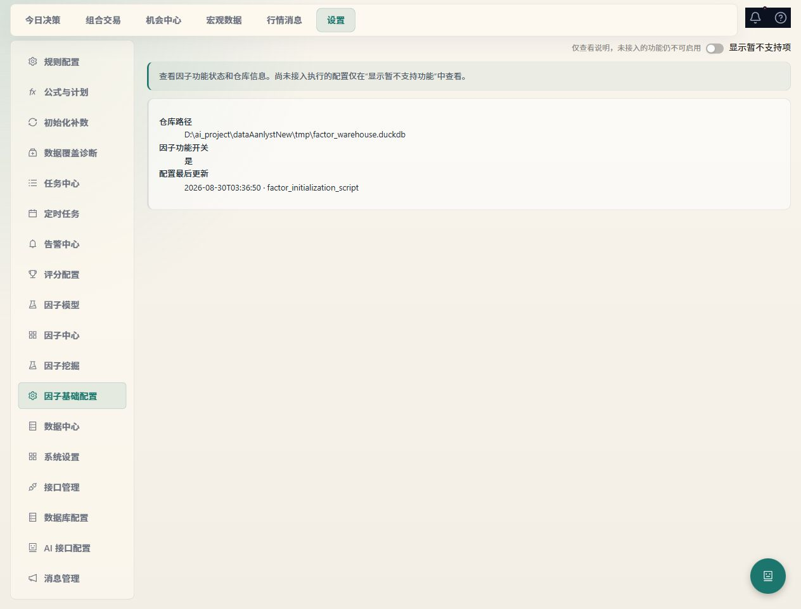

# 设置实效修复验收（2026-10-15）

本轮承接《设置全功能实效审查》的 S01–S25。修复原则是：已支持的配置必须进入真实消费者；未接入的选项默认隐藏，显示后仍不可启用；计算失败、任务部分失败和未验证的连接均不显示成功。

## 修复对照

| 编号 | 结果与兼容口径 |
| --- | --- |
| S01 | 规则保存按钮提交真实表单；点击保存会进入原保存 API。 |
| S02 | Akshare 请求包装器实际检查接口启停；禁用后拒绝调用，重新启用才恢复。 |
| S03 | 新版配置采用 `standard_score_v1`，明确按标准分解释高/低方向；旧分数已完成方向转换，不重复反转。暂未支持的区间方向拒绝保存并在 UI 禁用。 |
| S04 | 公式异常、历史不足和无结果显式报错；保留真实 0/false。机会列表按标的/指标展示未计算原因，null 不参加比较，回测不再将错误当正常信号。 |
| S05 | 3/5/10/20 日统计分别要求完整后续交易日，输出各期限成熟样本数。 |
| S06 | 正式告警仅开放评分下降、数据过期、任务失败；未支持类型不能新建或重新启用，旧规则可查看、停用。研究页另设当前标的的真实评分/数据阈值，明确为手动评估。 |
| S07 | 两个集合入口及 API client 统一按 `factor_id` 删除成员，以成员 ID 与因子 ID 故意冲突的用例验证。 |
| S08 | 版本响应包含后处理；编辑恢复已有、AI 草稿、显式 null 与附加字段。旧后端缺少字段时拒绝保存，防止覆盖未知配置。 |
| S09 | 目标连接、schema 初始化或配置写入失败不替换现有主库/控制库连接与磁盘配置；恢复接口缓存，清除评分缓存。切库期间有活动任务、迁移或 AI 请求则拒绝。 |
| S10 | 成功切库后，主业务与控制面引擎/会话工厂同步切换，后续控制面读取新库。 |
| S11 | 流式与非流式共用会话配额、Profile 用量和故障转移规则；只有未输出内容前可切备。中途断流、没有完成标志、空响应及畸形响应显示受控失败。 |
| S12 | 每个 Profile 的同步、流式、连接测试共用并发槽；每次实际请求原子预留每日请求额度，失败同样计数，并在结束后释放槽。 |
| S13 | Profile 新配置只开放已实现协议；Ollama 要求 `/v1` 兼容地址。原生 Anthropic/Azure 旧记录保留查看，不能伪装可执行；公式 AI 原生设置仍使用自身适配链。 |
| S14 | 助手与挖掘传递实际用途；未实现的解释/草稿用途不再作为新选项，旧记录保留提示。 |
| S15 | 就绪依据与完整请求配置/凭据摘要绑定的真实连接测试结果；仅保存、失败、过期或配置变化不会变为就绪。时间偏移正确换算 UTC，`auth_type=none` 不要求密钥，折叠高级表单同样有效。 |
| S16 | 数据迁移 partial 是终态；界面停止轮询并显示失败表、允许重新处理，不能显示迁移全部完成。 |
| S17 | WxPusher 接收者为数组、主题 ID 为数字；OneBot 使用 HTTP 原生 action 路径和扁平参数；SMTP 明确连接方式及收件人数组；Webhook 传递消费者实际使用的鉴权字段。 |
| S18 | 渠道编辑留空保留原凭据；旧客户端回传相同脱敏值也不会覆盖真实值。可显式清除可选凭据；真实变更才撤销测试成功和启用状态。 |
| S19 | 未接入调度的 digest 模式不能新建/启用；旧摘要策略不再被悄悄当即时模式执行。 |
| S20 | 范围可选择真实组合或标的，必须有有效对象；切换范围清空原 IDs，后端验证存在性。未接入观察池范围默认隐藏并禁用。 |
| S21 | 免打扰按显式时区计算，默认上海；校验起止时间、时区和布尔开关。损坏旧配置不崩溃、不误绕过 critical；保留并明示周一至周五限制（不等同交易日历）。 |
| S22 | 通知能力 API 仅开放有实际生产者的来源，补齐真实告警事件映射；无生产调用链的来源不能保存为可执行项。 |
| S23 | 季度评级复核任务类型可通过创建及更新校验。 |
| S24 | 初始化全部失败为 failed、混合成功为 partial、全部成功才 completed；共享任务和任务中心按相同终态展示，计数在提交成功后递增。 |
| S25 | 因子编辑/成员/关联模型、机会候选与指标、单标的诊断、质量历史弹窗均隔离请求身份；关闭、切换对象或卸载后，旧响应不能覆盖新界面。 |

设置顶部增加“显示暂不支持项”，只改变本地可见性，不扩大执行能力；因子基础配置的演示方向、复杂度、语言默认隐藏，显示后仍不能编辑。

独立复查还补齐：OneBot 旧 `message_type` 不得覆盖新接收对象，避免群聊/私聊误投；编辑通知策略不丢工作日免打扰选项；数据库失败回滚还原 Akshare 加载标记及完整配置缓存。

## 验收证据

测试均使用隔离数据库/临时配置路径，并在供应商 HTTP、SMTP 等边界替换传输；没有真实 LLM、通知投递、行情同步、训练、挖掘、模型激活或交易。

- 通知/告警/策略/发送队列及 AI 草稿合并回归：308 通过，见 `.analysis/settings-root-backend-2026-10-15.xml`；最后追加 OneBot 旧目标保护后，相关 95 项通过，见 `.analysis/settings-notify-review-final.xml`。重复回归不重复累计。
- 规则/API 启停/评分/公式/统计/初始化/定时：121 通过，3 个真实联网 slow 用例未运行，见 `.analysis/settings-execution-fixes-2026-10-15.xml`。
- 数据库与 AI Profiles：110 通过，见 `.analysis/settings-db-ai-focused-2026-10-15.xml`。
- 因子编辑后处理 HTTP 契约 3 项通过；因子相关界面首批 97 项通过，新增边界另经编辑器、旅程及引导相关用例复核。
- 通知与数据诊断界面 40 项通过，最后增加旧策略免打扰保留后，策略 2 项通过；规则/评分/机会/任务等 6 个前端文件 61 项通过。
- 公式 AI 就绪后端 57 通过、AI 与基础配置界面 7 通过，见 `.analysis/settings-ai-readiness-{backend,frontend}-2026-10-15.{xml,log}`。最终国际化及策略/告警回归 9 通过。
- 首页请求生命周期补修：真实 AppProvider + HTTP fetch 边界的 7 条用例及首页/设置现有回归共 33 通过，见 `.analysis/settings-workbench-lifecycle-2026-10-15.xml`。覆盖离页超时/旧成功/摘要不串页、当前失败仍提示、返回首页自动加载，以及观察池和消息快照迟到不写入；AI 未支持选项默认隐藏及旧值保留另有 2 条 UI 回归通过。
- 上述后端 XML 按测试 classname/name 去重，共 **600 项通过**；汇总见 `.analysis/settings-verification-summary-2026-10-15.json`。TypeScript 与 Vite 生产构建通过，存在既有大包体积警告；日志 `.analysis/settings-production-build-2026-10-15.log`。

协议修复参考 [WxPusher 官方 API](https://wxpusher.zjiecode.com/docs/api-reference.html) 和 [OneBot 11 HTTP 通信规范](https://github.com/botuniverse/onebot-11/blob/master/communication/http.md)。这些是协议依据，不代表当前用户凭据已通过真实供应商验证。

## 数据安全与测试隔离

早期扩展既有 AI 测试时，发现一个旧 fixture 未隔离默认 SecretStore，写入了一个固定虚构 QA 键。已核对现场无配置引用该键，在受限加密备份后仅删除该键，并以内存对比确认其余 3 项凭据键值不变。该 fixture 及配置测试路径已改为临时目录；后续回归前后真实凭据文件 SHA256 一致。此处不提供任何明文凭据或密文备份内容。

## 现场加载与实际能力边界

15:39（上海时间）再次确认异步任务、挖掘锁、镜像、因子流水线及外部同步均空闲后，仅重载本项目已核实托管的后端，PID 从 75468 变为 **72052**，前端 **46312** 保留。健康检查、通知能力、AI 配置元数据、5 个已有因子版本的后处理字段、镜像状态、挖掘锁及历史挖掘详情全部正常返回，镜像无 DuckDB configuration conflict；证据 `.analysis/settings-live-validation-2026-10-15.json`。没有发起真实业务任务。

现场公式 AI 状态为 `connection_test=untested`、能力 degraded：现有配置没有新格式的可信连接测试证据，应由本人在选定配置后进行真实测试。不能将其写成“连接失败”，也不能把原来的保存时间升级为测试通过。

真实页面已核对全局开关默认关闭，打开只展示不可编辑说明；推送策略提供真实标的搜索列表、范围选择、免打扰时区和工作日限制；旧策略未接入来源显示明确限制；取消表单未保存。截图见下方。开发过程曾产生 Context 热更新历史日志，最终验收前整页刷新；另将离开首页后迟到的工作台请求结果/错误隔离，避免污染设置页。最终源码构建成功后现场复核：设置页读取真实仓库配置，无首页迟到的“请求超时”提示，后端健康且活动任务仍为 0。此修复不等同缩短首页聚合接口耗时；留在首页的真实超时仍会显示错误和刷新入口。

[真实标的范围选择截图](assets/settings-scope-guidance-2026-10-15.jpg)

历史初始化结果、历史统计和旧模型未批量重写或重算。供应商实时可达性、真实数据质量及真实任务产出仍需按用户选定配置进行单独业务验收。Profile 并发限制用于当前单后端进程；未来部署多个 worker 时需共享并发协调。数据诊断的预期交易日仍有 5/7 近似，未替换为完整交易日历。
